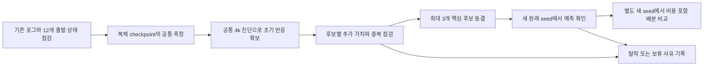

# 8개 후보 요인의 구체화와 최종 선정 설계

**8개 후보를 공통 자료에서 먼저 측정하고, 새로운 출발 상태의 배분 선택에 추가로 도움이 되는 소수만 남긴다.** 현재 성능은 기본 정보로 유지한다. 선택적인 핵심 예측 요인은 최대 3개로 제한하며, 아무 후보도 기준을 통과하지 않는 결과도 허용한다. F07은 진단 여부를 결정하는 조건, F08은 선택 가능한 배분 행동의 구조이므로 일반적인 예측 변수와 동일하게 평가하지 않는다.

이 문서는 2026-10-14의 설계 제안이다. [22번 후보 근거](../22_candidate_factor_grounding_v1/candidate_factors_ko.md)를 측정과 반증 가능한 비교로 구체화한다. [19번 설계](../../00_research_overview/19_budgeted_practice_research_feasibility_v1/research_plan_ko.md)와 과거 결과를 수정하지 않는다. 아래 수치는 앞으로 수행할 경우의 규모이며 신규 학습과 환경 평가는 실행하지 않았다.

## 공통 질문과 측정 시점

학습 상태 S는 정책뿐 아니라 critic, optimizer, entropy coefficient, replay, 수집기와 RNG를 포함한다. 목표는 추가 연습 H 이후의 과제별 성공률 변화와 그 동일 가중 평균이다. 주 H는 40k, 기존 자료에서의 보조 H는 20k다. 다음 양을 구분한다.

- **절대 이득:** 추가 학습 뒤 macro 성공률 − 출발 macro 성공률.
- **배분의 상대 이득:** 해당 배분의 최종 macro − 같은 부모·후속 seed의 Uniform 최종 macro.
- **선택의 이득:** 후보 정보를 쓴 방법이 고른 배분의 최종 macro − 비교 방법이 고른 배분의 최종 macro.
- **보존 손실:** 과제별 출발점 대비 하락, 최악 과제 하락. 현재 목적의 동일 가중 macro를 사후에 다른 가중치로 바꾸지 않는다.

후보의 주 선별 지표는 마지막의 '선택의 이득'이다. 예측 오차·순위 정확도·사후 최상위 대비 손실은 보조로 본다. 유한 반복에서 관측한 사후 최상위는 잡음 때문에 낙관적일 수 있으므로 이론적 oracle로 표현하지 않는다.

| 정보 시점 | 허용하는 입력 | 허용하지 않는 입력 |
| --- | --- | --- |
| 사전학습 직후 t0 | 현재 공개 성능·과거 로그·checkpoint·replay, 알려진 배분으로 계산한 예상 노출 | 미래에 실제로 관측한 sample 비중이나 40k 이득 |
| 짧은 진단 뒤 t4k | 해당 진단의 4k까지 얻은 변화와 비용 | 같은 분기의 20k·40k 결과 |
| 선택적 t8k | 같은 분기를 8k까지 실제로 이어서 얻은 정보 | 이를 비용 없는 t4k 특징으로 재명명 |

현재 자료로 보이는 '효과의 지속성'은 예측할 대상이기도 하다. 20k→40k의 실제 변화로 만든 점수를 4k 의사결정의 입력으로 넣지 않는다. 짧은 지속성 신호가 필요하면 같은 분기의 4k→8k를 실제로 관측하고 같은 시점의 비교군과 비교한다.

## 공통 자료를 만드는 순서

기존 개발 자료는 E1 A의 3원래 seed × 200k·400k와 E3 B·C의 각 3원래 seed × 200k, 총 **12개 출발 상태**다. 서로 다른 사전학습 정책은 9개지만 원래 seed 번호는 11·12·13의 세 블록이고, A의 두 시점은 같은 정책 이력에 속한다. E2는 같은 A 200k 부모의 통제 비교, E0는 seed 901의 별도 사례로 활용한다. 이를 수백 개의 독립 정책처럼 세지 않는다.

먼저 새 환경 실행 없이 기존 episode 로그와 원본 전체 checkpoint의 사본을 읽는다. 과제당 replay transition 2,048개를 시간 구간별로 층화해 고정하고, 1,024개는 측정, 1,024개는 별도 확인에 사용한다. 중복 transition·episode가 두 집합에 섞이지 않도록 나누며, episode 단위 구분을 복구할 수 없으면 연속 시간 블록을 분리하고 그 한계를 기록한다. gradient의 반복성은 과제당 128개씩 8개 batch로 본다. 자료가 부족한 항목은 결측으로 표시하고 성공률·보상으로 임의 대체하지 않는다.

모든 진단은 별도 RNG와 복제된 모델·optimizer에서 실행한다. actor·critic·replay·collector·RNG의 원본 hash는 측정 전후 동일해야 한다. offline forward/backward나 복제 모델의 진단용 update도 GPU·wall time과 update 수를 기록한다. 학습 중인 원본 모델에 hook이나 update를 추가하지 않는다.

환경 진단이 필요하면 공통 개발용 bank D를 과제당 20개로 고정한다. D는 과거 outcome bank 및 앞으로의 최종 bank O와 분리한다. 같은 D의 초기 상태를 t0·t4k에서 짝지어 평가한다. 성공률과 return을 함께 해석할 진단에서는 deterministic 정책을 500 step 동안 관측해 any-success와 동일 길이 return을 함께 기록한다. 기존 성공 시 종료 평가의 return과 이 값을 같은 통계로 합치지 않는다. 최종 O의 성공률 평가는 기존처럼 첫 성공 또는 500 step에서 종료해도 된다.

새 개발 probe의 continuation 번호는 3301·3302·3303으로 제안한다. 기존 완주 분기와 다른 실행이므로, 새 probe 1개와 옛 완주 seed 1개를 임의로 짝짓지 않는다. 이 단계에서는 **같은 부모·배분의 probe 평균이 별도의 완주 반복에서 얻은 평균 이득을 구별하는지**를 탐색한다. 최대 60개 부모·배분 셀의 자료이며 180개 probe가 독립된 180개 출발 상태를 만들지 않는다. 특정 4k 상태에서 이어질 결과를 예측한다는 주장은 뒤의 G3에서 실제로 같은 분기를 40k까지 이어 검증한다. 두 질문의 차이를 숨기지 않는다.

## F01 출발 성능과 능력의 취약성

**가설:** 같은 평균 성공률과 단기 개선량이라도 과제별 성능 분포와 이미 확보한 능력의 취약성이 다르면 최종 이득과 손실이 달라진다.

**측정:** 기본 입력은 과제별 공개 성공률 p_j와 개선 여지 1−p_j다. 이 두 값을 독립적인 두 발견으로 세지 않는다. 과거 공개 평가의 하락·변동을 추가 후보로 기록한다. 공통 4k probe에서는 t0에 성공했던 D 사례 중 t4k에 실패한 비율과, 반대로 새로 성공한 비율을 분리한다. 분모가 0이면 비율을 0으로 만들지 않고 '측정 불가'로 둔다.

**비교:** 평균 성능만 쓰는 기준 → 과제별 초기 성능을 쓰는 기준 → 초기 성능에 취약성 지표를 추가한 기준을 비교한다. '비연습 과제의 평균 변화'만 쓰는 기본 단기 신호에도 취약성 지표를 추가한다. 현재 순이득에 드러나지 않는 성공 사례의 교체·불안정성이 이후의 손실을 더 예측하는지 본다. 임의의 정책 perturbation은 별도 평가 비용과 난이도를 추가하므로 첫 단계에서는 사용하지 않는다.

**남길 기준:** 초기 성능 벡터는 공통 기준선으로 유지한다. 취약성 지표는 새 상태의 과제별 손실 또는 선택의 이득에 추가 정보가 있을 때 남긴다. 최종에 하락한 과제라는 사후 정의로 만든 지표는 제외한다. 초기 성능만으로 충분하면 F01의 추가 위험 점수는 탈락시킨다.

## F02 실제 학습 노출과 replay 지연

**가설:** 수집 비율과 업데이트에 사용되는 자료 비율의 차이 때문에 짧은 학습 반응의 크기와 나타나는 시점이 달라질 수 있다.

**측정:** t0에는 과제별 replay 구성·자료 나이와 예정된 수집 순서로 예상 sample 노출을 계산한다. t4k에는 누적 sample 카운터의 경계 차이로 실제 노출을 구한다. 후보 요약은 '예정 수집 비중과 예상/실제 sample 비중의 차이', '최근 자료 비중과 나이'다. r/R과 H/R도 기록하되 R이 고정된 자료에서 H만의 재표현일 수 있음을 확인한다. 기존 E3의 집중 수집 62.5% 대 처음 20k sample 28.76%는 출발 근거이지 성능 설명의 결론은 아니다. [실제 노출 감사](../22_candidate_factor_grounding_v1/results/20261014T040516Z_replay_b4e477d0/analysis.json)

**비교:** 초기 성능·배분·H만 쓰는 예측과 노출 지표를 추가한 예측을 비교한다. 후보가 남으면 같은 4k checkpoint와 저장 자료에서 (1) task sampling 비율만 바꾸는 대조와 (2) task 비율을 고정하고 각 task 안의 recent/old sampling 비율만 바꾸는 대조를 분리한다. update 수·batch 크기·부모 상태를 맞춘다. 최근 자료가 없는 task에는 비중을 강제로 부여하지 않는다.

**남길 기준:** 단순 시간 정보 이상으로 초기 신호의 과소·과대 추정이나 배분 선택을 개선해야 한다. 모든 상태에서 거의 같은 값이면 보정용 회계 변수로 남길 수 있지만 좋은 과제를 고르는 핵심 요인으로 승격하지 않는다. sampling 개입은 learner를 바꾸는 기전 실험이며 주 배분 비교와 별도로 보고한다. [replay 변수의 선행 분석](https://proceedings.mlr.press/v119/fedus20a.html)

## F03 유용한 경험과 탐험 접근성

**가설:** 낮은 성공률이 같아도 학습에 필요한 경험을 확보한 정도가 다르면 남은 예산에서의 개선 가능성이 다르다.

**측정:** task별 최근 완료 학습 episode 20개의 성공 여부와 고유 초기 상태 수를 기록한다. 고정 replay panel에서는 task one-hot을 제외한 raw observation을 개발 fold 안에서만 정규화하고, 과거 reference와의 거리·방문 범위를 측정한다. 가능한 경우 공식 환경의 접촉·잡기·목표 접근 정보를 수집해 단계 도달률을 보조 지표로 둔다. 환경 소스에서 의미를 검증하지 못한 단계는 사용하지 않는다. 현재 replay에는 성공 flag가 따로 없으므로 높은 reward를 성공 transition으로 바꾸지 않는다.

**비교:** 초기 공개 성공률·최근 task 내 return·관측 수를 맞춘 뒤 성공 경험 범위나 상태 범위가 추가 정보를 주는지 확인한다. 단순 novelty와 목표에 필요한 단계 도달률을 분리한다. snapshot의 표현을 바꿀 때 coverage 값만 달라지는지 raw-state 지표와 비교해 F06과의 중복을 점검한다. 경험 sampling을 바꾸는 대조는 기존 자료의 유용성을 보는 실험이며 새로운 경험을 발견하는 탐험 능력의 인과효과와 구분한다.

**남길 기준:** 단순히 다양한 상태를 방문하는 점수보다 실제로 이후 개선을 구별해야 한다. task별로 임의의 단계 정의를 많이 추가해야만 맞으면 해당 환경 전용 보조 지표로 제한한다. sparse reward 탐험 문헌을 dense reward인 현재 조건의 병목 증명으로 사용하지 않는다. [탐험 경험의 관련 연구](https://arxiv.org/abs/1709.10089v2)

## F04 업데이트 방향과 크기

**가설:** 단기 자체 개선이 비슷해도 다른 과제와 양립하기 어려운 업데이트이거나 특정 task가 업데이트를 지배하면 최종 전체 이득이 작을 수 있다.

**측정:** 같은 task별 panel에서 actor와 critic gradient를 분리해 계산한다. 방향 cosine뿐 아니라 norm 비율을 기록한다. 실제 Adam 상태를 복제해 후보 batch에 대한 가상 update δθ를 구하고, 별도 panel의 task loss gradient g_j와 −g_j·δθ의 관계도 계산한다. raw-gradient와 Adam-aware 결과를 별도 열로 둔다. F02의 실제 노출 비중을 반영한 요약과 task 균등 요약을 비교한다. 공유 entropy coefficient와 task별 entropy는 보조 로그로 둔다.

**비교:** cosine만 → 크기·노출까지 포함 → 실제 update 방향까지 포함한 신호를 비교한다. F05의 critic 신뢰도도 통제하고, 같은 4k에서 관측한 다른 과제 성공률 변화에 비해 무엇을 더 설명하는지 본다. gradient 방식은 추가 rollout이 없어도 측정 시간이 드므로 성능과 비용을 함께 비교한다.

**남길 기준:** 여러 batch에서 방향이 지나치게 바뀌면 신뢰도와 함께 사용하거나 보류한다. 값싼 신호로 실제 전이·손실과 선택을 구별할 때 남긴다. 음의 cosine 하나를 망각의 원인으로 명명하지 않는다. 개입이 필요하면 gradient projection과 같은 크기의 일반 update 축소 대조를 포함해 방향과 크기의 효과를 구분한다. 이는 별도 learner 변형이다. [PCGrad §2.2](https://arxiv.org/html/2001.06782v4)

## F05 학습 신호와 평가 목표의 관계

**가설:** 단기 return·loss·Q의 변화가 성공률 개선과 잘 맞지 않는 상태에서는 그 신호로 고른 배분이 최종 이득을 잘못 예측한다.

**측정:** 같은 D 상태의 동일 500-step 길이에서 성공 여부와 dense return을 함께 기록한다. task별 return→성공의 관계는 개발 fold에서만 보정한다. 고정 replay panel의 task별 정규화된 Bellman 잔차와 두 critic의 차이를 기록한다. soft target은 r+γ(1−done)[min Q_target(s′,a′)−α log π(a′|s′)]의 현재 learner 규약을 따른다. timeout의 bootstrap 처리도 보존한다. 두 critic이 함께 틀릴 수 있으므로 작은 차이를 정확성의 보증으로 취급하지 않는다.

**비교:** 성공률 기반, return 기반, gradient/loss 기반 예측의 최종 선택을 비교하고, 가치 진단이 부정확한 신호를 걸러내는지 본다. reward scale을 task 내에서 처리한 전후를 분리한다. 원래 train_metrics의 `task`는 수집 task이고 loss는 혼합 batch 통계이므로 그 열로 묶은 값을 task별 loss로 사용하지 않는다.

**남길 기준:** reward 크기·episode 길이·현재 성능으로 설명되는 차이를 넘어서야 한다. TD 오차가 크다는 이유로 항상 연습을 늘리지 않는다. 단순 return 보정이면 충분하면 복잡한 critic 진단을 제외한다. Monte Carlo 가치 검증을 추가할 경우 SAC entropy와 tail bootstrap을 맞추고 별도 rollout 비용을 계산한다. [actor-critic 가치 오차의 관련 연구](https://proceedings.mlr.press/v80/fujimoto18a.html)

## F06 신경망 가소성

**가설:** 같은 초기 성능·자료 범위·critic 신뢰도에서 새 신호를 받아들이는 능력이 다른 모델은 추가 연습의 반응도 다를 수 있다.

**측정:** actor와 두 critic의 마지막 hidden layer에서 task별 activation을 고정 panel로 측정한다. 첫 지표는 평균 절대 activation을 층 평균으로 나눈 값이 0.01 이하인 뉴런 비율이다. 0.01은 설계상 기준이며 보편적 임계값이 아니다. 보조 기준 0과 0.1은 민감도로 보고 선택에 유리한 값을 사후 고르지 않는다. 두 번째는 singular value 제곱을 정규화한 q에 대해 exp(−Σq log q)를 계산한 유효 rank이며 최대 가능한 rank로 나눈다. 모든 activation이 0이면 별도 실패·퇴화 상태로 기록한다.

**비교:** 정적인 activation·rank 지표와, 복제 모델을 고정 자료에서 20회 진단 update한 뒤 별도 panel의 loss가 얼마나 줄었는지를 비교한다. 후자는 t0에서 할 수 있는 계산 진단이지만 원래 모델을 바꾸지 않고 모든 update·GPU time을 계상한다. 학습 자료 loss만 줄고 별도 panel에서는 줄지 않는 경우를 구분한다. F03의 상태 범위와 F05의 가치 신뢰도를 함께 통제한다.

**남길 기준:** 비활성 뉴런이 존재한다는 사실 자체로 채택하지 않는다. 별도 상태의 반응과 선택을 개선해야 한다. 필요하면 후속 복제 실험에서 reset·용량 회복을 보지만 이런 개입은 가치 추정과 기존 함수도 바꾸므로 '가소성만의 효과'라고 단정하지 않는다. ReDo 논문에도 기본 크기 SAC 조건에서 이득이 없었던 결과가 있어 우선순위는 낮다. [ReDo Appendix B](https://proceedings.mlr.press/v202/sokar23a/sokar23a.pdf)

## F07 신호의 재현성과 배분 차이

**가설:** 높은 점수보다 그 점수의 신뢰도와 후보 간 차이를 함께 고려해야 불필요한 진단·잘못된 집중을 줄일 수 있다.

**측정:** 같은 D 사례의 짝지은 전후 차이를 episode 단위로 재표집하고, gradient·replay 특징은 8개 panel batch의 변동을 따로 추정한다. 짧은 continuation 3개 사이의 변동도 기록하지만 그 반복 비용을 무료로 처리하지 않는다. 평균 예측 이득, 상위 두 후보의 예측 차이, 재표집 시 선택되는 후보의 일치율을 구한다. binary 성공이 모두 0 또는 1이면 단순 bootstrap이 불확실성을 0으로 만드는 문제를 막기 위해 사례 수와 이항 구간도 함께 보고한다.

**비교:** 항상 점수 최고 후보를 선택하는 규칙, 증거가 약하면 개발에서 고른 기본 배분을 유지하는 규칙, 상위 후보에만 추가 진단하는 규칙을 비교한다. 추가 진단은 '불확실성 감소'가 아니라 그로 인해 바뀔 선택의 기대 이득과 잃는 학습 기회를 비교한다. 온라인에서는 아직 보지 않은 완주 seed 간 분산을 입력으로 쓰지 않는다.

**남길 기준:** 평균 이득의 회귀 정확도가 같아도 실제 오선택·진단비가 줄면 유용한 진단 gate로 남긴다. 저신뢰 신호를 과도하게 버려 좋은 선택을 놓치거나 진단비가 이득을 먹으면 탈락시킨다. 원래 seed, continuation, 평가 사례의 불확실성을 분리하며 수만 episode를 독립 사전학습 반복으로 세지 않는다. [RL 평가 불확실성](https://arxiv.org/html/2108.13264)

## F08 배분 강도와 순서

**가설:** 한 배분 비중에서 측정한 효과가 다른 비중·순서로 그대로 옮겨지지 않을 수 있다. 이 가설이 지지되면 점수의 새로운 입력뿐 아니라 행동 후보 집합을 바꿔야 한다.

**배분 강도 대조:** 같은 부모에서 특정 task i의 비중을 25%, 43.75%, 62.5%, 81.25%로 바꾸고 나머지 세 task에는 남은 비중을 동일하게 준다. 40k=80개의 500-step episode에서 수집 개수는 각각 (20,20,20,20), (35,15,15,15), (50,10,10,10), (65,5,5,5)다. 반올림으로 총량을 바꾸지 않는다. 16-episode 블록에서 정해진 개수를 무작위 순서로 배치하고 모든 조건을 같은 구현에서 다시 수행한다. 기존 U·focus의 다른 schedule 실행을 무조건 동일 대조로 재사용하지 않는다.

**순서 대조:** 두 task i,j에 대해 (1) F_i 20k→F_j 20k, (2) 반대 순서, (3) 4k마다 두 focus를 교대, (4) 항상 (37.5%,37.5%,12.5%,12.5%)인 혼합을 비교한다. 순서 대조의 공통 단위는 8 episode다. F_i의 블록 개수는 (5,1,1,1), 정적 혼합은 (3,3,1,1)이며 블록 안에서만 순서를 무작위화한다. 네 조건 모두 총 수집량은 (30,30,10,10) episode다. 상태·optimizer·replay는 실제로 이어서 학습한다. 서로 다른 분기의 점을 붙여 전환 결과를 만들지 않는다.

**개발용 소규모 패킷:** A/B/C의 seed 12·200k 세 상태, continuation 3개, 위 8조건이면 72분기·2.88M 학습이다. i,j는 A=(DO,DC), B=(BP,DO), C=(PP,BP)로 미리 고정한다. 이 선택은 기존 관찰을 활용한 개발 선택이며 확인용 일반화 근거가 아니다. task pair를 결과에 따라 교체하지 않는다. 독립 확인에서는 새 원래 seed와 개발에서 동결한 pair 선정 규칙을 사용한다.

**남길 기준:** 단순 선형 dose 예측보다 중간 비중 예측이 좋아지는지, 같은 총량에서 순서 차이가 반복되는지 본다. 작은 noisy 차이면 복잡한 행동 집합을 추가하지 않는다. 여기서 무엇이 개선되면 F08은 '핵심 숫자 특징'이 아니라 배분 주기·비중·순서의 설계 조건으로 남긴다. Aioli의 동적 반응 추정은 선행 방법이며 우리 RL의 비선형성을 미리 보증하지 않는다. [Aioli](https://arxiv.org/html/2411.05735v2)

## 후보를 줄이는 공통 기준

| 관문 | 확인할 것 | 통과하지 못했을 때 |
| --- | --- | --- |
| G0 측정 | 의사결정 시점에 얻을 수 있음, 의미가 분명함, 원본 상태 불변, 비용·결측 기록 | 측정 설계 수정 또는 보류 |
| G1 개별 추가 가치 | 같은 정보 시점의 기본 예측에 후보 하나를 더했을 때 선택이 나아짐 | 중복·무효·자료 부족을 구분해 기록 |
| G2 조합과 제거 | 여러 후보를 함께 썼을 때도 유용하고, 해당 후보를 빼면 손해가 남음 | 동등하면 더 싼 후보를 남김 |
| G3 새 상태 확인 | 동결한 후보와 모델이 새로운 원래 seed에서 선택을 개선 | 반증 또는 불확실로 보고 재선택 결과와 분리 |
| G4 실제 배분 | 진단 포함 동일 총예산에서 강한 비교군 대비 최종 성능 개선 | 예측용 지표로만 남기거나 비용 때문에 제외 |

G1은 먼저 작은 정규화 선형 모델을 사용한다. 기본 입력은 F01의 공개 과제 성능·과거 변화, 후보 비중, H다. 데이터가 적은 첫 화면에서는 선택적인 각 그룹의 대표 요약을 최대 2개로 사전 지정한다. actor·critic 등 하위 열은 모두 보존하지만 유리한 조합을 대량 탐색하지 않는다. task 이름과 seed 번호를 외우는 모델 대신 focus task와 나머지 task의 역할에 따른 요약을 주 분석에 사용하고, 구성 이름만 쓰는 기준도 별도로 점검한다.

세 비교 수준을 구분한다. 기존 로그만 쓰는 기준, 복제 checkpoint의 계산 진단을 쓰는 기준, 공통 4k 반응을 사용하는 기준이다. 후자는 자기 과제 변화와 다른 과제 변화만 쓰는 모델에 후보를 추가한다. 비용이 다른 수준을 같은 '무료 특징'으로 합치지 않는다. 처음에는 penalty를 고정하고 표준화·결측 처리·calibration을 training fold 안에서만 계산한다.

기존 자료의 탐색 선별안은 선택 이득 평균 **+1%p 이상**, 세 원래 seed 블록 중 **2개 이상에서 양수**다. 어느 구성에서 −2%p보다 큰 하락이 있으면 범용 요인으로 승격하지 않고 조건부 가설로 분리한다. 이 수치는 작은 후보 목록을 만드는 운영 기준이며 유의성 판정이 아니다. 반응이 작고 구간이 넓으면 '효과 없음' 대신 '판단 불가'로 둔다. F07은 추가 진단·fallback의 선택 이득으로, F08은 대조 조건의 실제 효과로 같은 취지를 적용한다.

G2에서는 후보를 하나씩 추가하고 하나씩 제거한다. 먼저 검토할 상호작용은 F02×F04, F02×F05, F01×F03뿐이며 결과를 본 뒤 모든 조합을 탐색하지 않는다. 단독 효과가 약해도 이 사전 지정 조합에서 유용할 가능성은 남긴다. 최종에는 F01 기본 정보를 포함한 모델에 선택적인 핵심 그룹 최대 3개를 붙인다. 동일한 예측·선택 성능이면 측정이 저렴하고 해석이 쉬운 조합을 택한다. F07 gate와 F08 행동 구조의 채택은 별도 표시한다.

각 후보의 최종 판정은 **핵심 예측 요인 / 진단 의사결정 조건 / 행동 구조 조건 / 탈락 / 자료 부족으로 보류** 중 하나다. '원인'이라는 명칭은 관련 변수를 분리한 대조 실험이 있을 때만 추가한다. 상관·예측력과 실제 기전은 다른 주장이다.

## 자료 분리와 독립 확인

개발에서는 seed 11을 검증할 때 A의 200k·400k, E2의 같은 부모, B/C의 seed 11을 모두 학습 쪽에서 제외한다. 12·13도 같은 방식이다. 과제 구성 하나를 통째로 제외하는 검증은 별도로 보고하며 seed 제외 결과와 합쳐 표본 수를 늘리지 않는다. E0의 901은 다른 자료 bank·사전학습 조건을 가진 보조 사례다. 이미 E0–E3를 보고 후보를 만들었으므로 이 교차검증도 탐색 분석이다.

G3의 규모 예시는 새 원래 seed **41–48**, A/B/C 각 200k, 다섯 배분, continuation 2개다. 이는 24개 출발 상태와 240개 40k 분기다. 4k 진단과 40k 결과를 **같은 실제 분기**에서 얻는다. 이전 개발 probe와 과거 20k·40k 분기를 연결해 한 trajectory처럼 만들지 않는다. 20k checkpoint는 저장할 수 있지만 이 예산 예시에서는 별도 성능 평가를 추가하지 않는다.

이 새 결과를 보기 전에 최대 3개 후보, 모델, 입력 정의, 비교군, 판정 기준을 동결한다. 주 평가는 완성 모델 대 개발에서 고른 가장 강한 비교 모델의 원래 seed별 짝지은 선택 이득이다. 후보별 제거 비교는 최대 3개에 대해 동시 불확실성을 보고한다. 동일 seed 안의 구성·continuation을 먼저 평균하고 seed를 재표집하며, 사례 불확실성은 task별 짝지은 재표집으로 별도로 보고한다. confidence interval이 0을 포함하면 양의 효과가 확인된 것으로 보지 않는다. 구간이 넓으면 무효과를 확정하지 않고 미해결로 남긴다. 효과가 없다는 결론에는 사전에 정한 실용적 범위 안에 충분히 좁게 들어가는 별도의 근거가 필요하다.

원래 seed 8개는 비용 계산 예시다. 실제 N은 개발에서 추정한 seed별 짝지은 변동과 사전 목표 효과 2%p에 대한 정밀도 계획으로 **새 결과를 보기 전에** 정한다. 시험 결과가 유의해질 때까지 seed를 늘리는 규칙은 사용하지 않는다. 확인 자료로 요인을 다시 선택하면 그 자료는 개발 자료가 되므로 별도 최종 확인이 필요하다.

여기서 통과해도 우선 적용 범위는 현재 SAC·dense reward·MetaWorld 과제 구성이다. A/B/C는 일부 task를 공유하므로 구성 하나를 제외하는 검증이 완전히 새로운 task 계열이나 다른 benchmark의 검증을 대신하지 않는다. 일반적인 요인이라는 주장은 사용하지 않은 task 계열 또는 별도 benchmark에서 측정 규칙과 선택기를 동결해 추가 확인한 뒤에만 확대한다. 그 외부 확인은 아래 비용 예시에 포함하지 않았다.

## 비용을 포함한 실제 배분

G4는 또 다른 원래 seed 집합(규모 예시 61–68)에서 수행한다. 비교는 Uniform, Failure, Learning progress, 개발에서 고른 고정 배분, gradient 전이 기반 SAC 적응판, Aioli 방식 SAC 적응판, 선택한 후보 배분기의 7개다. 두 적응판의 구체적인 규약은 구현 전 동결하고 원 논문의 그대로인 재현으로 부르지 않는다. 추가 학습 전 정책을 모든 부모의 별도 성능 참고점으로 평가한다.

각 방법의 총환경 예산 B는 **40k**이며 학습 수집과 의사결정용 평가·버린 probe를 모두 포함한다. 공통 사전학습 진단 비용은 모든 방법에 같은 정보로 제공하고 별도로 공개한다. 주 진단 상한은 20%=8k이고 0%·10%는 별도 민감도 설정이다. checkpoint 복제·gradient 계산·offline fitting은 환경 비용이 0이어도 계산 비용을 기록한다. 같은 wall-time을 맞춘 보조 결과도 필요하다.

후보 m개를 r씩 시험한 뒤 하나의 probe 정책에서 계속 학습한다면, 평가 비용 c를 포함한 선택된 정책의 학습 길이는 B−(m−1)r−c다. probe를 모두 버리고 부모에서 다시 출발하면 B−mr−c다. 예를 들어 5개 후보를 모두 4k 시험하면 수집만 20k이므로 온라인 8k 진단 상한을 넘는다. 개발 단계의 전 후보 probe는 반응을 배우기 위한 별도 준비 비용이다.

**실행 가능한 주 진단안:** 싼 checkpoint 신호로 후보 하나를 고른 뒤 4k를 연습하고, 과제당 2개 사례를 500 step씩 평가한다. 진단 수집 4k + 평가 최대 4k = 최대 8k다. 이어 쓴 probe의 수집도 진단 상한에 포함하되 총환경 비용에는 한 번만 센다. probe를 유지하면 최종 정책의 학습 길이는 최소 36k, 버리고 기본 배분으로 돌아가면 최소 32k다. 진단을 생략하면 40k 전체를 학습에 쓴다. 진단 없이 추가 학습을 생략하는 선택도 가능하다.

과제당 20회인 개발 진단에서 2회를 결과와 무관하게 뽑아 동일한 소형 진단을 미리 평가한다. 상위 예측 모델·선택 규칙·F07 gate는 이 작은 표본으로도 검증해야 한다. 재표집한 여러 부분집합은 측정 오차 민감도이며 독립 정책 반복이 아니다. 새 G3 bank에서도 사용할 2개 사례의 선정 규칙을 결과 전에 동결한다. 20회에서만 유효한 후보는 저비용 배분 요인으로 확정하지 않는다. 두 후보를 시험하는 다른 규약은 별도 설계·비용이 필요하다.

G3의 40k 고정 배분 예측이 비용 때문에 짧아진 32k·36k 또는 중간 전환의 효과까지 확인해 주지는 않는다. 개발 자료의 20k·40k 관계를 이용한 보간은 가정으로 표시하고, 실제 예산과 경로를 입력으로 쓰는 규칙을 G4 전에 동결한다. 그 가정의 최종 판정은 G4의 실제 학습 결과다. F08에서 새 행동 집합을 채택하면 기존 다섯 배분의 결과만으로 그 행동의 확인을 대체하지 않고 추가 조건을 따로 예산화한다.

성공 제안 기준은 개발에서 고른 강한 비교군 대비 평균 +2%p 이상의 실용적 개선과 양의 짝지은 주 구간이다. 다른 비교군, 절대 출발점 대비 이득, 최악 과제 손실, 비용을 함께 공개한다. +2%p는 설계상 실용적 목표이며 검정력이 보장된 값이 아니다. 실패·무개선·절대 손실 감소를 구분한다. C와 같은 조건에서 원래 정책을 보존하는 선택이 유리하면 학습 생략도 행동 후보로 인정하되 절대 학습 이득이 생긴 것으로 표현하지 않는다.

요인 하나를 뺀 실제 배분기의 추가 실행은 개별 요인의 온라인 가치를 확인하는 제거 실험이다. 아래 7개 방법 예산에는 포함되지 않으며, 핵심 모델이 성공한 뒤 후보별 비용을 별도로 산정한다.

## 단계별 규모와 비용

| 단계 | 학습 또는 온라인 환경 예산 | 평가 규모 | 환경 비용 상한 |
| --- | ---: | ---: | ---: |
| 기존 자료와 복제 checkpoint 점검 | 새 환경 학습 0 | 새 환경 평가 0 | 0, 계산 비용 별도 |
| 개발용 공통 4k probe | 12상태 × 5배분 × 3반복 × 4k = **720k** | t0 12개 + t4k 180개 정책, 정책당 80회 = 15,360회 | **8.40M** |
| 선택적 4k→8k 연장 | 추가 720k | 180개 정책 × 80회 = 14,400회 추가 | **추가 7.92M** |
| 선택적 F08 개발 패킷 | 3상태 × 8조건 × 3반복 × 40k = **2.88M** | 초기 D 240회, 초기·최종 O 30,000회 | **18.00M** |
| G3 새 상태 예측 확인, N=8 예시 | 사전학습 4.80M + 240분기 9.60M = **14.40M** | D 23,040회, O 105,600회 | **78.72M** |
| G4 실제 배분, N=8 예시 | 사전학습 4.80M + 336실행의 학습·진단 합계 ≤13.44M | 공통 사전 D 3,840회, 최종·비학습 O 144,000회 | **92.16M** |

평가 상한은 episode당 500 step이며 완료 시의 실제 비용을 따로 기록한다. 개발 D의 동일 길이 return 측정은 500 step을 사용한다. G3 D는 사전학습 100k·200k와 각 분기의 4k에서 과제당 20회, O는 부모와 각 분기의 40k에서 과제당 100회다. G4 공통 D는 각 부모의 100k·200k에서 과제당 20회이고 실행 중 진단은 이미 40k 예산에 포함된다. O는 336개 실행과 24개 비학습 부모에 대해 과제당 100회다.

G3의 원래 seed 수 N에 따른 상한은 **9.84M × N**, G4는 **11.52M × N**이다. 모델 선별·오프라인 준비·확인용 평가는 온라인 저비용 주장과 분리해 공개한다. 선택적 F01 perturbation, F02 sampling 개입, F04 gradient 변형, F05 추가 가치 rollout, F06 fitting·reset 실험과 G4 요인 제거·다른 진단 상한의 별도 실행은 이 표의 기본 범위에 포함하지 않았다. 해당 실험은 남은 후보에 대해서만 조건 수·반복·평가를 확정한다.

큰 비용의 대부분이 평가에서 발생한다. 따라서 바로 모든 단계를 실행하기보다 **기존 자료와 checkpoint에서 측정 가능한지 확인 → 공통 짧은 진단에서 후보가 남는지 확인 → 독립 확인** 순서가 적절하다. 현재 제안의 전체 규모를 한 번에 실행하는 예약은 만들지 않았다.
