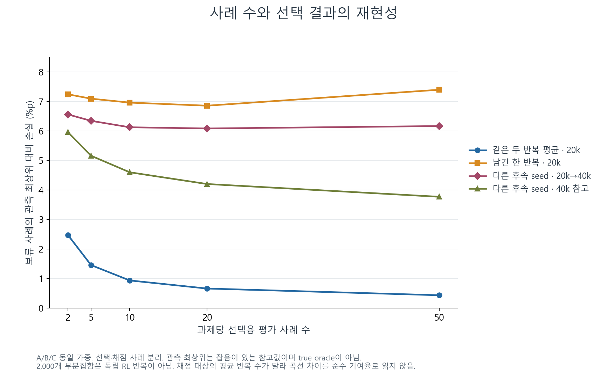
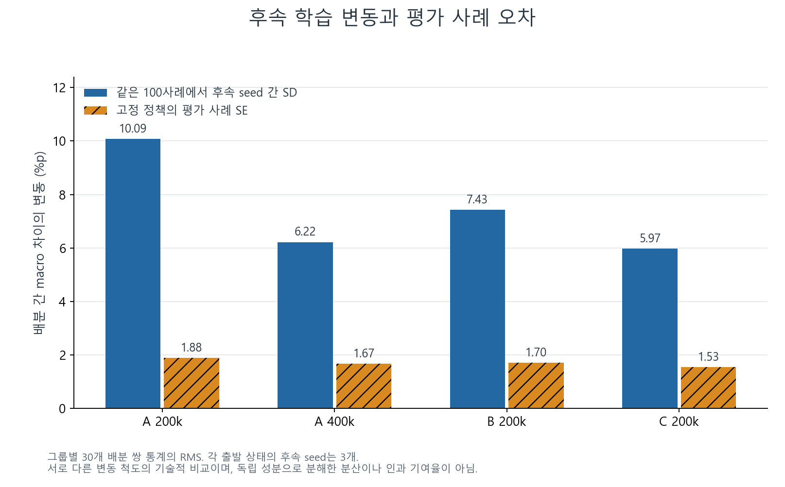
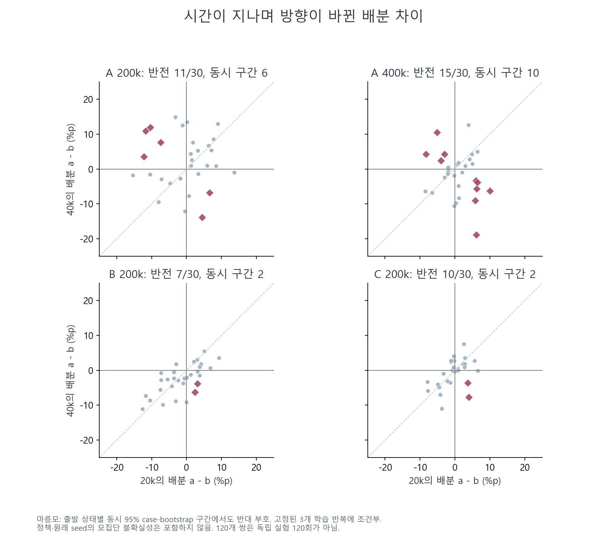
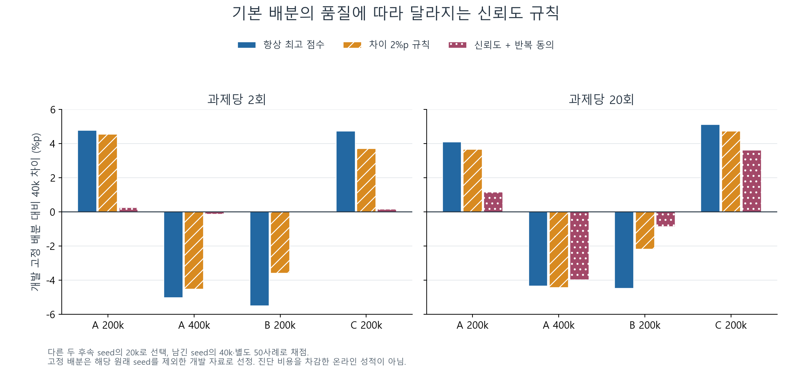

# F07: 신호의 재현성과 배분 차이 분석

**⑦ 분석을 완료했다. 신뢰도는 진단과 선택을 제한하는 조건으로 남길 가치가 있지만, 이번 규칙만으로 좋은 배분을 고르는 핵심 요인이라고 판단하기는 어렵다.** 적은 평가에서는 동점과 선택 불안정이 컸다. 평가를 충분히 해도 후속 학습 seed에 따른 변동과 20k→40k의 순위 반전이 남았다. 신뢰도가 낮으면 기본 배분을 유지하는 규칙의 추가 이득은 작았고, 단순한 차이 기준을 일관되게 넘지 못했다.

2026-10-14에 기존 E1·E3 자료를 사용해 수행한 탐색 분석이다. 신규 환경 step·평가 rollout·learner update는 모두 0이다. ⑤를 포함한 다른 후보의 실험은 실행하지 않았다. [사전 고정한 분석 규약](protocol.json), [계산 결과](results/20261014T053612Z_df5ecad4/summary.json).

## 범위와 자료 분리

| 항목 | 실제 사용 범위 |
| --- | --- |
| 출발 상태 | E1 A: seed 11·12·13 × 200k·400k; E3 B/C: 각각 seed 11·12·13 × 200k, 총 12개 |
| 사전학습 정책 이력 | 9개; A의 두 checkpoint는 같은 이력, 원래 seed 번호는 세 블록 |
| 배분·후속 반복·시점 | 각 출발점의 5배분 × 후속 seed 3개 × 20k·40k |
| 평가 자료 | 분기 평가 360개 + 부모 평가 12개, 총 **148,800 episode 행** |
| 선택/채점 분리 | 과제당 outcome 사례 100개를 초기 상태 hash만으로 50개 D와 50개 O로 분할 |
| 소형 진단 | D에서 과제당 2·5·10·20·50개를 비복원 추출; 작은 표본은 큰 표본에 포함 |
| 재표집 | 표본 크기별 2,000개 부분집합; 조건부 사례 bootstrap 5,000회 |
| 집계 | A/B/C 동일 가중; A 내부에서 200k·400k 동일 가중; 원래 seed 동일 가중 |

D와 O의 사례는 모든 배분·시점·후속 seed에 동일하게 적용했다. D에서 선택하고 O에서 성적을 계산하므로 선택에 쓴 평가 사례로 그대로 채점하지 않는다. 기본 배분도 검증 대상 원래 seed를 제외한 다른 두 원래 seed의 **D 자료만** 사용해 정했다. 같은 원래 seed의 다른 checkpoint를 기본 배분 선정에 섞지 않는다.

이전에 연구 과정에서 본 자료를 다시 나눈 것이므로 새 독립 확인 실험은 아니다. 2,000개 부분집합을 2,000개의 독립 RL 반복으로 세지 않는다. [사례 분할](results/20261014T053612Z_df5ecad4/case_splits.json), [원자료 경로·hash·재계산](results/20261014T053612Z_df5ecad4/evaluations.csv), [기본 배분의 선정 기록](results/20261014T053612Z_df5ecad4/development_fixed_choices.csv).

## 1. 과제당 두 사례에서는 선택이 불안정하다

아래는 다른 두 후속 seed의 20k 점수를 평균해 배분을 선택한 경우다. '50사례 선택과 일치'는 D 전체로 고른 배분과 같다는 뜻이며, 최종 최적 배분을 맞혔다는 뜻이 아니다.

| 과제당 선택 사례 | D 전체 50사례의 선택과 일치 | 최고 점수에 동점 발생 |
| ---: | ---: | ---: |
| 2 | **39.82%** | **47.85%** |
| 5 | 55.02% | 27.84% |
| 10 | 66.48% | 17.68% |
| 20 | **77.34%** | **10.50%** |
| 50 | 100.00% | 3.70% |

50개 행의 일치율 100%는 비교 기준 자체이므로 정확도 검증이 아니다. 동점은 사전에 고정한 Uniform 우선·과제 순서로 풀었다. 재표집에서 동점이 많으면 그 규칙도 선택에 영향을 준다.

두 후속 seed × 네 과제 × 과제당 두 사례의 binary 성공률 평균은 **6.25%p 단위**로 움직인다. 실제 온라인 예시처럼 한 정책을 과제당 두 사례만 평가하면 단위는 **12.5%p**다. 여러 조건을 평균한 연구 결과가 1~2%p 개선을 보일 수는 있지만, 이 작은 진단 하나로 작은 차이를 정밀하게 구별하기는 어렵다. 이 때문에 raw 차이 2%p 규칙은 두 사례 조건에서 Uniform 대비 양의 점수 차이를 거의 모두 통과시킨다.

## 2. 평가를 늘려도 다른 후속 학습의 결과까지 잘 맞추지는 않는다

| 선택과 채점 대상 | 과제당 2사례의 관측 최상위 대비 손실 | 20사례 | 50사례 |
| --- | ---: | ---: | ---: |
| 두 반복의 20k로 선택 → 같은 두 반복 평균의 20k 채점 | 2.48%p | **0.66%p** | 0.43%p |
| 두 반복의 20k로 선택 → 남긴 한 반복의 20k 채점 | 7.24%p | **6.86%p** | 7.40%p |
| 두 반복의 20k로 선택 → 남긴 한 반복의 40k 채점 | 6.56%p | **6.08%p** | 6.17%p |
| 두 반복의 40k로 선택 → 남긴 한 반복의 40k 채점 | 5.96%p | **4.20%p** | 3.77%p |
| 한 반복의 20k로 선택 → 같은 실제 분기의 40k 채점 | 5.87%p | **4.05%p** | 3.87%p |

표의 손실은 O에서 관측한 다섯 배분 중 가장 높은 점수와 선택된 점수의 차이다. O의 최상위에도 평가 잡음과 최대값 선택 편향이 있으므로 true oracle regret가 아니다. 첫 행은 채점 대상도 두 반복의 평균이고 다른 행은 한 반복이므로, 행 차이를 순수한 학습 변동의 인과 기여량으로 해석하지 않는다. 40k로 선택하는 행은 비싼 사후 참고값이며 20k에 쓸 수 있는 정보가 아니다.

관측된 경향은 분명하다. 사례를 늘리면 같은 학습 결과를 측정하는 선택은 안정되지만, 별도 후속 학습으로의 예측이나 장기 결과 예측에는 다른 문제가 남는다. 50사례에서 항상 더 좋아지지 않는 것도 이 자료의 결과로 그대로 보고한다. [전체 선택 결과](results/20261014T053612Z_df5ecad4/selection_summary.csv).

## 3. 100사례 평가에서도 후속 seed 변동이 크다

각 출발점의 10개 배분 쌍에서 40k 성능 차이를 계산했다. 같은 100사례 bank에 대한 후속 seed 세 개의 표준편차와, 고정한 한 학습 결과의 짝지은 사례 표준오차를 비교했다.

| 자료 | 후속 seed 간 관측 SD의 RMS | 고정 학습 결과의 평가 사례 SE의 RMS |
| --- | ---: | ---: |
| A 200k | 10.09%p | 1.88%p |
| A 400k | 6.22%p | 1.67%p |
| B 200k | 7.43%p | 1.70%p |
| C 200k | 5.97%p | 1.53%p |
| 120개 쌍 기술적 요약 | **7.60%p** | **1.70%p** |

120개 쌍 중 119개에서 관측 후속 seed SD가 이 사례 SE보다 컸다. 단, 배분 쌍들은 독립 표본이 아니며 후속 seed가 세 개뿐이다. 두 열은 조건이 다른 변동 척도이므로 분산을 빼서 '학습 변동이 전체의 몇 %'라고 주장하지 않는다. 특히 **100사례일 때의 비교**이고 과제당 두 사례에서도 사례 오차가 작다는 뜻은 아니다.

## 4. 시간에 따른 순위 반전 일부는 사례 오차를 고려해도 남는다

| 자료 | 관측 부호 반전 | 출발점별 동시 사례 구간에서도 반전 |
| --- | ---: | ---: |
| A 200k | 11/30 | 6 |
| A 400k | 15/30 | 10 |
| B 200k | 7/30 | 2 |
| C 200k | 10/30 | 2 |
| 합계 | **43/120** | **20/120** |

20k·40k의 배분 차이가 모두 절대 2%p 이상인 부호 반전은 21개였다. 단순 점별 95% 사례 bootstrap 구간에서도 부호가 반대인 것은 26개이고, 출발점별 20개 대조(10쌍 × 두 시점)에 대한 동시 구간을 사용하면 20개다. 20k와 40k의 최상위가 같은 출발점은 6/12였다.

동시 구간은 같은 task의 사례를 모든 정책·후속 반복·시점에 짝지어 재표집하고, 표준화된 최대 편차로 계산했다. **이미 학습된 세 반복을 고정한 조건부 구간**이며 새 사전학습 seed에 대한 신뢰구간이 아니다. 12개 출발점을 합친 전역 다중검정 보장도 주장하지 않는다. 성공이 전부 0 또는 1인 표본에서 경험적 분산이 0이어도 모집단의 불확실성이 0이라고 해석하지 않는다.

따라서 모든 순위 반전을 평가 잡음으로만 돌리기는 어렵다. 반대로 이 분석만으로 replay 지연이나 gradient 간섭이라는 특정 원인이 밝혀진 것은 아니다. [쌍별 차이·구간·반복 내 반전](results/20261014T053612Z_df5ecad4/horizon_pairs.csv).

## 5. 신뢰도 규칙의 실용적 추가 가치는 아직 작다

주 분석은 두 후속 seed의 20k 자료로 고르고, 남긴 seed의 40k를 별도 사례 O에서 채점한다. 기본 배분은 검증 대상 원래 seed를 제외한 자료에서 선택했다. 세 규칙을 사전에 고정했다.

1. **Greedy:** 최고 평균 점수를 고른다.
2. **차이 2%p 규칙:** 최고 점수가 기본 배분보다 2%p 이상 높을 때만 변경한다.
3. **신뢰도 규칙:** 2%p 차이에 더해, 각 진단 후속 seed가 변경에 동의하고 짝지은 수축 점수의 하한이 양수일 때만 변경한다.

신뢰도 계산은 과제별 짝지은 차이의 분포에 대칭 Dirichlet 사전질량 1을 더한다. 두 반복은 같은 사례 안에서 평균하며 독립 사례로 늘려 세지 않는다. 수축 평균 − 1.64485 × 사후 표준편차를 사용한다. 이는 영분산 문제를 완화한 **사전 고정 휴리스틱**이며, 보정된 95% 신뢰구간이나 미래 개선 확률이라고 부르지 않는다. 임계값·prior를 결과에 맞춰 재선택하지 않았다.

| 과제당 사례 | 선택 방법 | Uniform 대비 | 개발 고정 배분 대비 |
| ---: | --- | ---: | ---: |
| 2 | 개발 고정 배분 | +0.50%p | 0.00%p |
| 2 | Greedy | +0.20%p | −0.30%p |
| 2 | 차이 2%p 규칙 | +0.54%p | +0.04%p |
| 2 | **신뢰도 규칙** | **+0.57%p** | **+0.07%p** |
| 20 | 개발 고정 배분 | +0.50%p | 0.00%p |
| 20 | Greedy | +0.67%p | +0.17%p |
| 20 | 차이 2%p 규칙 | +1.22%p | +0.72%p |
| 20 | **신뢰도 규칙** | **+0.95%p** | **+0.45%p** |

두 사례 조건에서 신뢰도 규칙은 기본 배분을 **98.57% 유지**했다. Greedy 대비 +0.37%p지만 기본 배분 대비 이득은 +0.07%p다. 단순 차이 규칙 대비도 +0.03%p에 그친다. 과제당 20사례에서는 Greedy 대비 +0.27%p, 기본 배분 대비 +0.45%p이지만 **차이 2%p 규칙보다 −0.27%p**였다.

기본 배분을 Uniform로 바꾼 같은 신뢰도 규칙은 Uniform 대비 두 사례에서 +0.02%p, 20사례에서 −0.39%p였다. '신뢰도 규칙을 쓰면 항상 좋아진다'는 해석은 성립하지 않는다. 결과는 기본 배분의 품질과 규칙의 보수성에도 의존한다.

| 과제당 사례 | 신뢰도 규칙의 기본 배분 대비 원래 seed 11 / 12 / 13 |
| ---: | --- |
| 2 | +0.047 / +0.085 / +0.077%p |
| 20 | +0.556 / +0.192 / +0.592%p |

평균이 양수라는 것과 독립적인 실용적 효과를 확인했다는 것은 다르다. 새 seed 확인이 아니고, 세 블록뿐이며, 증가량은 v23의 탐색 선별 제안 +1%p에도 못 미친다. 이번 한 규칙의 결과로 모든 신뢰도 기반 방법을 반증하지도 않는다. [원래 seed별 결과](results/20261014T053612Z_df5ecad4/selection_by_original_seed.csv).

구성별로는 B처럼 기본 배분이 강한 조건에서 Greedy의 잘못된 변경을 줄였지만, A 200k와 C처럼 기본 배분 자체가 좋지 않은 조건에서는 유용한 변경도 막았다. 20사례 신뢰도 규칙의 기본 배분 대비 변화는 A 200k +1.15, A 400k −3.97, B −0.86, C +3.61%p였다. 평균만으로 범용 효과를 주장하기 어려운 이유다.

## 비용과 적용 범위

이번 실행에서 새 학습·환경 평가 비용은 0이다. 분석 프로그램의 실제 wall time은 31.42초, CPU time은 16.58초였으며 별도 독립 검증은 2.58초였다. 파일 읽기·재표집·표 생성 비용이며 전체 문서 작성 시간을 뜻하지 않는다. Python 3.12.0, NumPy 2.2.4, SciPy 1.17.1과 Matplotlib 3.10.1을 사용했다.

실제 배분 알고리즘으로 그대로 쓰는 비용은 다른 문제다. 주 분석의 진단은 5배분 × 두 후속 반복 × 20k = **200k 학습**을 이미 필요로 한다. 과제당 두 사례에서도 선택용 평가만 평균 **24,721 step**, 20사례에서는 **247,270 step**이다. 이는 기존 episode 길이로 계산한 모의 진단 비용이며, 성공 후에도 500 step을 채우는 v23의 return 진단 비용과 다르다. 개발 고정 배분을 찾는 데 쓴 다른 상태의 완주 자료도 과거 준비 비용으로 존재한다.

따라서 표의 성능은 진단 비용을 포함해 B=40k에서 이긴 온라인 결과가 아니다. 실제 짧아진 학습 길이의 결과를 측정하지 않았으므로 비용을 임의로 성공률에서 차감하지 않았다. 4k probe의 신뢰도와 비용 회수도 아직 확인하지 않았다.

## F07 판정과 다음 단계

**판정: 진단 의사결정 조건으로 유지, 핵심 배분 요인으로의 승격은 보류.**

- 적은 사례의 성공률 점수로 작은 배분 차이를 구별하기 어렵다는 근거를 확보했다.
- 충분한 평가에서도 후속 학습 변동과 시간에 따른 반전이 남으므로, 평가량만 늘리는 접근에는 한계가 있다.
- 측정 신뢰도가 높은 신호가 최종 개선을 잘 예측한다는 보장은 없다. 단기 측정의 안정성과 미래 예측의 적합성을 구분해야 한다.
- 이번 신뢰도 규칙의 추가 이득은 작고, 더 단순한 기준을 일관되게 넘지 못했다. F07 하나로 대규모 온라인 실험에 진입할 근거는 부족하다.

다음 후보로는 ⑤의 기존 checkpoint 진단을 검토할 이유가 생겼다. 성공률을 더 정밀하게 재는 것과 함께, return·critic 신호가 어떤 상태에서 최종 성공률을 잘못 안내하는지 살펴볼 수 있다. 여기서도 현재 성능과 기본 배분의 품질을 함께 통제해야 한다. 이번 작업은 ⑦에서 종료하며 다음 후보 실행은 포함하지 않는다.

## 재현과 검증

주 분석은 원자료 hash·평가 bank·과제별 성공률·기존 결과 재계산과 5,026개 검사를 통과했다. 독립 검증은 분석 함수를 import하지 않고 Python 표준 라이브러리로 원자료를 다시 읽어, D 전체 50사례를 사용하는 **1,260개 선택 행**과 **120개 배분 쌍**을 다시 계산했다. 독립 검증 9,427개 검사도 통과했다. 검사 개수는 과학적 효과의 증거가 아니다.

첫 figure 실행은 minus glyph와 범례 겹침이 발견되어 보존했고, 이후 별도 출력 폴더에서 수정했다. 최종 그림은 PNG·SVG로 제공한다. 모든 실행은 별도 폴더에 소스 사본·입력 hash·설정·실패 여부를 남긴다. 기존 실험 폴더와 checkpoint는 수정하지 않았다.

- [분석 실행](results/20261014T053612Z_df5ecad4/summary.json)
- [독립 검증](results/20261014T053931Z_verify_f8038b92/summary.json)
- [최종 그림 출처](results/20261014T054319Z_figures_39560e10/manifest.json)
- [선택별 전체 CSV](results/20261014T053612Z_df5ecad4/selection_by_context_repeat.csv)
- [과제 구성별 CSV](results/20261014T053612Z_df5ecad4/selection_by_group.csv)
- [진단 신뢰도 구간과 미래 성적의 탐색 자료](results/20261014T053612Z_df5ecad4/confidence_to_future_gain.csv)
