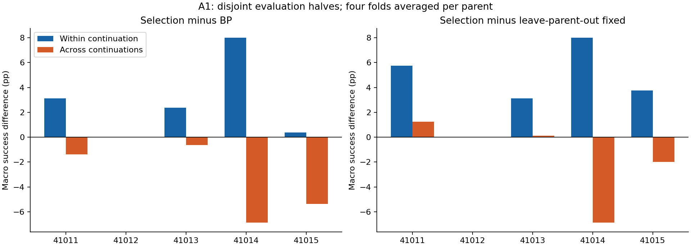
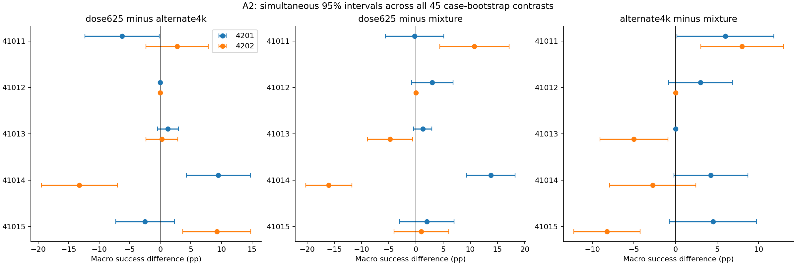
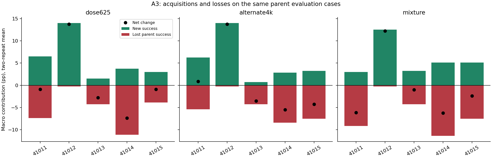
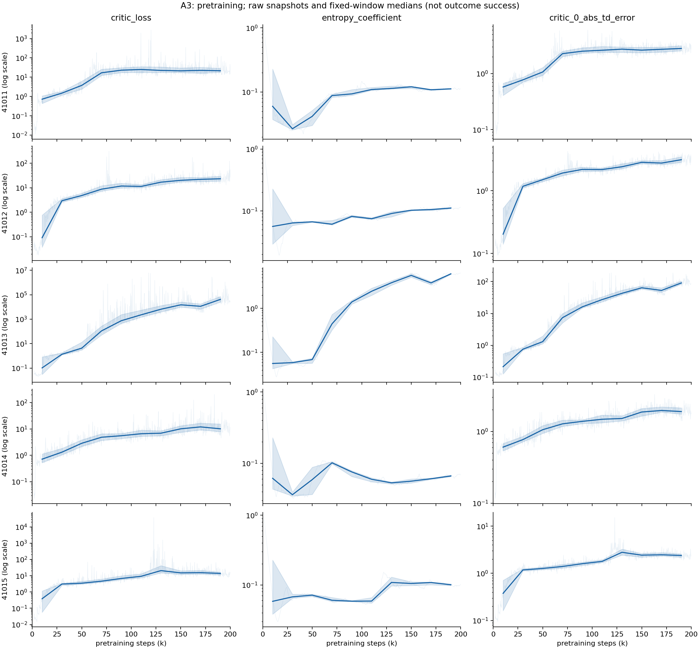
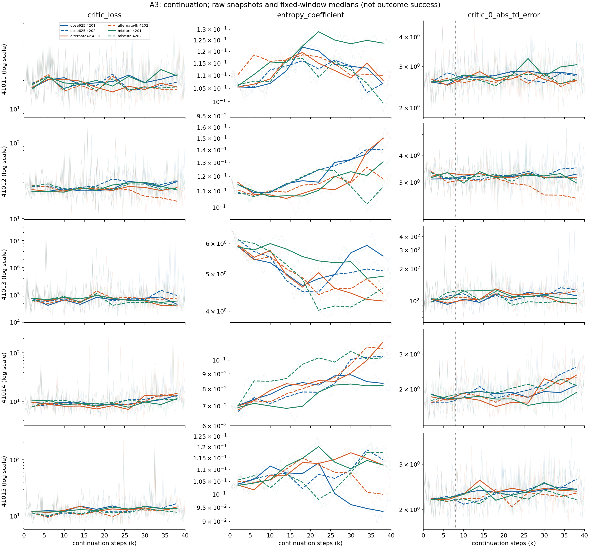

# A1–A3 결과: 부모의 고정 선호보다 학습 경로와 성공 보존을 먼저 살펴볼 근거

작성일: 2026-10-20 KST. 실행 범위: **기존 자료 분석 A만 완료**.
새 환경 실행·정책 평가·SAC 학습은 모두 0이며, B·C와 기존 2·3단계는 보류 상태다.

이번 결과는 **실현된 정책들의 성능 차이는 평가 사례를 바꿔도 남지만, 다른 후속 학습 반복에 가져갈 수 있는 부모별 일정 선호는 확보되지 않았다**는 해석을 지지한다.
또한 평균 순개선이 작은 이유 중 하나는 신규 성공의 획득과 기존 성공의 상실이 서로 상쇄되기 때문이다.

다만 여기서 바로 사용할 수 있는 조기 중단·일정 전환 규칙을 얻은 것은 아니다.
오히려 사전에 제안한 **초반 TD 오차 증가 점수와 임계값은 BP 경로 10개에서 모두 동일한 ‘지속’ 행동을 내놓는다**는 한계를 확인했다.
따라서 경로를 더 살펴볼 근거와, 그 경로를 예측하는 신호를 확보했다는 주장은 분리한다.

## 1. 자료와 분석 규약

[46번 사전 설계](../46_post_stage1_path_loss_design_v1/protocol.json)의 A1–A3를 실행했다.
세부 구현 선택은 결과 계산 전에 [47번 설정](analysis_config.json)에 기록했다.
분할·부모·방법·재표집 횟수·전환 검토 기준을 결과에 맞춰 바꾸지 않았다.

| 항목 | 사용한 자료 |
| --- | --- |
| 조건 | MetaWorld B: DO·DC·PU·BP, 기존 dense reward, 공유 SAC |
| 부모 | 200k 사전학습, 원래 seed 41011·41012·41013·41014·41015 |
| 후속 반복 | 4201·4202; 실제 파생 RNG seed 30건은 별도 CSV 보존 |
| 일정 | BP 집중 `dose625`, 4k 교대 `alternate4k`, 혼합 `mixture` |
| 학습 결과 | 부모 5개와 40k 후속 정책 30개 |
| 평가 원자료 | 정책당 4과제×100사례, 합계 14,000행 |
| 학습 로그 | 200개 segment의 metric 8,800행, episode 4,400행 |
| 통계 단위 | 부모 5개가 주 독립 단위; 같은 부모의 반복·방법·평가 반쪽은 독립 표본이 아님 |
| 새 비용 | 학습 0, 평가 0, 환경 step 0, SAC update 0 |

각 부모 안에서 과제·사례 번호·평가 seed·초기 상태 hash가 모든 정책에 동일함을 확인했다.
42번에서 44번으로 승계된 자료도 완료 marker가 가리키는 원본을 따라 읽었다.
과거 학습·평가·checkpoint 파일을 수정하지 않았다.

이 자료의 최종 성적은 이미 1단계에서 사용했다.
A는 그 자료를 사전에 정리한 질문으로 재분석하는 **개발 분석**이며 새 부모를 사용한 독립 확증은 아니다.

## 2. A1 — 선택이 무너지는 지점은 어디인가

과제별 사례 0–49와 50–99를 고정 반쪽으로 사용했다.
방법을 고르는 사례와 채점하는 사례는 겹치지 않는다.

- 동일 반복: 반복 r의 한쪽 평가 사례로 방법을 선택하고, 같은 r의 반대쪽 사례로 채점.
- 다른 반복: 다른 반복 r′의 한쪽 사례로 선택하고, r의 반대쪽 사례로 채점. 45번 분석을 그대로 재현.
- 고정 대조: BP 집중, 그리고 다른 부모들의 동일 선택 반쪽에서 두 반복을 평균해 고른 고정 방법.
- 동점: BP → 교대 → 혼합 순서.
- 부모당 2반복 방향×2반쪽 방향의 4개 점수를 평균한 후, 부모 5개를 같은 가중치로 집계.

| 선택 절차 | 선택 후 점수 | BP 대비 | 부모 제외 고정 대비 |
| --- | ---: | ---: | ---: |
| 동일 반복·다른 평가 반쪽 | 36.850% | **+2.775%p** | **+4.125%p** |
| 다른 반복·다른 평가 반쪽 | 31.225% | **−2.850%p** | **−1.500%p** |
| 두 절차의 차이 | +5.625%p | +5.625%p | +5.625%p |

BP 기준 점수는 34.075%, 부모 제외 고정 기준 점수는 32.725%다.
이 표의 동일 반복 선택도 **40k 최종 결과 일부를 이미 보고 선택**한다.
36.850%를 실제 온라인 배분 성능이나 8k 진단의 성능으로 부르지 않는다.
두 절차의 +5.625%p 차이 역시 비용을 지불해 회수할 수 있는 이득의 추정치가 아니다.

### 부모별 결과와 민감도

| 부모 | 동일 반복−BP | 다른 반복−BP | 동일 반복−다른 반복 |
| --- | ---: | ---: | ---: |
| 41011 | +3.125 | −1.375 | +4.500 |
| 41012 | 0.000 | 0.000 | 0.000 |
| 41013 | +2.375 | −0.625 | +3.000 |
| 41014 | +8.000 | −6.875 | +14.875 |
| 41015 | +0.375 | −5.375 | +5.750 |
| 평균 | +2.775 | −2.850 | +5.625 |

단위는 %p다. 이 다섯 값을 제시하고, 사후에 유리한 반쪽 분할을 찾지 않았다.
부모 하나를 완전히 제외하고 다른 부모들의 고정 기준 선정까지 다시 계산해도,
동일 반복 선택의 이득은 BP 대비 **+1.469~+3.469%p**, 부모 제외 고정 대비 **+2.594~+5.813%p**로 모두 양수다.
41014를 제거해도 동일 반복−BP는 +1.469%p다.
반면 다른 반복으로 옮긴 선택은 모든 제외 경우에서 두 대조 대비 음수였고 45번과 일치했다.

### 방법 쌍을 제한한 보조 분석

| 선택 가능한 두 방법 | 동일 반복−BP | 다른 반복−BP | 동일 반복−쌍 내부 고정 | 다른 반복−쌍 내부 고정 |
| --- | ---: | ---: | ---: | ---: |
| BP·교대 | +2.200 | −2.150 | +3.025 | −1.325 |
| BP·혼합 | +1.900 | −2.175 | +2.425 | −1.650 |
| 교대·혼합 | +1.500 | −0.975 | +3.000 | +0.525 |

세 쌍을 모두 보고한다. 교대·혼합의 다른 반복 선택은 그 쌍 안에서 고른 고정 방법보다 +0.525%p지만,
BP보다 −0.975%p다. 이를 강한 고정 기준을 넘어선 선택 가치로 승격하지 않는다.
각 쌍의 전체 부모 제거 결과도 원자료 표에 보존했다.

**판정:** 일부 실현된 방법 차이는 독립된 평가 반쪽에도 이어진다.
그러나 그 선호를 다른 학습 반복에 이전하는 데 실패했다.
‘최종 정책 사이의 차이가 전부 평가 잡음이라서 선택이 실패했다’는 설명만으로는 충분하지 않다.
학습 경로 차이의 어떤 부분을 8k에 알 수 있는지는 아직 답하지 않았다.

근거: [전체·쌍별 집계](results/20261020T033948Z_analysis_ff2c8362/a1_summary.csv),
[모든 원래 fold](results/20261020T033948Z_analysis_ff2c8362/a1_folds.csv),
[부모 제거 후 재선정 fold](results/20261020T033948Z_analysis_ff2c8362/a1_full_parent_removal_folds.csv).

## 3. A2 — 우열 반전을 평가 사례 오차만으로 설명할 수 있는가

부모×과제 안에서 100사례를 복원 추출하고,
**동일한 재표집 사례 인덱스를 부모 정책과 세 방법·두 반복 모두에 적용**했다.
부모·과제 사이에서는 별도로 추출했다.
재표집 20,000회, 분석 RNG seed 460202를 사용했다.

5부모×3방법 쌍×(4201 차이·4202 차이·그 차이의 차이) = **45개 대비를 하나의 비교군**으로 정했다.
각 대비의 percentile 95% 구간과, 최대 표준화 편차를 이용한 동시 95% 구간을 함께 저장했다.
부트스트랩 SD의 자유도는 1, 동시 구간의 임계값은 **3.1311**이다.
아래 표는 부호를 혼동하지 않도록 **BP−대안**으로 표시한다.

| 부모·비교 | 4201 차이 [동시 95% 구간] | 4202 차이 [동시 95% 구간] | 강한 반전 기준 |
| --- | ---: | ---: | --- |
| 41014, BP−교대 | +9.50 [4.25, 14.75] | −13.25 [−19.47, −7.03] | 충족 |
| 41014, BP−혼합 | +13.75 [9.27, 18.23] | −16.00 [−20.25, −11.75] | 충족 |

두 차이가 반대 부호이고 각각 절댓값 2%p 이상이며, 양쪽 동시 구간이 각각 0을 제외해야 통과한다.
이 기준을 충족한 것은 **15개 부모×방법 쌍 중 2개, 모두 부모 41014**였다.
서로 다른 두 부모에서 재현했다고 세지 않는다.

41014의 반복 간 차이 변화는 BP−교대 **−22.75%p [−30.80, −14.70]**,
BP−혼합 **−29.75%p [−34.31, −25.19]**다.
반면 41015의 BP−교대는 −2.50→+9.25%p로 바뀌지만,
첫 반복의 동시 구간이 [−7.29, +2.29]여서 엄격한 반전 기준을 통과하지 못했다.
반복 간 차이의 차이가 0을 제외한다는 사실만으로 두 방향의 우열을 확정하지 않았다.

41011에서는 교대−혼합 +6.00%p [0.19, 11.81], +8.00%p [3.03, 12.97]로
두 반복의 국소적인 교대 우위가 남았다. 이것은 우열 반전과 구별해 기록한다.

45개 대비 중 6개는 이 평가 자료에서 재표집 SD가 0이었다.
이는 관측 사례에서 대비가 일정했다는 뜻이며 모집단 불확실성이 0이라는 뜻은 아니다.
이들은 최대 편차 계산에서 제외하고, 긍정적인 진행 근거로 쓰지 않았다.

**판정:** 41014의 큰 반전은 고정된 정책들의 평가 사례를 다시 뽑는 정도로 쉽게 사라지는 결과는 아니다.
그러나 이 분석은 **이미 학습된 정책과 경험적 평가 분포에 조건부인 근사 구간**이다.
새 학습 seed·새 부모의 변동을 포함하지 않으며, 학습 분산과 평가 분산 전체를 정확히 분해한 것도 아니다.
두 후속 반복이 각각 다른 경로를 만들었다는 것까지 알 수 있고, 어떤 난수원·업데이트가 원인인지는 알 수 없다.

근거: [45개 대비와 모든 구간](results/20261020T033948Z_analysis_ff2c8362/a2_contrasts.csv),
[15개 반전 판정](results/20261020T033948Z_analysis_ff2c8362/a2_reversals.csv),
[정의와 순서](results/20261020T033948Z_analysis_ff2c8362/a2_definition.json).
모든 재표집 인덱스와 공동 결과도 실행 폴더에 NPZ로 보존했다.

## 4. A3 — 작은 순변화 안에 가려진 성공 획득과 상실

같은 사례에서 부모의 실패→후속 성공을 획득, 부모의 성공→후속 실패를 상실로 집계했다.
각 과제의 분모는 항상 100이고 macro는 네 과제 평균이다.

\[
\Delta\mathrm{success}=\mathrm{gain}-\mathrm{loss}.
\]

### 전체 평균

| 일정 | 신규 성공 획득 | 기존 성공 상실 | 순변화 |
| --- | ---: | ---: | ---: |
| BP 집중 | +5.750%p | −5.375%p | **+0.375%p** |
| 교대 | +5.425%p | −5.150%p | **+0.275%p** |
| 혼합 | +5.800%p | −6.500%p | **−0.700%p** |

‘추가 학습이 아무것도 바꾸지 않았다’는 설명과 다르다.
성공하는 사례 집합이 바뀌었고, 평균에서는 상당 부분이 상쇄됐다.
다만 사례별 획득·상실을 내부 표상이나 능력 전체의 인과적 획득·망각과 동일시하지 않는다.

### 부모별 획득 / 상실 / 순변화

각 칸은 macro %p, 두 반복 평균이다.

| 부모 | BP 집중 | 교대 | 혼합 |
| --- | --- | --- | --- |
| 41011 | 6.500 / 7.375 / −0.875 | 6.250 / 5.375 / +0.875 | 3.000 / 9.125 / −6.125 |
| 41012 | 14.000 / 0.250 / +13.750 | 14.000 / 0.250 / +13.750 | 12.500 / 0.250 / +12.250 |
| 41013 | 1.500 / 4.250 / −2.750 | 0.750 / 4.250 / −3.500 | 3.250 / 4.250 / −1.000 |
| 41014 | 3.750 / 11.125 / −7.375 | 2.875 / 8.375 / −5.500 | 5.125 / 11.375 / −6.250 |
| 41015 | 3.000 / 3.875 / −0.875 | 3.250 / 7.500 / −4.250 | 5.125 / 7.500 / −2.375 |

41012의 BP 이득은 매우 구체적이다.
두 반복 모두 BP에서 부모가 실패한 **56사례를 새로 성공**하고 부모의 BP 성공은 하나도 잃지 않았다.
macro +14.00%p를 얻고 PU의 기존 성공 1사례를 잃어 −0.25%p, 순이득 +13.75%p가 된다.

41014의 BP 경로는 다르다.

| 반복 | 부모 BP 성공 | 후속 BP 성공 | 새로 얻은 BP 성공 | 잃은 부모 BP 성공 |
| --- | ---: | ---: | ---: | ---: |
| 4201 | 68 | 63 | 15 | 20 |
| 4202 | 68 | 19 | 14 | 63 |

획득 수는 15와 14로 비슷한데, 상실 수는 20과 63으로 크게 다르다.
41015의 BP 경로에서도 획득은 두 반복 모두 4사례이고, 상실은 20 대 6사례다.
**이 두 부모의 BP 반복 차이는 신규 성공 획득의 차이보다 기존 성공 상실의 차이로 더 잘 기술된다.**
이것은 관측 결과 분해이며 8k에서 미리 예측했다는 뜻이 아니다.

41013은 부모의 DC 성공 17사례를 모든 후속 일정·반복에서 전부 잃었다.
일부 후속 정책이 DC에 성공해도 부모가 성공한 사례와 다른 사례다.
부모의 성공률이 낮다는 이유로 이런 상실을 분석에서 제외하지 않았다.

### BP 자체의 성공률이 거의 그대로인 이유

| BP 집중 후 변화의 대상 | 획득 | 상실 | 과제 성공률 순변화 | macro 기여 |
| --- | ---: | ---: | ---: | ---: |
| DO | 0.0 | 0.0 | 0.0 | 0.000 |
| DC | 1.7 | 3.4 | −1.7 | −0.425 |
| PU | 4.3 | 1.5 | +2.8 | +0.700 |
| BP | 17.0 | 16.6 | +0.4 | +0.100 |

단위는 %p다. BP 성공률 51.0→51.4%는 작은 변화지만,
그 안에서 평균 17.0%p를 얻고 16.6%p를 잃었다.
‘집중해서 연습했으니 그 과제의 기존 성공은 안정적으로 보존된다’는 가정은 이 자료와 맞지 않는다.

교대−혼합 +0.975%p도 분해할 수 있다.
전체 평균에서 교대는 신규 획득이 혼합보다 **0.375%p 적었지만**, 기존 성공 상실이 **1.350%p 적었다**.
41011의 교대−혼합 +7.000%p는 획득 차이 +3.250과 상실 감소 +3.750이 함께 기여했다.
41014의 +0.750%p는 획득 차이 −2.250과 상실 감소 +3.000의 합이다.
따라서 모든 일정 차이를 동일한 ‘학습 속도’ 하나로 설명하기 어렵다.

원래 실패가 없는 경우의 조건부 획득률, 원래 성공이 없는 경우의 조건부 보존율은 NA로 남겼다.
각각 18개·42개 과제별 비교가 해당하며 0으로 채우지 않았다.
이 절의 평균과 분해는 기술 통계다. 별도의 새 부모 확증이나 성공 획득·상실에 대한 다중 가설 검정을 수행한 것은 아니다.

근거: [120개 과제별 전이 표](results/20261020T033948Z_analysis_ff2c8362/a3_case_transitions.csv),
[30개 경로의 획득·상실](results/20261020T033948Z_analysis_ff2c8362/a3_path_gains_losses.csv),
[방법 간 획득·상실 분해](results/20261020T033948Z_analysis_ff2c8362/a3_pair_decomposition.csv).

## 5. A3 — 학습 로그에서 확인되는 것과 확인되지 않는 것

모든 부모의 사전학습은 고정 20k 구간, 모든 후속 경로는 고정 4k 구간으로 요약했다.
원래 250-step snapshot을 보존하고 중앙값·사분위수·범위·유효 수를 기록했다.
학습 에피소드는 과제별 실제 수량과 전체 500-step return, 한 번이라도 성공했는지를 집계했다.
어떤 부모나 일정도 제외하지 않았다.

### 41013의 큰 critic 수치는 마지막 한 번의 튐이 아니다

아래는 41013의 고정 20k 구간 중앙값이다.

| 사전학습 구간 | critic loss | α |
| --- | ---: | ---: |
| 40–60k | 4.243 | 0.0687 |
| 60–80k | 109.993 | 0.4458 |
| 80–100k | 754.769 | 1.3995 |
| 100–120k | 2,281.021 | 2.4481 |
| 120–140k | 6,554.220 | 3.8235 |
| 140–160k | 15,037.866 | 5.6133 |
| 160–180k | 11,395.900 | 3.7915 |
| 180–200k | 41,684.188 | 6.0883 |

40–60k에서 다른 네 부모의 critic loss 중앙값은 2.874~4.844, α는 0.0418~0.0714로 유사한 범위다.
60–80k에서 다른 네 부모는 각각 4.622~16.921, 0.0603~0.1016인데 41013은 크게 벌어진다.
180–200k의 다른 네 부모 critic loss 중앙값은 10.176~23.332다.
160–180k에서 일부 하락해도 비교 가능한 규모로 회복하지 않았고,
40k 후속 학습의 여러 구간에서도 큰 TD 오차와 critic loss가 지속됐다.

같은 40–60k→60–80k 구간에서 41013의 학습 BP 성공은 5/10→0/10, DC는 9/10→6/10이었다.
그러나 이후 DC 학습 성공은 다시 7~9/10인 구간도 있고, 마지막 부모 정책의 독립 O100 DC 성공은 17/100이다.
이 차이는 **학습 중 확률적 행동·방문 상태와 저장된 결정론적 정책 평가를 구별해야 함**을 보여준다.
20k 집계만으로 보상·성공·critic 변화의 정확한 선후나 원인을 정할 수 없다.

α는 엔트로피 항의 가중치이며 측정된 정책 엔트로피가 아니다.
실제 정책 엔트로피·행동 분산·매 update gradient norm의 과거 기록은 없으므로 만들거나 추정값으로 대신하지 않았다.
그림과 원자료에 보존한 entropy loss도 실제 정책 엔트로피로 바꾸어 해석하지 않는다.

### 41014·41015의 손실은 이 거대한 수치 발산만으로 설명되지 않는다

41014의 BP 경로 critic loss 4k 구간 중앙값은 첫 구간 9.61/7.81,
마지막 구간 13.29/12.75였다. 최종 BP 성공은 63%/19%로 크게 다르다.
41015에서도 첫 구간 12.13/11.37, 마지막 구간 13.86/16.75인데 BP 최종 성공은 67%/81%다.
이번 로그에서 이 두 부모의 큰 성공 상실은 41013 수준의 지속적 critic 폭증을 동반하지 않았다.

41014 혼합 경로의 마지막 4k 학습 BP 성공은 4201에서 0/3, 4202에서 3/3으로 최종 차이와 같은 방향이었다.
그러나 41014 교대의 마지막 구간은 두 반복 모두 0/1인데 최종 O100 BP 성공은 16%/72%다.
말기 학습 성공 역시 작은 사례 수와 확률적 정책의 영향을 받는다.
이 수치는 사후 경로 설명에만 사용하며 8k 입력으로 사용하지 않는다.

그림은 파랑 BP 집중, 주황 교대, 초록 혼합이며 실선 4201·점선 4202다.
옅은 선은 원래 snapshot, 진한 선은 고정 구간 중앙값이다.
부모별 y축 범위가 다르므로 수치 축을 함께 읽어야 한다.
[과제별 학습 성공 경로](results/20261020T033948Z_analysis_ff2c8362/figures/a3_training_success.png)도 함께 보존했다.

### 실제 수집과 replay 반영량을 구분했다

부모 200k의 누적 카운터를 빼고 후속 구간의 실제 증가량을 계산했다.
replay sampling 횟수는 batch 안의 중복 추출을 포함하는 수이며 고유 경험 수가 아니다.

| 일정 | 첫 4k BP 실제 수집 비중 | 첫 4k replay BP 비중 | 마지막 4k replay BP 비중 |
| --- | ---: | ---: | ---: |
| BP 집중 | 66.25% | 25.98% | 39.18% |
| 교대 | 62.50% | 25.87% | 30.30% |
| 혼합 | 37.50% | 25.36% | 29.92% |

BP 집중의 첫 4k는 원래 8k 블록의 앞부분이어서 정확한 62.5%가 아니다.
종료에 맞춰 과제 수량이나 순서를 재배치하지 않았고 실제 수집량을 그대로 썼다.
새 후속 경험의 batch 내 비중은 기록된 snapshot 평균으로 첫 4k 약 2.05%, 4–8k 약 6.08%, 마지막 4k 약 38.24%였다.
이는 매 update 전체 평균이 아니다.
초반의 새 수집 분포가 replay에 점진적으로 반영된다는 관찰은 남지만,
이 지연이 우열 반전이나 손실의 원인이라는 검증은 아니다.

근거: [고정 구간 metric 통계](results/20261020T033948Z_analysis_ff2c8362/a3_metric_windows.csv),
[과제별 학습 성공·return·사례 수](results/20261020T033948Z_analysis_ff2c8362/a3_training_task_windows.csv),
[누적 카운터 차분과 노출](results/20261020T033948Z_analysis_ff2c8362/a3_exposure_windows.csv).
warmup 동안 loss가 없는 snapshot은 결측으로 유지했다.

## 6. 초반 신호 점검: 제안한 TD 증가 규칙은 이 자료에서 구분력이 없다

46번에서 제안한 점수는 다음과 같다.

\[
e=(|\mathrm{TD}_0|+|\mathrm{TD}_1|)/2,\qquad
z=\log\frac{\operatorname{median}(e_{4\text{–}8k})+10^{-6}}
{\operatorname{median}(e_{0\text{–}4k})+10^{-6}}.
\]

모든 BP 경로에 각 구간 16개 유효 snapshot이 있어 최소 12개 조건을 충족했다.
아래 표의 학습 성공은 각 경로의 4–8k BP 에피소드 기준이고, 최종 차이는 **부모→40k**다.
아직 **8k→40k** 성공률 차이는 측정하지 않았다.

| 부모 | z: 4201 / 4202 | 4–8k BP 학습 성공: 4201 / 4202 | BP 경로의 부모→40k macro 차이: 4201 / 4202 |
| --- | --- | --- | --- |
| 41011 | +0.0170 / +0.0734 | 4/5 / 1/4 | −2.75 / +1.00%p |
| 41012 | −0.0044 / −0.0504 | 7/7 / 4/4 | +13.75 / +13.75%p |
| 41013 | −0.1606 / +0.1128 | 0/5 / 0/3 | −3.00 / −2.50%p |
| 41014 | −0.0339 / +0.0379 | 4/5 / 4/6 | −1.75 / −13.00%p |
| 41015 | +0.0186 / −0.0264 | 1/4 / 4/4 | −3.25 / +1.50%p |

사전에 지정한 수치 임계값은 log(1.5), log(2), log(4), log(8)이며, z가 임계값보다 크면 중단하는 후보 규칙이다.
최소 임계값은 **0.4055**, 관측 z의 최대는 **0.1128**이다.
따라서 **10경로×4수치 규칙의 40개 판단이 모두 ‘지속’**이다.
수치 규칙 4개와 ‘항상 지속’은 같은 행동 벡터이고, ‘항상 중단’만 다른 상수 행동이다.

이것은 B의 미래 성적을 보고 적합한 결과가 아니라 **현재 사용 가능한 입력만으로 확인한 규칙의 구조적 한계**다.
부모 제외 fold마다 서로 다른 상수 규칙을 고르더라도 그것은 해당 경로의 z를 읽어 구별한 것이 아니다.
현재 임계값군을 그대로 두고 B를 실행해도 이 점수를 통한 상태별 선택을 검증하는 실험은 성립하기 어렵다.

41013처럼 이미 큰 TD 오차를 가진 상태에서도 비율은 1 근처일 수 있다.
따라서 ‘현재 수준이 나쁜가’와 ‘첫 8k 동안 더 나빠졌는가’는 서로 다른 질문이다.
이 관찰을 근거로 지금 사후에 유리한 임계값이나 절대 TD 점수로 갈아타지는 않았다.

초반 학습 성공도 당장 채택할 근거는 없다.
41015의 두 경로는 낮은 초반 성공과 더 나쁜 최종 성적이 대응하지만, 41011에서는 그 순서가 반대다.
과제별 3~7개 에피소드로 얻은 지표이며, 부모→40k와 8k→40k의 차이를 혼동할 수 없다.
46번의 단순 정보 대조를 실제로 적합하거나 채점하지 않았다.

**판정:** H_early의 예측 효과는 미검증이다.
특히 사전 TD 비율·임계값 조합은 이 표본에서 상태별 행동을 나누지 못한다.
현재 부모 정책보다 나빠질지 예측하는 것과, 8k에서 멈추면 그 손실을 막는다는 것은 별도 주장이다.

근거: [30경로의 prefix-only 신호](results/20261020T033948Z_analysis_ff2c8362/a3_prefix_only_signals.csv),
[BP 10경로의 고정 임계값 행동 점검](results/20261020T034238Z_verification_2078bee6/prefix_rule_action_audit.csv).

## 7. 연구 판단: 무엇이 바뀌었고 무엇은 유지하는가

| 질문 | 이번 A의 판단 |
| --- | --- |
| 실현된 일정 차이가 다른 평가 사례에도 남는가? | 동일 반복 선택 +2.775%p, 모든 부모 제거에서도 양수. 탐색적 근거 확보 |
| 다른 학습 반복에 부모별 선호를 재사용할 수 있는가? | −2.850%p. 기존 1단계 음성 결론 유지 |
| 큰 반전을 평가 사례 오차만으로 설명할 수 있는가? | 41014의 두 대비는 공동 구간에서도 반전. 조건부 경로 차이의 근거 |
| 추가 학습의 작은 순이득 안에 성공 상실이 있는가? | 있음. 여러 부모에서 획득보다 상실이 크고, 41014·41015 반복 차이는 상실이 크게 기여 |
| 초반 TD 증가로 중단·지속을 구별했는가? | 아니오. 고정 수치 규칙이 모두 지속으로 동일 |
| 8k에 멈추면 더 좋은가? | 미측정 |
| 같은 8k 상태에서 전환하면 더 좋은가? | 미실행 |
| 정보 비용을 회수하는 실제 선택기를 얻었는가? | 미검증 |

46번의 **선택적 전환 검토를 위한 A 필요조건** 세 가지는 수치상 충족했다.
동일 반복 선택은 두 대조 대비 1%p 이상이고, 모든 부모 제거에서 양수이며,
41013 밖에서 강한 반전이 하나 이상 존재한다.
하지만 이 기준은 C 전환 실행의 충분조건이 아니다.
B의 중단·지속 결과와 규칙 기준, 실제 동일 상태의 행동 비교, 별도의 실행 승인이 남아 있다.
원래 1단계 관문을 통과한 것으로 다시 기록하지 않는다.

여러 부모에서 경로 차이·성공 상실을 확인했으므로 **손실이 언제 발생했는지 조사할 이유**는 커졌다.
반면 구체적인 사전 TD 증가 규칙으로 이어갈 근거는 약해졌다.
두 판단을 함께 반영해야 한다.

현재 권고는 다음과 같다.

1. A를 완료된 분석으로 고정하고, 원래 2·3단계 보류를 유지한다.
2. B를 검토한다면 먼저 목적을 명확히 한다. 기존 BP 8k 정책 10개 평가로
   부모→8k와 8k→40k 손익을 구분하는 측정은 여전히 유용할 수 있다.
   학습 0, 새 평가 상한 2.0M step이며 **이번에 실행하지 않았다**.
3. B를 ‘현재 TD 규칙의 유효성을 확인해 곧바로 C로 넘어가는 실험’으로 그대로 진행하는 것은 권하지 않는다.
   고정 규칙의 동일 행동 문제를 먼저 기록하고, 규칙 연구를 계속한다면 결과를 보기 전에 새 버전으로 목적·입력을 명시해야 한다.
   지금 낮은 임계값을 찾아 바꾸거나 단순 학습 성공 규칙을 사후 주 규칙으로 승격하지 않는다.
4. 중간 정책 평가로 실제 손실 위치가 밝혀지고, 결정 시점의 정보에 대한 구체적인 가설이 생길 때
   같은 8k 상태의 미래 반복·유지/전환 실험을 다시 검토한다.
   위험 신호가 있다는 것만으로 전환이 도움이 된다고 가정하지 않는다.

이 권고는 후속 실행 승인이 아니다. 이번 작업은 A에서 종료한다.

## 8. 검산·비용·보존

| 항목 | 기록 |
| --- | --- |
| 본분석 | `20261020T033948Z_analysis_ff2c8362` |
| 별도 검산 | `20261020T034238Z_verification_2078bee6` |
| 무결성·계산 확인 | 본분석 6,163건, 별도 검산 18,091건 통과 |
| 검산 내용 | 45번 다른 반복 선택 재현, 원본 hash, 사례 짝지음, 부모 제거 재선정, 재표집 RNG·동일 사례 적용, 45대비 공동 구간, 집합 연산으로 획득·상실 재계산, 누적 카운터 차분, prefix 시간 제한 |
| 본분석 wall / CPU | 16.409초 / 6.625초 |
| 별도 검산 wall / CPU | 13.093초 / 6.688초 |
| 신규 실험 비용 | 환경 step 0, SAC update 0, GPU 학습·평가 실행 없음 |
| 그 외 시간 | 문서 작성·검토·콘솔 조회는 위 계산 시간과 별도이며 전체 소요를 계측하지 않음 |
| 개발 실패 | 최초 Python 구문 오류 1건. 분석 시작 전 발생, 원본 소스와 실패 기록 보존 |
| 분석 의존성 | Python 3.12.0, NumPy 2.2.4, Matplotlib 3.10.1 |
| 학습 의존성 | 기존 SB3 2.7.1, PyTorch 2.5.1+cu121, MetaWorld 3.0.0, MuJoCo 3.5.0 등 runtime 기록 보존 |

기존 1단계가 사용한 6,997,719 환경 step을 새 분석 비용에 다시 더하지 않는다.
전체 입력 hash·설정·원래 학습 소스 hash·실행 소스 사본·원자료 정렬본·실패 실행을 보존했다.
이 분석은 checkpoint binary를 로드·재평가하지 않았으며, 미래 복구 검증까지 수행한 것으로 주장하지 않는다.

기술 검사가 통과했다는 것과 가설이 입증됐다는 것은 다르다.
불리한 쌍·부모·후보 점수의 결과도 모두 남긴다.

- [본분석 요약과 모든 표·그림의 기준](results/20261020T033948Z_analysis_ff2c8362/summary.json)
- [입력 hash](results/20261020T033948Z_analysis_ff2c8362/input_hashes.json)
- [기존 학습 출처·의존성](results/20261020T033948Z_analysis_ff2c8362/training_provenance.json)
- [별도 검산 결과](results/20261020T034238Z_verification_2078bee6/summary.json)
- [최초 실패 보존](results/20261020T033940Z_syntax_failure_68e9d998/failure.json)
- [후보 요인별 판정 기록](evidence_record_ko.md)
