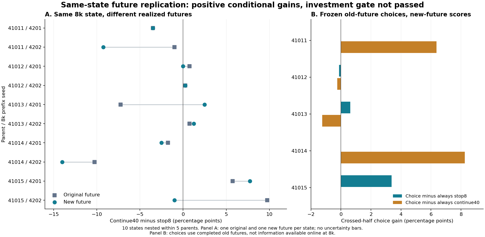

# 동일 8k 상태의 미래 반복 — 결과 및 연구 판단

분석일: 2026-10-22. 실행: 52번, 사전 분석 명세: 51번, 독립 결과 기록: 54번.

**10개 새 미래는 모두 완료됐다. 과거 결과로 고정한 중단·지속 선택은 새 미래에서도 평균 이득이 남았지만,
그 이득의 크기와 부모 간 분포가 사전 투자 기준을 충족하지 못했다.**
이는 이번 실험 전체가 음성이었다는 뜻도, 실제 적응형 선택기를 확보했다는 뜻도 아니다.

## 1. 무엇을 실제로 반복했는가

기존 부모 41011–41015에서 후속 seed 4201/4202로 얻은 **10개의 BP 8k 전체 학습 상태**를 각각 복원했다.
정책·critic·target·optimizer·entropy state·replay·수집 누계·일정 위치는 보존하고,
그 이후 학습에 쓰이는 전역 난수·환경 reset root·아직 생성하지 않은 일정 블록의 난수만 바꿨다.
기존 BP 집중 dose625를 각 상태에서 32k 더 실행했다. 다른 배분으로 전환하는 실험은 아니다.

각 새 미래는 BP 20k, DO/DC/PU 각 4k를 수집하고 SAC 업데이트 32k를 수행했다.
새 최종 정책 10개를 기존과 동일한 부모별 O100 사례로 평가했다.
중단의 비교 대상은 이미 평가한 해당 8k 정책이다. 추가 중단 학습은 필요하지 않다.
부모 5개가 주 독립 단위이며, 그 안에 중간 상태 2개와 상태당 기존/새 미래 2개가 있다.

기술 검사 44개를 통과한 실행이다. 이번 분석에서는 실행 소스 hash, 10개 시작 checkpoint와
40개 새 checkpoint의 manifest·구성 파일 hash, RNG 교체 전후 상태 지문, 수집량·평가 비용을 대조했다.
부모→8k→기존 40k→새 40k의 평가 seed와 초기 상태 hash도 사례별로 일치했다.
이 검사는 분석의 기술적 타당성을 뒷받침하며 과학적 독립 표본을 늘리지는 않는다.

## 2. 주 결과: 작은 재사용 이득은 남았고, 투자 기준은 통과하지 못했다

선택은 새 미래를 보기 전에 고정했다. 기존 미래의 평가 A 반쪽에서 지속 이득이 양수이면 지속,
그 외에는 중단을 선택하고 새 미래의 B 반쪽에서 채점한다. B→A도 동일하게 계산한다.
각 부모 안에서 두 방향과 두 중간 상태를 평균한 뒤, 부모 5개를 같은 가중치로 집계했다.
20개 방향별 선택 중 9개가 지속, 11개가 중단이다. 새 결과로 선택을 다시 하지 않았다.

| 새 미래의 비교 방법 | 전체 과제 macro 성공률 | 항상 중단 대비 | 새 미래 항상 지속 대비 |
| --- | ---: | ---: | ---: |
| 항상 8k에서 중단 | 34.725% | — | +1.850%p |
| 항상 40k까지 지속 | 32.875% | −1.850%p | — |
| 과거 미래로 고정한 선택, 반대 사례 반쪽 채점 | **35.500%** | **+0.775%p** | **+2.625%p** |

이전 미래에서의 항상 지속은 34.075%였다. 이번 선택의 지속 기준선에는 **새 미래의 32.875%**를 쓴다.
기존 미래의 값을 대신 쓰거나, 새 미래를 본 뒤 좋은 행동을 골라 주 결과로 제시하지 않았다.

이전 관찰로 정한 선택이 새 학습 미래에서 두 고정 행동을 평균적으로 앞선 점은 남는 긍정적 근거다.
그러나 이 선택은 과거의 완성된 40k 결과를 알고 있다. 지금 사용할 수 있는 8k 신호로 구현한 선택기가 아니며,
그 정보를 얻는 비용을 회수했다는 결과도 아니다.

| 사전 투자 조건 — 모두 충족해야 함 | 관측 결과 | 판정 |
| --- | --- | --- |
| 두 고정 행동 각각 대비 최소 +1%p | 중단 +0.775, 지속 +2.625%p | 미충족 |
| 사례 재표집의 두 대비 공동 95% 하한이 모두 양수 | +0.075, +1.925%p | 충족 |
| 어느 부모 하나를 제거해도 두 대비 평균이 모두 양수 | 다섯 경우 모두 양수 | 충족 |
| 각 대비에서 최대 양의 부모 기여 비중 ≤ 2/3 | 중단 대비 84.375%, 지속 대비 56.410% | 미충족 |
| 기술적 무결성 | 원자료·상태·소스·비용 대조 통과 | 충족 |

**기준 미통과의 이유는 중단 대비 효과 크기와 집중도다.** 사례 불확실성 기준까지 모두 실패했다고 쓰면 잘못이다.
반대로 일부 조건을 만족했다는 이유로 사전에 요구한 전체 조건을 바꾸지도 않는다.

## 3. 불확실성의 범위를 구분해야 한다

| 선택 이득 | 점추정 | 사례 재표집 공동 단측 95% 하한 | 부모 재표집 기술적 95% 구간 |
| --- | ---: | ---: | ---: |
| 중단 대비 | +0.775%p | +0.075%p | [−0.050, +2.125]%p |
| 새 미래 지속 대비 | +2.625%p | +1.925%p | [−0.600, +6.175]%p |

사례 재표집은 부모×과제×반쪽 안에서 사례 50개를 복원 추출했다. 동일 인덱스를 두 중간 상태 및
모든 평가 시점·미래에 함께 적용했다. 고정 선택을 재적합하지 않았다. seed 510303, 20,000회다.
θ=(중단 대비, 지속 대비)라 할 때, 각 재표집의 `max(θ−θ*)`의 95% 분위수 q=0.700%p를 구해
두 하한을 θ−q로 계산했다. 분위수는 linear 규약이다.

이 하한은 **이미 학습된 정책과 고정 선택표에 조건부**다. 미래 학습 난수 전체의 변동이나
새 부모 모집단에 대한 일반화까지 포함하지 않는다. 같은 상태의 미래는 두 번뿐이다.
부모 구간은 부모 안 집계를 먼저 마친 뒤 가능한 순서 있는 5개 재표집 3,125개를 모두 계산한 기술량이다.
부모 5개에서 나온 넓은 구간이며, 사전 투자 관문에는 사용하지 않았다.

전체 O100으로 선택·채점하는 보조 결과는 35.550%, 중단 대비 +0.825, 지속 대비 +2.675%p다.
이 보조 계산은 J8 측정 사례를 선택과 채점에 다시 사용하므로 주 결과로 대체하지 않는다.
평가 bank 자체도 기존 개발에서 사용한 bank다. 반쪽 분리가 연구 전체의 독립성을 보장하지는 않는다.

## 4. 어떤 손익이 반복되고, 무엇이 뒤집혔는가

아래 차이는 모두 **지속 후 성공률 − 해당 8k 성공률**이다. 양수는 지속, 음수는 8k 정책 보존에 유리하다.
단위는 % 및 %p다. 각 칸은 한 번 실현된 미래의 결과이며 기대 효과 추정치로 확정하지 않는다.

| 부모 / 8k까지의 후속 seed | 8k | 기존 40k | 새 40k | 기존 지속 손익 | 새 지속 손익 |
| --- | ---: | ---: | ---: | ---: | ---: |
| 41011 / 4201 | 41.00 | 37.50 | 37.50 | −3.50 | −3.50 |
| 41011 / 4202 | 42.25 | 41.25 | 33.00 | −1.00 | −9.25 |
| 41012 / 4201 | 49.25 | 50.00 | 49.25 | +0.75 | 0.00 |
| 41012 / 4202 | 49.75 | 50.00 | 50.00 | +0.25 | +0.25 |
| 41013 / 4201 | 8.50 | 1.25 | 11.00 | −7.25 | +2.50 |
| 41013 / 4202 | 1.00 | 1.75 | 2.25 | +0.75 | +1.25 |
| 41014 / 4201 | 42.75 | 41.00 | 40.25 | −1.75 | −2.50 |
| 41014 / 4202 | 40.00 | 29.75 | 26.00 | −10.25 | −14.00 |
| 41015 / 4201 | 36.00 | 41.75 | 43.75 | +5.75 | +7.75 |
| 41015 / 4202 | 36.75 | 46.50 | 35.75 | +9.75 | −1.00 |

- 41014/4202의 큰 후기 손실과 41015/4201의 후기 순이득은 새 미래에서도 나타났다.
- 41015/4202의 큰 회복은 반복되지 않았다. 같은 8k 정책에서 이전 +9.75%p가 새 미래 −1.00%p로 바뀌었다.
- 41013/4201은 이전 큰 손실 −7.25%p에서 새 미래 +2.50%p로 반전됐다.
- 41011/4202는 손익의 방향은 유지됐지만 손실 크기가 −1.00에서 −9.25%p로 커졌다.

열 상태 중 엄격한 손익 부호 일치는 7개, 반전은 2개, 새 미래 동률은 1개다.
이 개수를 독립 표본 10개의 안정성 검정이나 기대 행동 효과의 증명으로 사용하지 않는다.
공유된 J8을 포함하는 기존/새 손익의 단순 상관도 상태 효과의 증거로 제시하지 않았다.

그림 왼쪽은 각 상태의 두 실현값이다. 각 미래가 한 번씩이므로 오차 막대를 만들지 않았다.
오른쪽은 평가 반쪽을 교차한 고정 선택의 부모별 이득이며, 두 대비의 기여 부모가 다르다.

## 5. 이득이 어디에 집중됐는가

| 부모 | 항상 중단 | 새 미래 지속 | 고정 선택 | 중단 대비 | 지속 대비 |
| --- | ---: | ---: | ---: | ---: | ---: |
| 41011 | 41.625% | 35.250% | 41.625% | 0.000%p | +6.375%p |
| 41012 | 49.500% | 49.625% | 49.375% | −0.125%p | −0.250%p |
| 41013 | 4.750% | 6.625% | 5.375% | +0.625%p | −1.250%p |
| 41014 | 41.375% | 33.125% | 41.375% | 0.000%p | +8.250%p |
| 41015 | 36.375% | 39.750% | 39.750% | +3.375%p | 0.000%p |

중단 대비 양의 부모별 이득은 41013의 +0.625와 41015의 +3.375%p다.
따라서 사전 정의한 집중도는 `3.375 / (0.625 + 3.375) = 84.375%`다.
이는 음의 기여까지 포함한 전체 순이득에서의 비율과 다른 정의다.
지속 대비의 양의 기여는 41011·41014에서 나오며, 최대 비중은 `8.25 / (6.375 + 8.25) = 56.410%`다.

| 제외한 부모 | 선택−중단 | 선택−새 미래 지속 |
| --- | ---: | ---: |
| 41011 | +0.96875%p | +1.68750%p |
| 41012 | +1.00000%p | +3.34375%p |
| 41013 | +0.81250%p | +3.59375%p |
| 41014 | +0.96875%p | +1.21875%p |
| 41015 | **+0.12500%p** | +3.28125%p |

모든 제거에서 두 대비가 양수라는 점은 기록할 만하다. 다만 41015를 빼면 관측 평균이 더 높은
고정 행동인 중단 대비 이득은 +0.125%p로 작다. 제외 분석은 주 분석을 대신하지 않으며 41013도 주 분석에 포함했다.

## 6. 신규 성공·회복·상실의 순가치

같은 사례의 부모→8k→40k를 0/1 성공 패턴으로 연결했다. 아래 값은 전체 과제 macro에 대한 기여다.

| 후기 변화의 구성 | 기존 미래 | 새 미래 |
| --- | ---: | ---: |
| 001: 후기 신규 성공 | +2.450%p | +2.950%p |
| 101: 부모 성공의 회복 | +1.600%p | +0.850%p |
| 110: 8k에 남아 있던 부모 성공의 상실 | −3.425%p | −4.275%p |
| 010: 초반 신규 성공의 상실 | −1.275%p | −1.375%p |
| 지속의 순손익 | **−0.650%p** | **−1.850%p** |

새 미래는 후기 획득·회복 +3.800%p와 후기 상실 −5.650%p가 합쳐져 −1.850%p다.
상실 5.650%p를 중단의 순이득으로 부르면 안 된다. 중단하면 획득·회복도 포기한다.
전체 여덟 패턴과 부모·상태·과제별 수는 원자료 표에 남겼다.
세 관측 시점 사이의 패턴이므로 그 사이의 정확한 상실·회복 시점까지는 알 수 없다.

| 과제 | 부모 | 8k | 기존 40k | 새 40k |
| --- | ---: | ---: | ---: | ---: |
| DO | 0.0% | 0.0% | 0.0% | 0.6% |
| DC | 82.2% | 81.6% | 80.5% | 83.0% |
| PU | 1.6% | 2.7% | 4.4% | 2.9% |
| BP | 51.0% | 54.6% | 51.4% | 45.0% |

새 미래의 8k 대비 평균 손실은 BP 변화 −9.6%p의 macro 기여 −2.4%p가 중심이며,
다른 과제의 기여 +0.55%p가 일부 상쇄했다. 이는 과제별 산술 분해이며 손실의 기전 규명은 아니다.
DO는 새 미래에서 소수 성공이 생겼지만 여전히 매우 낮고, PU도 희소하며 대부분 부모의 DC는 높다.
여러 과제에 넓게 분포한 학습 기회의 배분 문제로 일반화하기 어려운 설정이라는 제한은 남는다.

## 7. 실행 규모·시간·실제 비용

| 항목 | 실제 값 |
| --- | ---: |
| 새 사전학습 | 0 |
| 새 미래 학습 | 10 × 32,000 = 320,000 step |
| SAC 업데이트 | 320,000 |
| 최종 평가 | 10 × 4 × 100 = 4,000 episode |
| 평가 환경 step | 1,385,201 |
| 본 실행 총 환경 step | **1,705,201** |
| 기술 검증 환경 step | 4,515 |
| 기술 검증 포함 총계 | **1,709,716** |
| 승인 상한 | 본 실행 2,320,000 / 기술 포함 2,330,000 |
| 완료 시각 | 2026-10-20 21:04:58 KST |

본 실행은 18:50:13 KST에 시작해 약 2시간 15분 걸렸다. 성공 시 일찍 종료하는 평가이므로
평가 2M은 실제 지출이 아닌 상한이다. worker wall 합은 8,041.940초, 학습 구간 wall 합은
5,734.315초, worker CPU 합은 4,389.516초다. GPU busy 시간은 별도로 계측하지 않았다.
수집 step과 GPU update, CPU 시간·wall 시간을 같은 자원 단위로 합치지 않는다.

본 실험의 자동 재시도·실패 실행은 없었다. 이번 54번은 기존 파일만 읽었고 새 환경 step·SAC update는 0이다.
본분석 wall 5.683초/CPU 1.516초, 독립 검산 wall 0.792초/CPU 0.234초다.
보고서 작성·조회 시간은 이 수치에 포함하지 않는다. 코드·입력 hash와 실행별 소스 사본을 보존했다.

## 8. 연구 방향에 대한 판단

이번 결과는 이전 1단계와 질문이 다르다. 이전에는 부모별 일정 선호를 다른 후속 반복에 옮겼고,
이번에는 **동일한 8k 전체 상태**에서 중단·BP 지속의 과거 손익을 새 미래에 옮겼다.
이번 양의 조건부 이득이 이전 일정 선택 관문의 실패를 뒤집지는 않는다.

남은 긍정적 근거는 일부 상태의 후기 손실·이득이 새 미래에서도 나타났고,
과거 결과에 고정한 선택이 이번 새 미래의 두 기준선을 평균적으로 앞섰다는 것이다.
남은 불리한 근거는 강한 고정 행동 대비 이득이 작고 한 부모의 기여가 크며,
이전 큰 회복·손실 중 일부가 동일 상태에서도 반전됐다는 것이다.

따라서 현재 조건에서 예측기·TD 임계값·후보·시점·새 부모를 자동으로 늘릴 투자 기준은 확보하지 못했다.
A·B·이번 미래 반복을 완료된 제한적 개발 근거로 정리하고, **C 및 원래 2·3단계는 계속 보류**한다.
임계값을 낮춰 현재 결과를 통과시키거나 새 미래를 이용해 선택표를 다시 고르지 않는다.

연구 주제 1번과 3번을 묶는 질문 자체는 여전히 일관된다. 다만 현재 설정에서 그 논문의 중심 기여가
확보됐다고 판단할 근거는 부족하다. Replay 전달 지연은 여전히 별도 원인 후보이며 이번 실험으로 검증되지 않았다.
추가 연구를 택한다면 새로운 기전 가설·학습 가능한 조건·새 투자 기준을 먼저 정하는 별도 설계가 필요하다.
이번 결과만으로 모든 상태별 선택이 불가능하다거나 고정 중단의 우월성·동등성·비열등성이 입증됐다고 결론 내리지 않는다.

## 9. 원자료와 재현

- [사전 명세 51](../51_same_state_future_investment_protocol_v1/protocol.json), [실행 52](../52_same_state_future_replication_v1/README.md).
- [기존 B 분석 49](../49_bp8k_late_value_analysis_v1/report_ko.md), [집중도 보조 분석 50](../50_b_posthoc_concentration_review_v1/report_ko.md).
- [분석 요약](results/20261022T021845Z_analysis_98fe07c3/summary.json), [기계 판독 결정](results/20261022T021845Z_analysis_98fe07c3/decision_record.json).
- [10개 상태 결과·이전/새 RNG seed](results/20261022T021845Z_analysis_98fe07c3/state_results.csv), [고정 선택 30행](results/20261022T021845Z_analysis_98fe07c3/frozen_choice_scores.csv).
- [부모별 집계](results/20261022T021845Z_analysis_98fe07c3/parent_results.csv), [부모 제거](results/20261022T021845Z_analysis_98fe07c3/leave_one_parent_out.csv).
- [4,000개 짝지은 사례](results/20261022T021845Z_analysis_98fe07c3/paired_outcomes.csv), [전체 성공 패턴](results/20261022T021845Z_analysis_98fe07c3/success_patterns.csv).
- [입력 hash](results/20261022T021845Z_analysis_98fe07c3/input_hashes.json), [실행 소스 hash](results/20261022T021845Z_analysis_98fe07c3/source_hashes.json), [분석 환경·비용](results/20261022T021845Z_analysis_98fe07c3/runtime.json).
- [독립 검산](results/20261022T021906Z_verification_8656944c/summary.json): 분석 집계 함수를 재사용하지 않고 원시 CSV를 다시 읽어 유리수로 점추정, 정수로 사례 재표집 벡터를 계산했다. 4,117개 확인 통과.

학습 의존성은 NumPy 2.2.4, PyTorch 2.5.1+cu121, Gymnasium 1.2.3, MuJoCo 3.5.0,
MetaWorld 3.0.0, Stable-Baselines3 2.7.1이다. 분석은 Python 3.12.0·NumPy 2.2.4이며
기존 모델·replay를 실행하거나 수정하지 않았다. 검산 통과는 위 계산과 기록의 일치에 대한 것이며
새 부모·추가 미래에서 효과가 확증됐다는 인증이 아니다.
