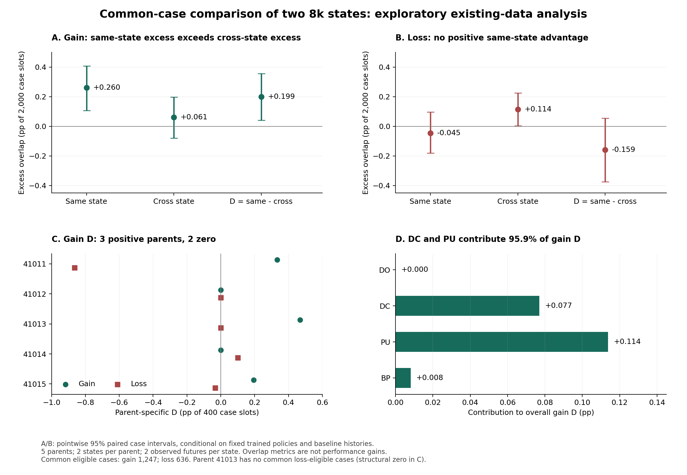

# 같은 상태와 다른 상태에서 획득·상실 사례의 중첩은 다른가?

2026-10-22 / 기존 자료 분석 완료 / 추가 학습·환경 평가 **0 step**

**공통 사례 집합에서도 획득의 초과 중첩은 교차 상태보다 동일 상태에서 더 컸다.** 차이는 전체 부모×과제×사례 슬롯 기준 **+0.199%p**이고, 조건부 사례 95% 구간은 **[+0.041, +0.357]%p**다. 부모 3개에서 양수, 2개에서 0이며, 어느 부모를 하나 제외해도 양수였다. 따라서 여러 상태에 똑같이 적용되는 사례 성향만을 기준으로 비교했을 때, **출발 상태와 연결된 추가 사례 반응 구조가 남는다는 탐색적 근거**가 생겼다.

다만 이 차이의 **95.9%는 DC·PU의 기여**다. BP의 큰 성능 반전이나 상실을 설명한 결과로 확대하지 않는다. 상태별 사건 확률의 강도 차이와 사례 순위 변화도 아직 분리하지 않았다. 상실의 동일−교차 차이는 −0.159%p이며 구간이 0을 포함한다. 이 결과로 상실의 비반복성이나 상태 효과의 부재를 확정하지 않는다.

55번의 분석과 사용자의 해석 보완을 보존하면서, 제안된 동일 상태·교차 상태 대조 한 가지를 수행했다. 원래 선택기 투자 기준 미통과, C·원래2/3단계 보류는 그대로다. 새로운 선택기·replay 개입·추가 미래 학습은 실행하거나 예약하지 않았다.

## 1. 무엇을 같은 조건으로 맞췄나

각 부모의 prefix4201 상태 S1, prefix4202 상태 S2를 비교한다. 각 상태에는 기존 미래와 52번에서 추가한 새 미래가 하나씩 있다. 부모는 41011–41015 다섯 개, 과제는 DO/DC/PU/BP, 부모·과제당 O100 사례는 100개다.

- 획득: S1과 S2에서 **모두 8k 실패**였던 사례만 사용.
- 상실: S1과 S2에서 **모두 8k 성공**이었던 사례만 사용.
- 같은 상태 두 쌍과 교차 상태 두 쌍을 이 **동일한 공통 집합**에서 다시 계산.

| 쌍 | 기존 미래 | 새 미래 |
|---|---|---|
| 동일1 | S1 | S1 |
| 동일2 | S2 | S2 |
| 교차1 | S1 | S2 |
| 교차2 | S2 | S1 |

네 쌍이 정책과 사례를 공유하므로 독립된 네 반복이 아니다. 4,000개 상태×사례 행은 **2,000개 부모×과제×사례 슬롯**에 두 상태를 연결한 자료다. 주 독립 단위는 부모 5개이며, 서로 다른 부모의 case 인덱스가 같다는 이유로 같은 물리적 평가 사례라고 취급하지 않는다.

| 사건 | 공통 적격 사례 | 55번 적격 상태×사례 | 공통 집합에 남은 상태×사례 | 유지 비율 |
|---|---:|---:|---:|---:|
| 상실 | 636 | 1,389 | 1,272 | 91.577% |
| 획득 | 1,247 | 2,611 | 2,494 | 95.519% |

두 상태의 8k 성공 여부가 다른 **117개 슬롯**은 이번 공통 집합 대조에서 제외한다. 636+1,247+117=2,000이다. 특히 41013은 두 상태에서 공통으로 성공한 사례가 **0개**다. 따라서 41013의 기존 큰 상실은 이번 상실 대조의 대상에 들어오지 않는다. 공통 집합의 보존율이 높다는 이유로 모든 중요한 경로가 포함됐다고 해석해서는 안 된다.

원자료: [공통 집합 범위](results/20261022T035037Z_analyze_9e4e0e84/coverage_by_parent_task.csv), [층별 네 쌍](results/20261022T035037Z_analyze_9e4e0e84/overlap_by_pair.csv).

## 2. 점수와 주 결과

부모×과제×공통 적격 집합 안에서 N은 사례 수, n1/n2는 두 미래의 사건 수, m은 공통 사건 수다.

\[
T=m-\frac{n_1n_2}{N},\quad
T_{\rm same}=\frac{T_{11}+T_{22}}2,\quad
T_{\rm cross}=\frac{T_{12}+T_{21}}2,\quad
D=T_{\rm same}-T_{\rm cross}.
\]

‘기대 중첩’은 각 층의 사건 수를 보존하면서 사례 라벨을 무작위 대응시키는 기준이다. 현실에서 사례들의 사건 확률이 동일하다는 주장이 아니다.

아래 수는 각 부모×과제에서 두 쌍을 평균한 뒤 합한 값이다. **네 쌍 전체의 고유 사건 수가 아니므로 0.5건 단위도 가능하다.**

| 사건 | 비교 | 관측 중첩 합 | 기대 중첩 합 | 초과 중첩 합 |
|---|---|---:|---:|---:|
| 획득 | 동일 상태 | 19.000 | 13.796 | +5.204 |
| 획득 | 교차 상태 | 15.500 | 14.274 | +1.226 |
| 상실 | 동일 상태 | 41.500 | 42.406 | −0.906 |
| 상실 | 교차 상태 | 32.000 | 29.719 | +2.281 |

주 단위는 100×ΣD/2,000 = ΣD/20으로, 부모·과제에 동일 가중한 **전체 사례 슬롯 대비 초과 중첩 차이**다. **성공률 개선이나 선택기 이득이 아니다.**

| 사건 | 동일 상태 초과 중첩 | 교차 상태 초과 중첩 | 동일−교차 D | 조건부 사례 95% 구간 | 부모 재표집 95% 기술 구간 |
|---|---:|---:|---:|---:|---:|
| 획득 | +0.260%p | +0.061%p | **+0.199%p** | **[+0.041, +0.357]** | [+0.039, +0.359] |
| 상실 | −0.045%p | +0.114%p | **−0.159%p** | [−0.375, +0.054] | [−0.519, +0.054] |

공통 적격 사례 수로 나누면 획득 D는 +0.319%p, 상실 D는 −0.501%p다. 이것은 같은 분자를 다른 분모로 표현한 보조 기술량이며 주 가중치를 바꾸지 않는다.

부모 시점 성공 여부 J0로 기대 중첩을 추가 층화해도 획득 D는 **+0.167%p**, 조건부 사례 구간 **[+0.018,+0.317]%p**로 남았다. 상실은 −0.173%p, 구간 [−0.389,+0.040]%p다. J0 층화가 모든 사례 난이도나 상태 특성을 통제한 것은 아니다.

[정확한 요약값](results/20261022T035037Z_analyze_9e4e0e84/summary.json) · [SVG](results/20261022T035334Z_make_figure_e15b9cd8/same_vs_cross_overlap.svg)

## 3. 한 부모의 결과인가? 어떤 과제의 결과인가?

부모별 표의 D는 각 부모의 400개 슬롯을 분모로 사용한다. 전체 값은 이 다섯 값을 동일 가중한 평균이다.

| 부모 | 획득 공통 N | 획득 D | 상실 공통 N | 상실 D |
|---|---:|---:|---:|---:|
| 41011 | 226 | +0.333%p | 159 | −0.864%p |
| 41012 | 198 | 0.000%p | 194 | 0.000%p |
| 41013 | 362 | +0.468%p | 0 | 0 기여 — 비교 대상 없음 |
| 41014 | 216 | 0.000%p | 147 | +0.101%p |
| 41015 | 245 | +0.193%p | 136 | −0.033%p |

획득 D는 세 부모에서 양수이고, 부모 하나씩 제외한 전체 D는 **+0.132~+0.249%p**로 모두 양수다. 최대 기여 부모 41013의 비중은 **47.1%**다. 이전 중단 선택 여지의 41015 집중과 다른 형태의 관측이다. 이것을 예전 선택기 투자 기준 통과로 다시 분류하지 않는다.

상실은 41011의 음의 차이가 크다. 41011을 제외하면 D는 +0.017%p로 바뀐다. 따라서 상실의 교차 상태 우위나 일반적인 음의 상태 구조도 확정하지 않는다.

| 과제 | 획득 공통 N | 전체 획득 D에 대한 기여 | 관측 범위 |
|---|---:|---:|---|
| DO | 500 | 0.000%p | 획득 사건이 없음 |
| DC | 75 | +0.077%p | 양의 차이는 41013에만 존재 |
| PU | 473 | +0.114%p | 41011·41013의 양의 차이 |
| BP | 199 | +0.008%p | 41011 음수와 41015 양수의 상쇄 |

DC·PU 합이 전체 획득 D의 **95.938%**다. BP에서는 41011의 −0.611건과 41015의 +0.773건이 거의 상쇄되어 전체 기여가 작다. 따라서 이번 단서를 **BP의 후기 성공 상실·회복을 설명하는 증거**로 연결하면 안 된다. 네 과제에 널리 퍼진 보편적인 현상이라고 주장할 근거도 부족하다.

[부모별 결과](results/20261022T035037Z_analyze_9e4e0e84/parents.csv) · [과제별 결과](results/20261022T035037Z_analyze_9e4e0e84/tasks.csv) · [부모 제외](results/20261022T035037Z_analyze_9e4e0e84/leave_one_parent_out.csv) · [검산된 기여 분해](results/20261022T035234Z_verify_fdfb3853/scope_summary.json)

## 4. 사건 수 때문에 드러낼 수 없는 차이를 구분했다

각 쌍에서 가능한 m과 초과 중첩의 범위는 다음과 같다.

\[
\max(0,n_1+n_2-N)\le m\le\min(n_1,n_2),\qquad
T_{\max}=\min(n_1,n_2)-n_1n_2/N.
\]

한 미래의 사건 수가 0 또는 N이면 T는 반드시 0이다. 큰 상실이 두 미래에서 반복되어도 그 집단 안의 특별한 취약 사례를 더 구별할 여지가 없을 수 있다.

| 사건 | 적격 N>0 층 / 20 | 동일 상태 가변 사건 쌍 / 40 | 교차 상태 가변 사건 쌍 / 40 | 동일 상태 T_max 합¹ | 교차 상태 T_max 합¹ |
|---|---:|---:|---:|---:|---:|
| 상실 | 8 | 5 | 5 | 15.594 | 11.281 |
| 획득 | 16 | 9 | 8 | 20.204 | 19.226 |

¹ 두 쌍 평균을 층별 합산한 값이다. D 자체의 최대값이나 달성 가능한 성능 이득이 아니다. 두 비교의 T_max가 다르므로, 획득과 상실의 본질적인 반복성 순위를 이 수치로 매기지 않는다.

N, n1, n2, m, 기대값, m 하한·상한, T_min/T_max를 **160개 쌍 행 전체**에 기록했다. 55번의 원래 적격 집합에도 같은 범위를 추가한 [80행 보완 표](results/20261022T035037Z_analyze_9e4e0e84/prior55_full_support_with_bounds.csv)를 제공한다. 원래 55번 초과 중첩 합인 상실 +0.301826건, 획득 +15.241411건이 그대로 재현됐다. 기존 문서와 결과는 덮어쓰지 않았다.

## 5. 어디까지 해석할 수 있나

**이번에 남은 주장:** 같은 부모의 두 8k 상태가 모두 실패했던 사례를 맞춰 비교했을 때, 기존·새 미래의 획득 사례 반응 차이에 출발 상태와 연결된 공통 부분이 있었다. 모든 상태에 같은 사건 확률 벡터가 적용된다는 단순한 기준에서는 설명하기 어려운 방향의 탐색적 관측이다.

**아직 남은 설명:** 공통 사례 성향과 상태의 영향은 배타적이지 않다. 여러 상태에서 사례 난이도 순위는 같아도, 상태에 따라 그 확률 차이가 확대·축소되면 D가 양수일 수 있다. 이번 대조만으로 ‘어떤 사례가 쉬운지의 순위가 상태마다 달라진다’거나 ‘그 상태만의 고유 획득 영역’까지 식별하지 않았다. 두 상태의 가중치·optimizer·critic·replay·수집 이력이 함께 다르므로 어느 요소가 원인인지도 모른다.

두 미래의 사건 확률이 p_i, q_i이고 미래 벡터들이 독립이라는 가정 아래 E[T]=N Cov_i(p_i,q_i)다. p_i=q_i이면 사용자가 제시한 **N Var_i(p_i)**가 된다. 따라서 55번의 양의 T 자체를 미래 간 의존성이나 상태 고유 기전이라고 부르지 않는다. 56번은 동일한 사례 집합에서 상태 사이의 반응 차이가 두 미래에 공통으로 남는지를 한 단계 더 물었다. [계산 항등식과 가정](methods_addendum_ko.md)을 함께 기록했다.

**상실에 관한 결론:** 관측 D가 음수이고 구간이 0을 포함하므로 동일 상태에서 더 큰 초과 중첩을 확보하지 못했다. 적격 집합이 없는 부모와 사건량이 극단적인 층이 있어, 상실 전체가 반복되지 않거나 상태 효과가 없다고 해석하지 않는다. 전체 상실량의 반복성과 사건 총량을 조건으로 한 하위 사례의 초과 반복성은 다르다.

**성공 이력 가설:** [55번](../55_casewise_gain_loss_repeatability_v1/report_ko.md)의 집계 차이가 조건·가중·부모에 민감하다는 판단을 유지한다. ‘최근에 성공한 사례는 보편적으로 덜 고착되어 더 취약하다’는 중심 설명은 채택하지 않는다. 이번 J0 보조 분석이 그 가설을 다시 검증하거나 회복시킨 것도 아니다.

## 6. 불확실성의 범위와 미래 seed 기록

사례 재표집은 20,000회, seed560303이다. 부모×과제×공동 이력(J0,J8_S1,J8_S2) 안에서 원래 크기만큼 복원추출하고, 같은 인덱스를 네 정책 모두에 적용했다. D를 매번 직접 계산했다. 독립된 구간의 양 끝을 빼서 차이의 구간을 만들지 않았다.

이 구간은 **학습된 정책과 관측 이력 구성을 고정한 조건부 사례 구간**이다. 상태당 두 미래로 새로운 학습 미래의 분산이나 상태별 기대값을 정밀 추정한 결과가 아니다. 부모 5개를 다시 뽑는 3,125개 표본의 구간은 기술량이다. 이번 획득 부모 D가 3양수·2제로이므로 이 부모들만 재표집해서 음의 평균이 생기지 않는다. 양의 부모 구간을 독립적인 확인 실험으로 세지 않는다. 모든 구간은 탐색적 개별 구간이며 확증적 다중검정이나 새 투자 관문으로 사용하지 않았다.

52번 state manifest와 실제 완료 result, fork_integrity, 54번 seed 표를 대조했다. 10개 상태의 **20개 기존·새 future root는 모두 다르다.** 새 root는 SeedSequence([510202,51,parent,prefix]), schedule seed는 SeedSequence([root,10]) 규약과 일치했다. 모든 실제 fork 기록에서 학습 상태·replay·비활성 RNG를 제외한 collector·config의 변경 전후 지문이 같고, 활성 난수 스트림 교체가 기록돼 있었다. 같은 부모의 평가 bank hash와 사례 seed·initial_state_hash도 일치했다.

이는 파일과 과거 실행 기록의 대조다. seed가 다르다는 것만으로 확률적 독립성을 증명하거나 이번에 전체 학습을 다시 실행한 것은 아니다. 52번에서 수행했던 상태 복원 기술 검증과 원래/새 미래 생성 규약에 의존한다. [seed 감사 표](results/20261022T035037Z_analyze_9e4e0e84/seed_audit.csv)에 부모·prefix·old/new/schedule seed 및 입력 지문을 남겼다.

## 7. 연구 판단

55번에서 남은 것은 ‘사건 총량을 넘어서는 획득 사례의 공통 부분’이었다. 이번에는 공통 사례를 맞춘 교차 상태 기준을 추가했고, **획득에서 출발 상태와 연결된 추가 차이가 남았다.** 이 점은 현상 연구를 구체화하는 실제 진전이다.

다음 설명의 중심은 **공통 사례 성향 위에 상태별 반응 차이가 어떻게 더해지는가**로 둘 수 있다. 다만 현재 양의 차이는 DC·PU의 좁은 범위에 있고, 특히 DC는 41013 한 부모의 결과다. 다음 설계를 한다면 이 범위를 명시한 독립 재현 또는 요소 하나의 개입으로 질문을 좁혀야 한다. replay가 원인이라는 가정으로 바로 학습 조건을 바꾸거나, BP 상실 방지·중단 선택기로 넘어가는 근거는 아니다.

이번 결과는 새 과제·학습 반복·지표를 자동 확대하는 승인이 아니다. **원래 선택기 투자 관문 미통과와 후속 단계 보류를 유지하면서, 상태에 따른 획득 반응 구조를 후속 가설로 남긴다.** 이번 범위는 기존 자료 대조 완료로 닫는다.

## 8. 검산·실제 비용·출처

- 주 분석: `20261022T035037Z_analyze_9e4e0e84`, 106개 입력·상태 기록 검사 통과. 기존 원시 평가 CSV들과 4,000행의 값·seed·초기 상태 지문을 대조했다.
- 독립 검산: `20261022T035234Z_verify_fdfb3853`, **3,103개 검사 통과**. 주 분석 함수를 import하지 않고 집합과 유리수로 점추정치를 재계산했다. 20,000회 사례 재표집 전체를 빈도 가중 방식으로, 3,125개 부모 재표집을 별도로 재계산했다. 62개 입력 파일의 hash를 다시 확인했다.
- 비용: **새 학습 0, 환경 평가 0, GPU 사용 없음**. 주 분석 wall 2.653초, 독립 검산 2.506초. 문서 작성·그림·최종 전달 검사는 별도 실행 기록에 남긴다. CPU 파일 분석 시간이 과거 RL 실험 소요 시간이라는 뜻은 아니다.
- 환경: Python3.12.0, NumPy2.2.4, Matplotlib3.10.1. 이번 원본 실행·검산에는 실패한 검사나 재시도 없음. 각 실행은 새 디렉터리에 코드·명세 snapshot/hash와 runtime을 보존한다.
- 주 입력: [54번 paired_outcomes.csv](../../04_stop_continue_value/54_same_state_future_replication_analysis_v1/results/20261022T021845Z_analysis_98fe07c3/paired_outcomes.csv), SHA256 `7c75c6186ae833ecfb3f9a71180c87bcd7aec37137ee6cd85c6490eec3750efb`.
- 결과 summary SHA256: `185d68ac1908e7118cb3823fbeb5ca15c7f3b5f20cf7cabc910b8b77e8458143`.

[입력 지문](results/20261022T035037Z_analyze_9e4e0e84/input_hashes.json) · [실행 소스 지문](results/20261022T035037Z_analyze_9e4e0e84/source_hashes.json) · [독립 검산](results/20261022T035234Z_verify_fdfb3853/COMPLETE.json) · [별도 근거 원장](evidence_record_ko.md) · [재실행 안내](README.md)
