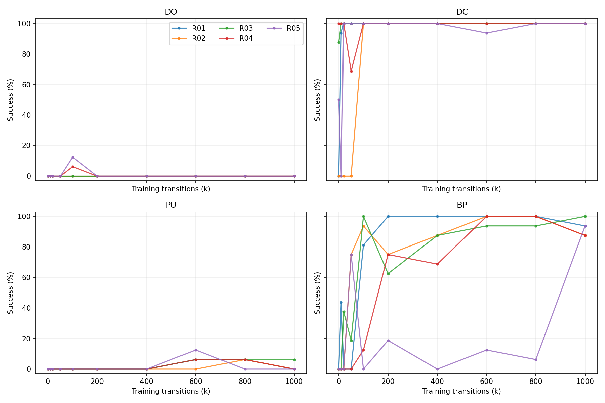
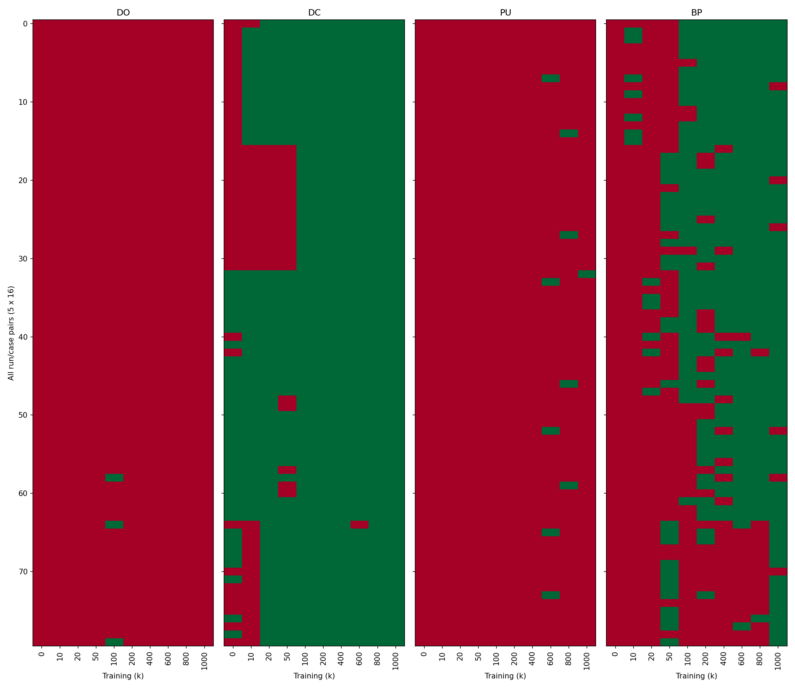
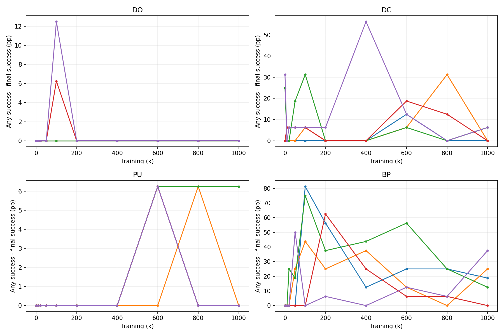
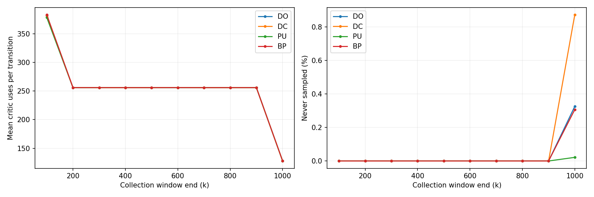
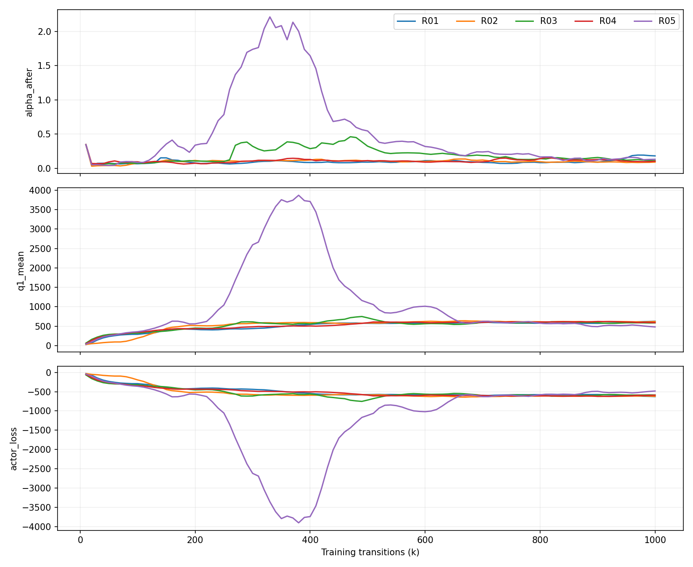

# 기본 SAC 관측 캠페인 보고서

## 1. 실제 완료 범위와 핵심 관측

정상 완료 실행 5/5. 정기 평가 완료 3,200/3,200 에피소드. 실제/보수적 계상 환경 전이 6,604,850/6,710,000. 예정한 관측을 정상 완료했다.

이 캠페인은 하나의 기본 SAC 조건을 관측한다. 특정 방법의 우월성, 재시작 선택 효용, 공유 기초동작, 원인 또는 논문 기여를 확정하지 않는다. 성공률과 현상 발견 여부는 완료 조건이 아니다.

| run_id | completed | failed |
| --- | --- | --- |
| R01 | True | False |
| R02 | True | False |
| R03 | True | False |
| R04 | True | False |
| R05 | True | False |

## 2. 기본 설정과 평가·기록 규약

Meta-World 3.0.0의 drawer-open-v3, drawer-close-v3, push-v3, button-press-v3; 보상은 v2. PU는 Push다. 39개 환경 관측을 float32로 변환하고 4개 과제 one-hot을 붙인 43차원 정책 입력, 정규화 4차원 행동이다. 분리된 actor와 double critic의 256/256 ReLU MLP, Adam, 학습률 0.0003, batch 256, replay 100,000, gamma 0.99, tau 0.005, 자동 entropy를 유지했다. 과제별 head가 없는 공통 과제조건부 정책이다. 8에피소드 블록마다 과제별 두 에피소드를 독립 난수로 섞고, 에피소드당 500 전이를 수집한다. warm-up 1,000도 총량에 포함하며 이후 전이당 한 번의 stock SAC 업데이트를 수행한다. 총길이 의존 스케줄은 없다.

각 과제 16개, 총 64개 물리 초기조건을 정책 결과 관측 전에 동결했다. 5개 독립 초기학습과 3,200개 반복 평가를 독립 표본으로 혼동하지 않는다. 표준 MT10/MT50 전체 goal 평가가 아니다. 평가는 deterministic CUDA이며 최초 성공에서 중단하지 않고 원래 환경의 500-step truncation까지 기록한다. 평가에서 학습·replay 삽입·정규화 갱신은 없다. autoreset은 사용하지 않는다. timeout bootstrap은 원래 구현을 유지한다.

## 3. 과제별·실행별 결과

최종 성공률의 단위는 %이며 각 실행·과제 분모는 표에 명시한다.

| run_id | task_id | completed_episodes | success_any_rate | success_final_rate | return_mean |
| --- | --- | --- | --- | --- | --- |
| R01 | BP | 16 | 93.75 | 75.00 | 3788.31 |
| R01 | DC | 16 | 100.00 | 100.00 | 4851.88 |
| R01 | DO | 16 | 0.00 | 0.00 | 1683.52 |
| R01 | PU | 16 | 0.00 | 0.00 | 22.62 |
| R02 | BP | 16 | 87.50 | 62.50 | 3524.79 |
| R02 | DC | 16 | 100.00 | 100.00 | 4854.73 |
| R02 | DO | 16 | 0.00 | 0.00 | 2256.57 |
| R02 | PU | 16 | 0.00 | 0.00 | 20.12 |
| R03 | BP | 16 | 100.00 | 87.50 | 4206.67 |
| R03 | DC | 16 | 100.00 | 93.75 | 4497.08 |
| R03 | DO | 16 | 0.00 | 0.00 | 2527.76 |
| R03 | PU | 16 | 6.25 | 0.00 | 28.51 |
| R04 | BP | 16 | 87.50 | 87.50 | 3786.98 |
| R04 | DC | 16 | 100.00 | 100.00 | 4866.88 |
| R04 | DO | 16 | 0.00 | 0.00 | 2497.35 |
| R04 | PU | 16 | 0.00 | 0.00 | 23.12 |
| R05 | BP | 16 | 93.75 | 56.25 | 677.53 |
| R05 | DC | 16 | 100.00 | 93.75 | 4581.25 |
| R05 | DO | 16 | 0.00 | 0.00 | 1440.76 |
| R05 | PU | 16 | 0.00 | 0.00 | 20.98 |

전체 시점과 미완료 범위는 cell_metrics.csv에 있다. CI는 이번 요약에서 계산하지 않았다. 개별 실행과 고정 패널에 대한 기술 결과이며 새 seed·새 goal 모집단의 보장으로 해석하지 않는다.

## 4. 사례별 행동 변화

| task_id | valid_case_pair_observations | observed_gains | observed_losses |
| --- | --- | --- | --- |
| BP | 720 | 129 | 55 |
| DC | 720 | 56 | 14 |
| DO | 720 | 3 | 3 |
| PU | 720 | 10 | 9 |

위 건수는 같은 물리 사례의 반복 관측이며 고유 사례 수가 아니다. 모든 인접 시점에서 J 차이=획득−상실을 검산했다. 한 번의 1→0을 영구 능력 소실로 부르지 않는다. 평가 사이의 정확한 최초 상실·회복 시점은 미측정이다.

에피소드 내 원시 성공 상태 이탈은 학습 시점 간 상실과 별도로 집계했다.

| task_id | episodes | any_success | any_but_not_final |
| --- | --- | --- | --- |
| BP | 800 | 397 | 143 |
| DC | 800 | 687 | 53 |
| DO | 800 | 3 | 3 |
| PU | 800 | 10 | 7 |

성공 이후 기록 가능한 범위에서의 실제 관측이다. 접촉은 제어 step 끝의 표본이며 중간 물리 substep 전체의 접촉을 측정한 것이 아니다.

## 5. 경험 사용과 학습 통계

| task_id | transitions | critic_uses | actor_uses | never_sampled | active_censored |
| --- | --- | --- | --- | --- | --- |
| BP | 1250000 | 319934095 | 319934095 | 383 | 125000 |
| DC | 1250000 | 319641026 | 319641026 | 1090 | 125000 |
| DO | 1250000 | 319845994 | 319845994 | 407 | 125000 |
| PU | 1250000 | 319298885 | 319298885 | 27 | 125000 |

각 critic_sample_count는 두 Q망을 사용하는 한 critic 업데이트 배치에서의 사용 횟수다. actor가 같은 배치를 실제 사용한 횟수는 별도 기록했다. 활성 replay 항목의 사용량은 종료 시점에서 우측 절단된다. 250번째 배치 ID와 누적 횟수만으로 모든 배치를 복원했다고 주장하지 않는다.

loss·Q·alpha·gradient norm은 진단값이며 성공 보존이나 수행 능력의 대리 정답이 아니다. 원본 업데이트 스칼라는 각 실행 update_scalars, 분포는 update_summaries에 있다.

## 6. 반복 현상과 경쟁 설명

phenomenon_register.json은 관측 범위와 경쟁 설명을 분리한다. 과제·seed 차이, 동일 사례의 성공 교체, 에피소드 내 성공 이탈, replay 사용의 수집 시기 차이를 각각 확인할 수 있다. 전체 표와 반대·무변화 사례를 보존하며, 평균 개선만으로 공통 기초동작이나 특정 경험의 인과적 유용성을 선언하지 않는다. 이 단계에서 예측 가능한 조건이나 개선 방법을 확보했다고 판정하지 않는다.

## 7. 추가 진단

추가 진단 환경 전이: 0. 잔여 예산은 자동 소진하지 않았다. 진단 계획은 캠페인 diagnostic_plan.jsonl에 있다.

## 8. 비용·기술 한계·미측정

본학습 5,000,000/5,000,000; 정기 평가 1,600,000/1,600,000; 기술·무효·재시도 4,850/10,000; 추가 진단 0/100,000. 완료가 확인되지 않은 issued 전이 0건도 보수적으로 상한에 계상했다.

환경 전이는 실제 개별 환경의 action step이며 reset 내부 물리 계산과 구분한다. reset 횟수는 기술·평가 영수증과 각 실행 비용에 기록했다. reset 내부 solver/kernel 시간은 별도 직접 측정하지 않았다. GPU job 경과 시간은 kernel-only 시간으로 해석하지 않는다. 분포 요약은 원래 텐서에서 추가 표집·backward 없이 계산했다. policy 행동의 sampled log probability는 기존 collection predict 경로에서 계산되지 않아 필수 전이 로그에 임의 생성하지 않았다.

환경 snapshot은 technical_certification.json의 검증 범위로 제한한다. 그 범위를 벗어난 snapshot은 diagnostic_state이며 검증된 재시작 능력으로 부르지 않는다. light는 전체 재개용이 아니며 full은 완료 episode 뒤 일관된 학습 경계에서 model/replay/collector/RNG를 함께 저장했다.

## 9. 후속 질문 후보

반복 성공·실패 교체가 어떤 상태·행동 구간에서 나타나는가, 경험의 수집과 사용 시차가 실제 행동 변화와 어떻게 대응하는가를 현재 기록에서 더 좁힐 수 있다. 상관만으로 원인을 정하거나 새 방법을 채택하지 않는다. 재시작, 복귀, 경험 선택, 스킬 발견은 이번에 실행·검증한 방법이 아니다. 구체적인 관찰과 경쟁 설명을 구분할 필요가 생겼을 때만 별도 후속 명세를 작성한다.

## 재분석 안내

baseline_manifest/config_resolved/input_receipt/seed_manifest/protocol은 캠페인 루트에 있다. 원본 전이는 runs/Rxx의 training_transitions와 evaluation_transitions, 영상은 videos, snapshot과 checkpoint는 해당 디렉터리에 있다. NPZ sidecar JSON에 원본 해시와 공통 식별자를 연결했다. 정규화·좌표·시점·상태 지위는 schema 및 evaluation_cases의 feature_schema에 있다. 대형 원본은 재현 ZIP에 중복 포함하지 않는다.
