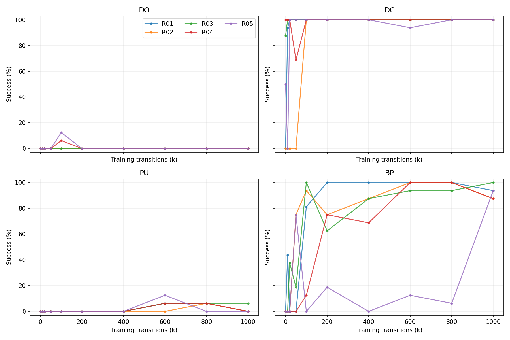

# 기본 학습의 행동·경험 관측

81번은 DO/DC/Push/BP 기본 SAC의 다섯 독립 초기학습을 실행당 총 1M 전이까지 기록한 관측 캠페인이다. 82번은 같은 자료의 탐색 분석이며 별도의 독립 실험이 아니다.

- [81 실험 보고서](81_basic_sac_observation_campaign_v1/results/20261102T085036Z_observation_8e858967/analysis/20261103T000632Z_f77754/report_ko.md)
- [82 탐색 분석 보고서](82_basic_observation_exploratory_report_v1/results/20261103T000931Z_1c0dc354/report_ko.md)
- [공개 자료 범위·재현 안내](../07_operations_and_publication/83_basic_observation_results_publication_v1/results/20261105T024924Z_publication_4f3ebc79/report_ko.md)
- [영상 400개와 대응 수치 궤적 목록](../07_operations_and_publication/83_basic_observation_results_publication_v1/results/20261105T024924Z_publication_4f3ebc79/media_index.csv)

| 과제 | 최종 success_any | 5개 실행 범위 | 최종 시점 success_final |
|---|---:|---:|---:|
| DrawerClose | 100% | 100% | 97.5% |
| ButtonPress | 92.5% | 87.5–100% | 73.75% |
| DrawerOpen | 0% | 0% | 0% |
| Push | 1.25% | 0–6.25% | 0% |

과제당 고정된 16개 물리 초기조건을 모든 실행·시점에서 공유한다. 표의 평균은 5개 실행의 평균이며 표준 Meta-World 전체 goal 평가가 아니다. 신뢰구간은 계산하지 않았다.

BP의 80개 실행×사례 이력 중 45개에서 후속 평가의 실패, 41개에서 이후 관측된 회복이 있었다. 이 수는 80개의 독립 초기조건 또는 영구적 능력 상실 건수가 아니다. 한 에피소드 안의 성공 상태 이탈과 학습 시점 사이의 성공 상실을 구분한다.

학습 5M, 정기 평가 1.6M, 기술 검사 4,850으로 총 6,604,850 전이를 사용했다. 추가 진단은 0이며 6.71M 상한 이내다. 유용한 기초동작·원인·경험 선택 방법을 확인한 결과는 아니다.

원본 보고서·분석 코드·표·그림·재현 ZIP은 원문 bytes를 유지했다. 전체 훈련 전이·모델·replay·상세 업데이트 로그와 중간 환경 snapshot은 로컬 보관이며 이 GitHub 게시본에 포함되지 않는다. 누락 범위와 해시 출처는 공개 자료 범위 문서를 따른다.
