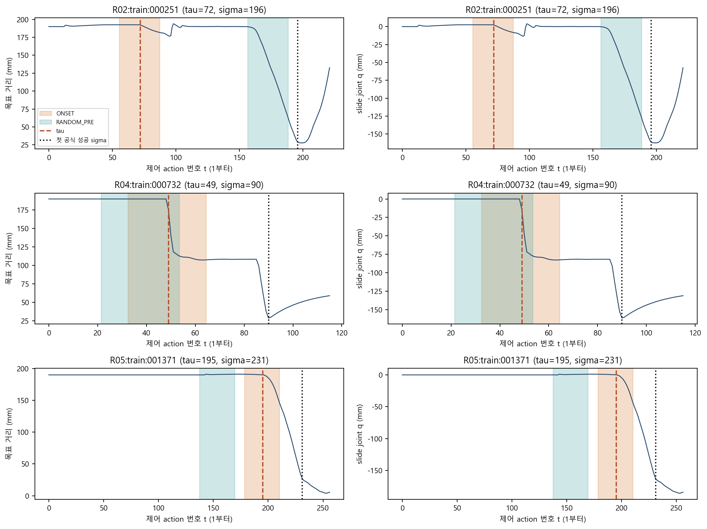
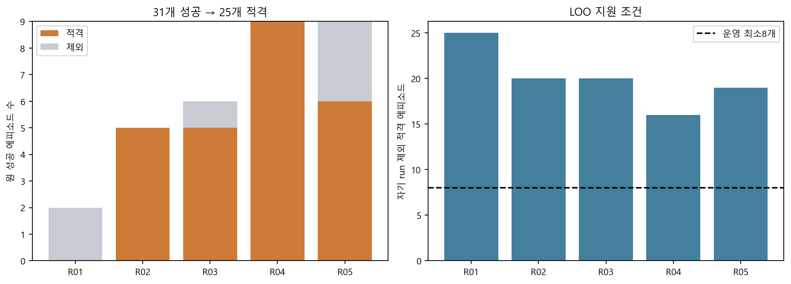
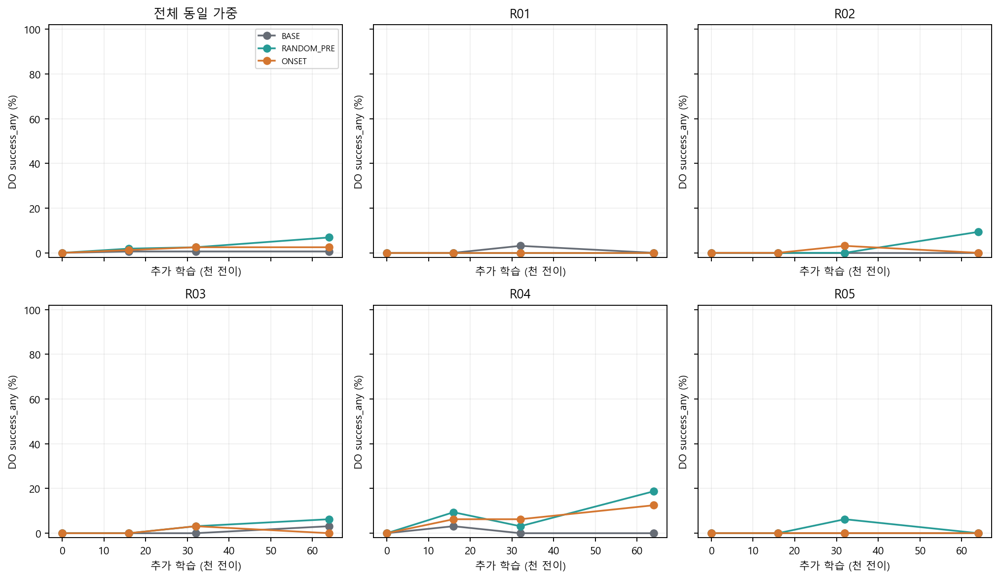
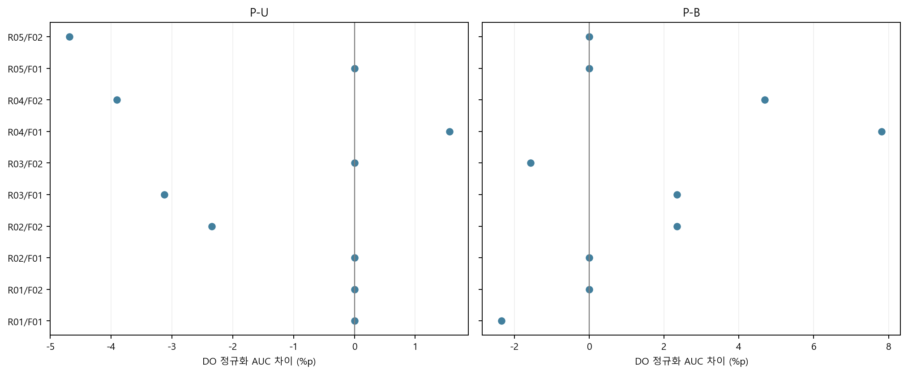
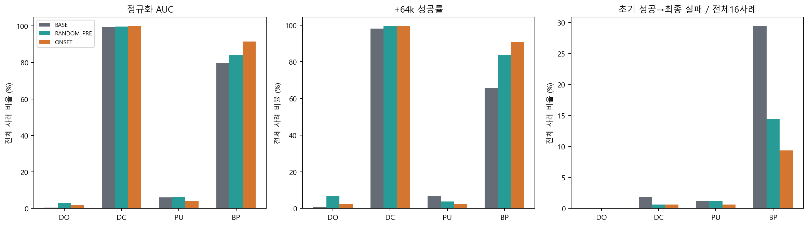
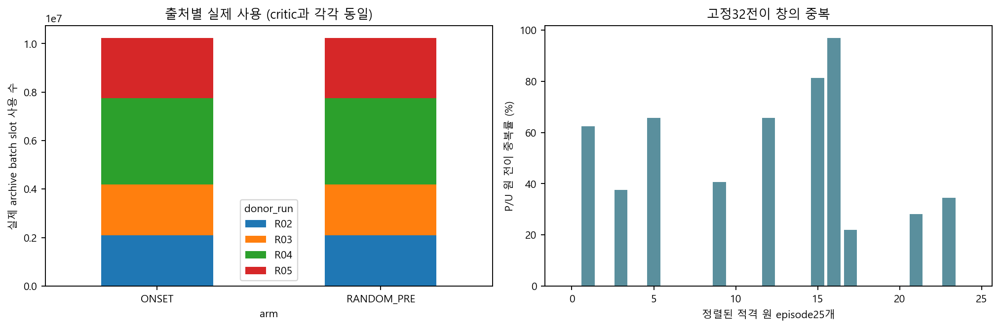

# DO 진행 시작 구간 재사용 파일럿 — 한국어 결과 보고서

## 1. 실제 완료 범위와 핵심 관측

본실험 30/30분기, 공통 시작 평가 5/5부모, 신규 평가 6,080/6,080에피소드를 완료했다. 신규 본학습은 네 과제 합계1,920,000전이이며 모든 분기는 같은 부모의 실제1M full 상태를 다시 복원했다. 81/82/84는 같은 과거 캠페인의 관측/사후분석이고, 이번85는 그 저장소를 활용한 새 추가학습 파일럿이다.

- 원 DO 성공31개에서 명목 검출기와 W32 경계를 통과한 적격25개를 확보했다. LOO별25/20/20/16/19개로 모든 준비 기준을 통과했다.
- DO AUC의 ONSET−RANDOM_PRE는 -1.250%p, 부모 bootstrap 분위 범위 [-1.875, -0.547]%p다. 양의 부모는 0/5개다.
- ONSET−BASE는 +1.328%p, 같은 범위 [-0.469, +3.828]%p다. 양의 부모는 3/5개다.
- 다른 세 과제 평균 AUC의 ONSET−BASE는 +3.490%p, 네 과제 macro는 +2.949%p다.
- 사전 명목 운영 신호 판정: **nominal_pilot_signal_not_met**. 이는 우위·일반화·방법 완성의 확증 판정이 아니다.

RANDOM_PRE의 BASE 대비 점추정은 양수이지만 onset 선택의 추가 이득은 지지되지 않는다. 성공 이전 자료 재사용 자체와 onset 규칙의 가치를 구분하고, 이번 결과에서 승자를 골라 확인한 방법으로 제시하지 않는다. onset 경로 확대는 보류한다.

| 비교 | DO_AUC차이_pp | 분위하한_pp | 분위상한_pp | 양의부모수 | LOPO최소_pp | LOPO최대_pp |
| --- | --- | --- | --- | --- | --- | --- |
| P-U | -1.250 | -1.875 | -0.547 | 0 | -1.562 | -0.977 |
| P-B | 1.328 | -0.469 | 3.828 | 3 | 0.098 | 1.953 |
| U-B | 2.578 | 0.234 | 5.312 | 4 | 1.367 | 3.516 |

위 범위는 부모5개의 구성 민감도를 나타내는 명목95% bootstrap 분위 범위다. 중첩된 고정 LOO 저장소와 기존 개발 패널에 조건화하며, 모집단95% 보장이나 독립 평가 사례 일반화를 뜻하지 않는다.

## 2. 기본 설정과 초기 좌표 매핑 정정

DO/DC/Push/BP의 기존 uniform 네 과제 SAC를 유지했다. 부모당 F01/F02, BASE/RANDOM_PRE/ONSET이며 분기64k는 네 과제 합계다. 원 batch256에서 DO slot만 독립 확률0.25로 archive 전이와 교체했다. 최종 같은 batch를 actor/critic/alpha가 사용했으며 별도 BC/KL, 추가 optimizer step, reward 변경, online replay 삽입, curriculum 및 상태 재시작은 없다. lr0.0003, gamma0.99, tau0.005, replay100k 및 원 timeout bootstrap을 유지했다.

처음에는 reset 반환 관측의 object X를 현재 물리 handle X로 사용해 적격9개로 계산했다. 이후 제외20개가 모두 첫 action의 X좌표 변화이고 joint는 사실상 정지한 점을 발견했다. 저장된 초기 물리 snapshot66개(평가16개, 사전 표집 훈련50개)의 모델 위치·integration qpos·고정 XML을 파일만으로 대조해, reset가 drawer 모델 X를 바꾼 뒤 반환 관측에는 이전 forward의 X가 남는 것을 확인했다. 원 관측을 실제 reset 물리 좌표와 혼동한 입력 매핑을 수정했다.

고정 slide의 실제 초기 handle은 `h0=goal+[0,0.19+q0,0]`이며 q0는 저장 reset Y와 XML에서 산술 복원했다. 실제 저장 reset qpos와의 최대 오차는9.365e-17m다. x1로 대체하지 않았으며 새 환경/forward를 실행하지 않았다. 명세가 허용한 단위·시점 매핑 오류 수정이고, 모든 문턱·창·원 obs/action/reward 및 이후 물리 표본은 유지했다. 수정 전 준비·독립 검산과 수정 근거는 별도 출력에 보존했다. 이 오류는 어떤 branch 학습 결과도 보기 전에 수정했다. 원81/82/84 보고서와 원 관측은 덮어쓰지 않았다.

과거 raw reset 거리 기준의 작은 진행에는 이 X 정렬 변화가 포함될 수 있어, 그것을 곧바로 drawer의 실제 개방 진행으로 읽지 않는다. 이번 DO 물리 진행 표는 위 산술 물리 x0 기준과 raw 관측 기준을 별도 열로 보존했다. 공식 성공 라벨은 변경하지 않았다.

같은 원1M 정책·사례의 신규 공통 +0 평가80회를 대조한 결과, 기존 raw reset 관측 기준5mm 진행은63/80, 물리적으로 일치하는 x0 기준은14/80이었다. 49회는 raw 기준에서만 진행으로 잡혔다. 따라서 이전63/80을 실제 서랍 진행의 빈도로 읽은 해석은 정정한다. 공식 성공0/80, 원 return/성공 라벨 및 원 보고서는 변하지 않는다. 정정 영수증은 campaign의 `verification/*_initial_geometry_*/correction_summary.json`과 개별80사례 표다.

실제로 적용한 난수 역할은 `effective_rng_streams.json`에 기록했다. rollout은 keyed PyTorch fork, native replay는 분리한 기존 NumPy 경로, learner actor/target action은 원 PyTorch update stream이다. 평가는 원 고정 case별 reset/action seed를 사용하고, 영상 표집은 고정 case와 stride를 따른다. 새로 파생해 둔 evaluation/logging seed는 이 결정론적 경로에서는 사용하지 않았다.

소스·좌표 정정 근거: `C:\Users\SS\Projects\robot_practice_allocation\85_onset_reuse_pilot_v1\results\20261106T040755Z_initial_state_mapping_audit_44a7c57f`. 최신 유효 준비: `C:\Users\SS\Projects\robot_practice_allocation\85_onset_reuse_pilot_v1\results\20261106T040844Z_preparation_31c9735e`. 기술 검증: `C:\Users\SS\Projects\robot_practice_allocation\85_onset_reuse_pilot_v1\results\20261106T041847Z_technical_validation_4f512db1`. 모든 +0 평가의 성공·끝 성공·길이·return은 원1M 전체64사례와 정확히 일치했다.

## 3. 적격 자료와 무작위 대조의 내용

| donor_run | successful_episodes | eligible_episodes |
| --- | --- | --- |
| R01 | 2 | 0 |
| R02 | 5 | 5 |
| R03 | 6 | 5 |
| R04 | 9 | 9 |
| R05 | 9 | 6 |

| parent_id | raw_LOO_successes | eligible_episodes | donor_runs_with_at_least_two | transitions_per_arm | mean_P_U_overlap_fraction |
| --- | --- | --- | --- | --- | --- |
| R01 | 29 | 25 | 4 | 800 | 0.214 |
| R02 | 26 | 20 | 3 | 640 | 0.217 |
| R03 | 25 | 20 | 3 | 640 | 0.214 |
| R04 | 22 | 16 | 3 | 512 | 0.168 |
| R05 | 22 | 19 | 3 | 608 | 0.248 |

검출 후보는 직전 joint 거의 정지, 첫 거리 감소, 8-action5mm 진행, 이후3개 표본에서2.5mm 이상 유지 및 joint 개방 방향 일치로 정의했다. 최초 후보 뒤 다른 후보로 바꾸지 않았다. 32전이는0.4초이며 전후 각16전이0.2초다. 대표 제외는 후보 없음2개와 창이 첫 공식 성공에 닿음4개다. 적격 자료만의 결과이며 느린/빠른/경계 진행 전체를 대표하지 않는다.

| arm | 에피소드수 | 창시작평균 | 첫성공까지평균잔여step | 최초action포함창수 | 평균보상 | 평균목표거리_m | 평균접촉step |
| --- | --- | --- | --- | --- | --- | --- | --- |
| ONSET | 25 | 153.080 | 47.280 | 0 | 3.397 | 0.176 | 21.160 |
| RANDOM_PRE | 25 | 108.080 | 92.280 | 0 | 3.435 | 0.167 | 18.800 |

같은 원 episode에 P/U 각각 고정 창 하나를 사용했다. U는 sigma 이전 창 시작점의 균일 추출이며 모든 prefix 전이의 동일 포함 확률을 뜻하지 않는다. P/U 중복은 허용하고 재추출하지 않았다. 부모별 donor 수와 시간·상태·행동·보상 분포가 함께 달라지는 선택 규칙 전체의 비교다. 원 성공 자료가 모든 현재 정책에 최적 행동이라는 가정은 하지 않았다.

고정 ID 정렬의 첫 대표 `R02:train:000251`은 선택된 초기 진행 뒤 다시 닫힌 위치 쪽으로 돌아갔다가, 이후의 더 큰 진행에서 첫 성공을 보인다(그림1). 따라서 이번 최초 onset가 항상 최종 성공으로 이어지는 마지막 진행의 시작인 것은 아니다. 이것만으로 해당 경험이 해롭거나 불필요하다고 판정하지 않으며, 성공 episode 내부에도 서로 다른 국소 경로가 포함된다는 내용상의 제한으로 남긴다. 이 사례를 이유로 episode를 제외하거나 다음 onset를 대신 선택하지 않았다.

## 4. 과제별 학습 곡선과 대응 효과

아래 AUC 및 최종 성공률은 %다. AUC는 [0.125,0.25,0.375,0.25] 가중이며 실제4시점 사이를 선형 연결한 요약이다.

| task_id | arm | AUC | 최종성공률 |
| --- | --- | --- | --- |
| BP | BASE | 79.531 | 65.625 |
| BP | ONSET | 91.562 | 90.625 |
| BP | RANDOM_PRE | 83.984 | 83.750 |
| DC | BASE | 99.531 | 98.125 |
| DC | ONSET | 99.844 | 99.375 |
| DC | RANDOM_PRE | 99.609 | 99.375 |
| DO | BASE | 0.547 | 0.625 |
| DO | ONSET | 1.875 | 2.500 |
| DO | RANDOM_PRE | 3.125 | 6.875 |
| PU | BASE | 6.094 | 6.875 |
| PU | ONSET | 4.219 | 2.500 |
| PU | RANDOM_PRE | 6.172 | 3.750 |

부모 안 두 미래, 이후 다섯 부모를 동일 가중했다. 부모별 DO AUC 차이(%p)는 다음과 같다.

| parent_id | P-B | P-U | U-B |
| --- | --- | --- | --- |
| R01 | -1.172 | 0.000 | -1.172 |
| R02 | 1.172 | -1.172 | 2.344 |
| R03 | 0.391 | -1.562 | 1.953 |
| R04 | 6.250 | -1.172 | 7.422 |
| R05 | 0.000 | -2.344 | 2.344 |

5부모×2미래의 모든 DO 대비(%p):

| parent_id | future_id | contrast | delta_auc | delta_final |
| --- | --- | --- | --- | --- |
| R01 | F01 | P-U | 0.000 | 0.000 |
| R01 | F01 | P-B | -2.344 | 0.000 |
| R01 | F02 | P-U | 0.000 | 0.000 |
| R01 | F02 | P-B | 0.000 | 0.000 |
| R02 | F01 | P-U | 0.000 | 0.000 |
| R02 | F01 | P-B | 0.000 | 0.000 |
| R02 | F02 | P-U | -2.344 | -18.750 |
| R02 | F02 | P-B | 2.344 | 0.000 |
| R03 | F01 | P-U | -3.125 | -12.500 |
| R03 | F01 | P-B | 2.344 | 0.000 |
| R03 | F02 | P-U | 0.000 | 0.000 |
| R03 | F02 | P-B | -1.562 | -6.250 |
| R04 | F01 | P-U | 1.562 | -6.250 |
| R04 | F01 | P-B | 7.812 | 25.000 |
| R04 | F02 | P-U | -3.906 | -6.250 |
| R04 | F02 | P-B | 4.688 | 0.000 |
| R05 | F01 | P-U | 0.000 | 0.000 |
| R05 | F01 | P-B | 0.000 | 0.000 |
| R05 | F02 | P-U | -4.688 | 0.000 |
| R05 | F02 | P-B | 0.000 | 0.000 |

P-U: 미래별10개 대응값에서 양/0/음=1/5/4; 부모평균 양=[], 음=['R02', 'R03', 'R04', 'R05']. P-B: 미래별10개 대응값에서 양/0/음=4/4/2; 부모평균 양=['R02', 'R03', 'R04'], 음=['R01'].

LOPO는 해당 receiver의 집계만 제외하며, 다른 receiver 저장소에 남아 있는 donor 자료까지 제거한 검증이 아니다. 부모 상태와 LOO 자료가 함께 달라지므로 차이를 출발 상태 하나의 원인으로 설명할 수 없다. 조건 차이에서 공통 +0 점수는 상쇄되며 시작 점수로 부모를 선택하지 않았다.

## 5. 다른 과제와 기존 성공의 유지·획득·상실

합계 분모는 각 task×arm의10개 부모×미래 패널, 160개의 대응 실행–사례 관측이다. 고유 물리 사례는 task당16개이고 독립 초기 학습기는5개다. G/L은 각 고정16사례를 분모로 한 평균 %p이며, 초기 성공 조건부 비율과 다르다.

| task_id | arm | 초기성공합 | 최종성공합 | 획득합 | 상실합 | G | L |
| --- | --- | --- | --- | --- | --- | --- | --- |
| BP | BASE | 148 | 105 | 4 | 47 | 2.500 | 29.375 |
| BP | ONSET | 148 | 145 | 12 | 15 | 7.500 | 9.375 |
| BP | RANDOM_PRE | 148 | 134 | 9 | 23 | 5.625 | 14.375 |
| DC | BASE | 160 | 157 | 0 | 3 | 0.000 | 1.875 |
| DC | ONSET | 160 | 159 | 0 | 1 | 0.000 | 0.625 |
| DC | RANDOM_PRE | 160 | 159 | 0 | 1 | 0.000 | 0.625 |
| DO | BASE | 0 | 1 | 1 | 0 | 0.625 | 0.000 |
| DO | ONSET | 0 | 4 | 4 | 0 | 2.500 | 0.000 |
| DO | RANDOM_PRE | 0 | 11 | 11 | 0 | 6.875 | 0.000 |
| PU | BASE | 2 | 11 | 11 | 2 | 6.875 | 1.250 |
| PU | ONSET | 2 | 4 | 3 | 1 | 1.875 | 0.625 |
| PU | RANDOM_PRE | 2 | 6 | 6 | 2 | 3.750 | 1.250 |

ONSET−BASE의 task별 AUC 차이와 부모 bootstrap 분위 범위(%p):

| scope | estimate | lower | upper |
| --- | --- | --- | --- |
| DO | 1.328 | -0.469 | 3.828 |
| DC | 0.312 | -0.469 | 1.406 |
| PU | -1.875 | -4.062 | 0.312 |
| BP | 12.031 | 2.656 | 24.531 |
| OTHER3 | 3.490 | -0.599 | 8.229 |
| MACRO4 | 2.949 | -0.254 | 6.543 |

초기 성공 중 BASE만 최종 성공한 추가 상실 H와 ONSET만 최종 성공한 상실 회피 B를 분리하면 다음과 같다. 이는 대응 실행–사례 합계이며 고유 물리 사례 수를 늘린 값이 아니다.

| task_id | 초기성공위험관측수 | 추가상실_H | 상실회피_B |
| --- | --- | --- | --- |
| BP | 148 | 1 | 33 |
| DC | 160 | 1 | 3 |
| DO | 0 | 0 | 0 |
| PU | 2 | 0 | 1 |

DO의 공통 시작 성공 수가0이면 초기 성공 유지/상실의 조건부 분모는0/NA다. 이를 능력 보존 성공으로 쓰지 않는다. DC/PU/BP 상실도 모두 보고했다. 이번 사전 비교는 P−U/P−B/U−B 세 쌍이며 각 초기 성공/실패 집합의 양방향 불일치는 `paired_case_discordance.csv`에 모두 있다.

학습 checkpoint 사이 사건 수와 해당 이력 수:

| task_id | arm | gain_events | loss_events | recovery_events | histories_with_loss | histories_with_observed_recovery |
| --- | --- | --- | --- | --- | --- | --- |
| BP | BASE | 32 | 75 | 20 | 69 | 20 |
| BP | ONSET | 34 | 37 | 22 | 37 | 22 |
| BP | RANDOM_PRE | 34 | 48 | 24 | 45 | 24 |
| DC | BASE | 0 | 3 | 0 | 3 | 0 |
| DC | ONSET | 0 | 1 | 0 | 1 | 0 |
| DC | RANDOM_PRE | 1 | 2 | 1 | 2 | 1 |
| DO | BASE | 3 | 2 | 0 | 2 | 0 |
| DO | ONSET | 10 | 6 | 0 | 6 | 0 |
| DO | RANDOM_PRE | 18 | 7 | 1 | 7 | 1 |
| PU | BASE | 29 | 20 | 1 | 20 | 1 |
| PU | ONSET | 20 | 18 | 1 | 18 | 1 |
| PU | RANDOM_PRE | 26 | 22 | 1 | 22 | 1 |

회복은 관측된 성공→실패 구간 후 재성공이며 영구 능력 회복이 아니다. 에피소드 내 목표 이탈과 학습 시점 사이 상실은 별도 열이다. 학습 시점 사이 정확한 발생 시점은 미측정이다. 소수 평가의 변화가 곧 영구 기능 소실을 뜻하지 않는다.

## 6. 노출 검산과 해석 범위

원 native draw와 교체 후 actual use를 구분했다. 같은 최종 batch의 actor/critic 사용은 각각1회이며 critic 두 개로 두 배 계산하지 않았다. P/U 대응 난수·교체 mask는 `paired_exposure_checks.csv`, 시점별 실제 누계와 출처는 `archive_usage_by_checkpoint.parquet`에 있다. 실제 학습 상태에서 관측된 loss/Q/alpha는 원 로그에 보존했고 새 진단 forward/backward는 하지 않았다.

DO의 연속 물리 진행 지표는 다음과 같다. 성공 여부는 이 평균값이나 반올림한 joint에서 역산하지 않고 원 공식 flag를 사용한다.

| arm | relative_train_step | 에피소드수 | 최소목표거리평균_mm | 최대목표진행평균_mm | 최소joint평균_mm |
| --- | --- | --- | --- | --- | --- |
| BASE | 16000 | 160 | 185.967 | 4.033 | -4.033 |
| BASE | 32000 | 160 | 182.004 | 7.996 | -8.315 |
| BASE | 64000 | 160 | 186.294 | 3.706 | -3.706 |
| ONSET | 16000 | 160 | 177.939 | 12.061 | -12.117 |
| ONSET | 32000 | 160 | 179.330 | 10.670 | -10.850 |
| ONSET | 64000 | 160 | 182.286 | 7.714 | -7.766 |
| RANDOM_PRE | 16000 | 160 | 183.250 | 6.750 | -6.957 |
| RANDOM_PRE | 32000 | 160 | 179.183 | 10.817 | -10.817 |
| RANDOM_PRE | 64000 | 160 | 171.244 | 18.756 | -19.912 |
| SHARED_START | 0 | 80 | 187.505 | 2.495 | -2.495 |

정적 source/XML 기하에서 닫힌 handle–goal 거리는 약0.19m, slide joint 범위는[-0.16,0]m이며 명목 하한의 목표 거리는0.03m로 공식 성공 경계와 같다. 이는 완료 판정이 개방 끝 경계에 놓인다는 진단적 맥락이다. 실제 soft constraint와 endpoint 관측이 우선하며, 이 산술만으로 실패 원인이나 환경 오류를 확정하지 않는다.

물체 변화의 원인이 해당 action이라는 주장은 식별되지 않는다. onset의 위치, 상태 난도, 보상, 행동 내용 및 현재 정책과의 거리 등이 함께 달라질 수 있다. 구간 전이를 개별 표집했으므로 순서 학습이나 재사용 가능한 실행 스킬을 확인한 것이 아니다. 저장소 확보 비용을 이미 지불한 조건의 추가 재사용 가치이며, 종단 간 수렴 효율이나 다른 task의 보편적 선택 원리를 확인한 것도 아니다.

## 7. 운영 판정과 다음 결정

명목 기준의 개별 충족 여부:

| 기준 | 충족 |
| --- | --- |
| DO_PU_at_least_2pp | False |
| DO_PB_at_least_2pp | False |
| at_least_four_positive_parents_PU | False |
| at_least_four_positive_parents_PB | False |
| all_LOPO_PU_positive | False |
| all_LOPO_PB_positive | True |
| other_three_mean_at_least_minus1pp | True |
| each_other_task_at_least_minus3pp | True |
| macro_four_nonnegative | True |
| valid_complete_design | True |

현재 다음 결정: RANDOM_PRE의 BASE 대비 점추정은 양수이지만 onset 선택의 추가 이득은 지지되지 않는다. 성공 이전 자료 재사용 자체와 onset 규칙의 가치를 구분하고, 이번 결과에서 승자를 골라 확인한 방법으로 제시하지 않는다. onset 경로 확대는 보류한다.

효과가 양수인 부모뿐 아니라 0·음수 부모/미래를 위 표에 모두 포함했다. 범위가0을 포함하는 것을 동등성·무해성으로 해석하지 않는다. 기준을 충족하더라도 고정 규칙의 후속 독립 확인을 검토할 신호이고, 충족하지 못했더라도 큰 연구 방향 전체의 부재를 뜻하지 않는다. 이번 검출기·W32·대체율0.25·1M 출발·64k 예산·고정 저장소/패널에서의 한계다.

후속을 자동 실행하지 않는다. 우선순위는 최대 다음3개다: (1) P−U와 P−B 및 다른 task의 손익을 함께 근거로 동일 고정 규칙을 새 학습 실행/미사용 초기조건에서 확인할 가치 판단, (2) 효과가 donor/receiver에 집중됐다면 자료 구성과 학습기 차이를 구분할 제한된 대조 설계, (3) 최초 진행과 이후 진행의 차이를 구분할 필요가 남는 경우에만 새로운 단일 대조를 별도 명세. 창·비중·seed sweep이나 새 모델은 이번 결과에 자동 추가하지 않는다.

## 8. 실제 비용·실패·저장·미측정

| category | issued | completed |
| --- | --- | --- |
| post_eval | 2880000 | 2880000 |
| start_eval | 160000 | 160000 |
| technical | 4900 | 4900 |
| train | 1920000 | 1920000 |

신규 실제 issued/completed는 4,964,900/4,964,900, 총상한4,970,000, 잔여5,100전이다. 기술/실패/재시도 공유10k 중 기술 4,900전이를 계상했다. 원 캠페인6,604,850은 추가 비용에 다시 넣지 않았으며 장부상 기존+신규 합계는11,569,750다. archive 재사용 draw는 신규 환경 전이가 아니다. reset 내부 물리 계산·GPU kernel-only 시간은 환경 전이 수에 포함하지 않았으며 별도 미계측 항목이다. 프로세스 wall/CPU/메모리/I/O, checkpoint 저장 시간·크기와 최종 원자료 크기 목록은 실행/저장 영수증을 따른다.

정상 +0 및 본분기 큐의 실제 경과 시간은 6.868시간이다. 2개 작업을 병행했으며, 중첩되는 개별 작업 wall 합계는 13.379시간, 기록된 평가 에피소드 시간 합계는 1.766시간이다. 이 시간들을 서로 더하지 않는다. GPU는 NVIDIA GeForce RTX 3070다. 호스트 프로세스별 최대 working set의 최대값은 4.409GiB이며 GPU VRAM이 아니다. 정상 작업의 OS I/O 읽기/쓰기 누계는 각각 30.691/30.771GiB다.

추가 full checkpoint 480회의 실제 저장 시간 합계는 390.781초다. outer reset/환경 생성 및 step 호출 시간은 `compute_resources.json`, 개별 작업 wall/CPU/메모리/I/O는 `job_resource_costs.jsonl`에 수록했다. 평가 시간에는 영상과 I/O가 포함된다. 렌더링 단독 시간, GPU VRAM peak, kernel-only 시간, reset 내부 물리 계산량은 별도 분리 측정하지 않았다. 이 추가 집계도 저장 영수증만 읽었으며 환경/정책 실행은0이다.

4k마다 원 검증 형식의 추가 full 상태를 저장해 기술 여유 안에서 복구할 수 있는 경계를 확보했다. +16k/+32k light와 +64k full을 포함한다. 비검증 delta 형식을 도입하지 않았다. 기존 자료를 삭제하거나 덮어쓰지 않았다. 영상은 최종 정기 평가 중 원 패널의 과제별 사전2사례에만 붙이며 추가 rollout은 없다.

첫 ONSET 셀의 사전 고정4k full 상태는 양의 archive 사용 누계를 포함한 채 다시 로드해 전체 fingerprint 일치를 확인했다. 이 추가 저장 상태 검사는 정책 forward·환경 reset/step·학습 업데이트0이며, 실제 모델 로드1회와 계산 시간은 별도 영수증에 있다.

보조 파일 감사의 첫 시도에서는 현재 루트 AGENTS.md를 원81 당시 문서 hash와 동일해야 하는 런타임 자산처럼 검사해 실패했다. 이후 변경 가능한 작업 규칙/인덱스와 고정 구현·환경 자산을 구분해 차이를 기록했고, 원 참조463개의 구현·패키지 source·XML/mesh hash와 archive 행동 변환 검사를 통과했다. 이 파일 감사 실패와 수정 전 초기 좌표 준비 시도는 모두 보존했으며 신규 환경 비용은0이다. 이는 실패한 branch를 삭제하거나 seed를 바꾼 재실행이 아니다.

## 9. 재분석과 원본 참조

원 캠페인 `C:\Users\SS\Projects\robot_practice_allocation\81_basic_sac_observation_campaign_v1\results\20261102T085036Z_observation_8e858967`. 새 캠페인 `C:\Users\SS\Projects\robot_practice_allocation\85_onset_reuse_pilot_v1\results\20261106T042248Z_onset_campaign_24d98d21`. 고정 실행계획/seed/source는 그 루트, 원 branch 기록·체크포인트·평가 수치는 `jobs/<cell>/<attempt>`에 있다. 분석/검산은 파일 전용이며 모델 역직렬화·정책 forward·환경 reset/step·학습 업데이트 추가0이다.

재실행은 `analysis_tools/analyze.py --campaign <campaign>` → `analysis_tools/verify.py --analysis <new analysis>` → `analysis_tools/finalize.py --analysis <new analysis>` 순서다. 과거 결과를 덮어쓰지 않는 새 출력 ID가 필요하다. 코드·명세·입력 hash와 표/그림의 작은 ZIP을 제공하고, 대형 checkpoint·archive 원본·궤적·영상은 절대 경로와 hash로 연결한다.

참고 맥락: [Demo-SCORE](https://arxiv.org/html/2503.03707v2), [CUPID](https://proceedings.mlr.press/v305/agia25a.html), [SAC](https://arxiv.org/abs/1801.01290), [Meta-World 평가](https://metaworld.farama.org/evaluation/evaluation/). 자료 정제·replay 자체의 신규성을 주장하지 않으며 이 선행들의 완전 재현/대체 성능 비교도 아니다. 실행 권위는 실제 원 캠페인의 고정 코드/의존성/자산 hash다.

적격 ID 정렬의 처음/중간/마지막 3개. 원 제어 step, 단위 mm. x0 물체 위치는 고정 XML·goal·reset joint에서 산술 복원했다. W32=0.4초이며 P/U 모두 sigma 이전 원 전이32개다. 접촉은 적격 조건이 아니다.

독립 donor run5개의 성공 수와 적격 수, receiver별 LOO 지원. 운영 최소8개 및 2 donor×2개 조건은 검정력 보장이 아니다. 대표 제외 사유: onset 없음2개, W32가 첫 성공에 닿음4개.

4개 실제 평가 시점의 선형 연결. 원래 시작 분포의 고정16사례, 부모별 두 미래 동일 가중, 전체 부모5개 동일 가중. 연속 시간의 곡선이나 수렴 시점을 관측한 것은 아니다.

5부모×2미래 대응 점추정 전체10개. 각 점은16개 동일 물리 사례 평가를 사용한다. 10개 독립 초기학습으로 세지 않는다. 부모 단위 bootstrap 범위는 본문 표의 별도 민감도 요약이다.

네 과제별 전체 부모·미래 동일 가중 요약. 세 번째 패널은 전체16사례 분모의 상실이며 초기 성공 조건부 비율과 다르다. DO 초기 성공 수0이면 그 조건부 비율은 NA다.

최종 실제 actor/critic 사용량은 교체를 마친 batch 기준이며 critic 두 개로 배수 계산하지 않는다. archive draw는 새 환경 전이가 아니다. 중복은 허용했고 재추출하지 않았다.

원본 중복 압축 없이 참조하는 신규 job 산출물은 32,785개, 총 25.561GiB다. source_snapshot 중복과 캠페인 외부의 원 부모/archive는 이 합계에서 제외했다. 파일별 SHA256은 `large_artifact_references.jsonl`을 따른다.
