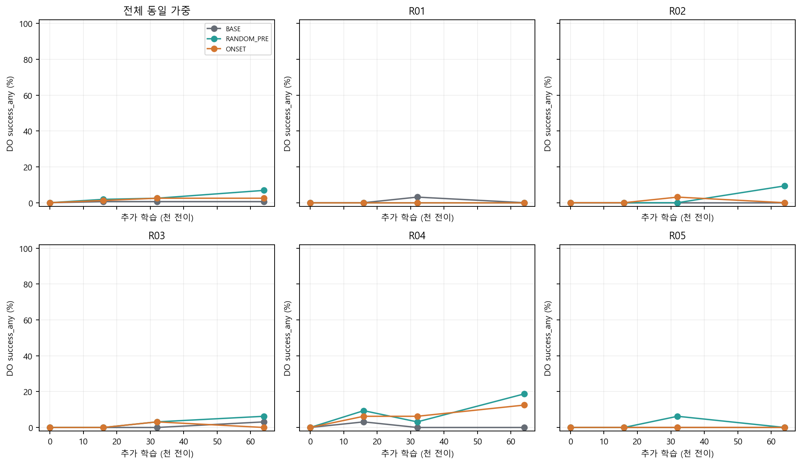

# 경험 구간 재사용 파일럿

같은 성공 에피소드에서 어떤 구간을 SAC에 재사용할 때 추가 학습에 도움이 되는가?

- [85번 결과·공개 자료 안내](85_onset_reuse_pilot_v1/PUBLICATION_README_ko.md)
- [원문 한국어 보고서](85_onset_reuse_pilot_v1/results/20261106T042248Z_onset_campaign_24d98d21/analysis/20261106T111509Z_paired_3db89d3f/report_ko.md)
- [관련 원81·82 관측](../08_basic_learning_observations/README.md)

85는 ONSET/RANDOM_PRE/BASE30분기를 모두 완료했다. DO AUC의 ONSET−RANDOM_PRE는−1.250%p, ONSET−BASE는+1.328%p다. 명목 후속 신호 기준은 미충족이며, 고정 저장소/기존16사례 패널의 파일럿이다. 추가 학습에서의 보편적인 경험 선택법이나 기초동작을 찾았다고 주장하지 않는다.

