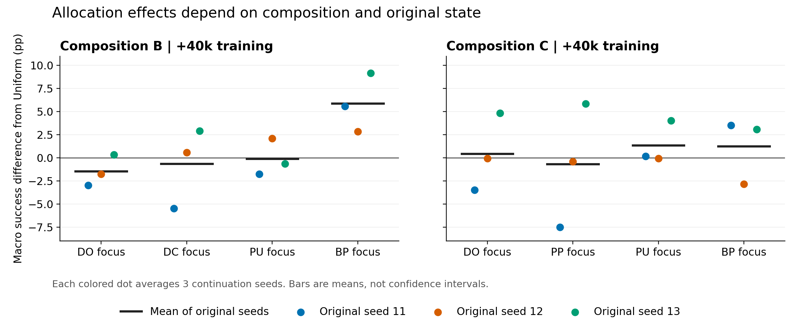
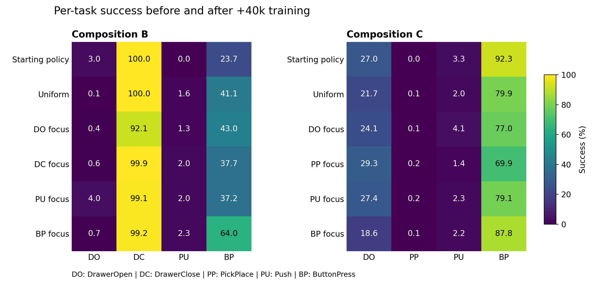

# E3 과제 구성 변경 실험의 완료 결과

**E3는 2026년 10월 14일 오전 1시 27분 KST에 완료됐다.** B 조합에서는 ButtonPress 집중이 Uniform보다 평균 +5.86%p 좋았고, 세 원래 seed에서 모두 이득이 있었다. C 조합에서는 좋은 배분이 seed에 따라 달랐으며, 모든 배분의 조합 평균이 사전학습 checkpoint보다 낮았다. 따라서 E3는 배분의 구성 의존성과 유지 손실을 보여주지만, 복잡한 선택기가 필요하다거나 비용을 포함해 이긴다는 결과는 아니다.

## 실행과 검증 범위

| 항목 | 완료 결과 |
| --- | --- |
| B 구성 | DrawerOpen, DrawerClose, Push, ButtonPress |
| C 구성 | DrawerOpen, PickPlace, Push, ButtonPress |
| 원래 사전학습 seed | 각 구성에서 11·12·13 |
| 출발점 | 각 구성·seed의 Uniform 200k 전체 checkpoint |
| 후속 seed | 2301·2302·2303 |
| 후보 배분 | Uniform와 과제별 집중 4개 |
| 집중 배분 | 해당 과제 62.5%, 다른 과제 각각 12.5% |
| 추가 학습 | 분기당 40k, 보조 평가 20k |
| 완료 분기 | 2구성 × 3원래 seed × 3후속 seed × 5배분 = 90개 |
| 완료 작업 | E3 459/459, 전체 E0–E3 1,051/1,051 |
| 완료 학습량 | 사전학습 1.20M + 분기 3.60M = 4.80M step |
| 평가 | 81,600 episode, 실제 29,601,294 환경 step |
| 완료 작업의 환경 비용 | 학습·평가 합계 34,401,294 step |
| 완료 작업의 wall time 합계 | 38.66시간, 전원 중단 동안의 대기 제외 |

전원 중단은 C의 seed 11 사전학습 140k→160k 구간에 있었다. 중단 기록에서 최소 9k의 수행을 확인하며 미기록분을 포함하면 이 시도의 비용 상한은 20k다. 전체 140k checkpoint에서 이 구간을 다시 수행했고 모든 후속 작업을 완료했다. 중단된 파일도 보존되어 있다. 따라서 실제 지출 학습량은 완료분 4.80M 외에 이 중단 시도의 비용이 추가된다.

공유 task-conditioned SAC, dense reward, one-hot 순서, 500-step 학습 episode와 성공 시 종료하는 평가는 동결한 규약을 따랐다. 공개 진단과 결과 bank는 분리했다. 아래 평균은 원래 seed를 동일 가중하고 각 seed 안에서 후속 반복을 평균했다. 독립 학습 단위는 구성마다 원래 seed 세 개이며, 90개 분기나 수만 episode를 독립 원래 seed로 보지 않는다. [규약](../12_task_composition_study_v1/README.md), [완료·검증 기록](results/20261014T024817Z_ca372238/analysis.json)

## B에서는 ButtonPress 집중이 명확한 비교 후보다

출발 checkpoint의 macro 성공률은 평균 **31.67%**였다. 40k 추가 학습 뒤 결과는 다음과 같다.

| 배분 | 최종 macro 성공률 | 출발점 대비 | Uniform 대비 |
| --- | ---: | ---: | ---: |
| Uniform | 35.69% | +4.03%p | 0.00%p |
| DrawerOpen 집중 | 34.22% | +2.56%p | −1.47%p |
| DrawerClose 집중 | 35.03% | +3.36%p | −0.67%p |
| Push 집중 | 35.58% | +3.92%p | −0.11%p |
| **ButtonPress 집중** | **41.56%** | **+9.89%p** | **+5.86%p** |

ButtonPress 집중의 Uniform 대비 차이는 원래 seed 11/12/13에서 **+5.58 / +2.83 / +9.17%p**였다. 각 원래 seed 안의 세 반복을 따로 보면 9개 중 8개가 양수다. 세 원래 seed 모두의 평균에서 ButtonPress 집중이 다섯 후보 중 가장 좋았다. 이는 다음 확인 실험의 강한 고정 배분 후보이지만, 독립 seed가 세 개뿐인 현재 자료로 보편적 우월성을 확정하지 않는다.

이득의 대부분은 **ButtonPress 자체의 향상**이다. ButtonPress 성공률은 Uniform 41.11%에서 집중 배분 64.00%로 +22.89%p 높아졌다. 네 과제를 평균하므로 이 항이 macro 차이에 기여한 값은 +5.72%p다. 전체 macro 차이 +5.86%p 중 거의 전부를 설명한다. 나머지 세 과제의 기여 합계는 +0.14%p였다. 이는 성능 차이의 산술적 분해이며 학습 기전의 인과적 분해는 아니다.

| B의 과제 | 출발점 | Uniform 종료 | ButtonPress 집중 종료 |
| --- | ---: | ---: | ---: |
| DrawerOpen | 3.00% | 0.11% | 0.67% |
| DrawerClose | 100.00% | 100.00% | 99.22% |
| Push | 0.00% | 1.56% | 2.33% |
| ButtonPress | 23.67% | 41.11% | 64.00% |

따라서 B의 결과는 여러 과제에 대한 광범위한 긍정적 전이를 보여주기보다, 이 출발 상태와 40k 예산에서 반응이 큰 과제에 더 배분한 결과에 가깝다. DrawerOpen과 Push는 여전히 낮다. 현재 낮은 성공률만으로 추가 연습의 가치를 정하기 어렵다는 관찰과는 맞지만, 그 원칙 자체는 선행연구에도 있다.

DrawerClose 집중의 macro 차이는 −0.67%p였다. DrawerOpen 성공률은 DC 집중 0.56%, DO 집중 0.44%로 차이가 +0.11%p에 그쳤다. 기존에 관심을 가졌던 DC의 유리한 역할이 B에서도 뚜렷하게 재현됐다고 해석하기 어렵고, DO의 바닥 성능 때문에 작은 비교 차이를 기전의 부재로 단정하기도 어렵다. [배분·과제별 재계산](results/20261014T024817Z_ca372238/allocation_summary.csv)

## C에서는 덜 하락한 배분과 절대 개선을 구분해야 한다

C의 출발 macro 성공률은 평균 **30.67%**였다.

| 배분 | 최종 macro 성공률 | 출발점 대비 | Uniform 대비 |
| --- | ---: | ---: | ---: |
| Uniform | 25.92% | **−4.75%p** | 0.00%p |
| DrawerOpen 집중 | 26.33% | −4.33%p | +0.42%p |
| PickPlace 집중 | 25.22% | −5.44%p | −0.69%p |
| Push 집중 | 27.28% | **−3.39%p** | +1.36%p |
| ButtonPress 집중 | 27.17% | −3.50%p | +1.25%p |

Push와 ButtonPress 집중은 평균적으로 Uniform보다 높았지만 출발점을 넘지 못했다. 두 배분의 평균 차이도 0.11%p에 불과하다. Push를 안정적인 최고 배분으로 선언할 근거는 약하다. PickPlace는 어떤 배분에서도 평균 성공률이 0.11–0.22%에 머물렀고, Push 역시 1.44–4.11%였다. 이 결과는 현재 학습 상태와 예산에서의 반응을 말하며 과제의 본질적인 학습 불가능성을 뜻하지 않는다.

평균 하락을 모든 seed의 현상으로 읽으면 안 된다. **C의 큰 손실은 seed 13에 집중됐다.**

| C의 원래 seed | 출발 macro | Uniform 종료 | 다섯 후보 중 사후 최상위 | 그 종료 macro |
| --- | ---: | ---: | --- | ---: |
| 11 | 23.75% | 24.08% | ButtonPress 집중 | 27.58% |
| 12 | 25.00% | 26.25% | Uniform | 26.25% |
| 13 | **43.25%** | **27.42%** | PickPlace 집중 | **33.25%** |

seed 13에서는 최상위 후보조차 출발점보다 −10.00%p 낮았다. 나머지 seed에서는 작은 절대 개선이 있었으므로 C 전체에서 추가 학습이 언제나 해롭다는 결론은 아니다. 위 사후 최상위는 정보를 미리 알 수 있었다는 뜻도 아니다.

seed 13의 과제별 변화는 연구 질문과 특히 연결된다.

| C seed 13 | DrawerOpen | ButtonPress | macro |
| --- | ---: | ---: | ---: |
| 출발점 | 81.00% | 85.00% | 43.25% |
| Uniform 종료 | 61.00% | 48.00% | 27.42% |
| PickPlace 집중 종료 | **87.33%** | **45.00%** | **33.25%** |
| ButtonPress 집중 종료 | 46.00% | 75.33% | 30.50% |

PickPlace 집중 배분에서 DO는 출발점보다 +6.33%p 좋아졌지만 BP가 −40.00%p 하락했다. PickPlace 자체의 성공률은 이 seed에서 여전히 0%였다. 한 목표 과제의 좋아진 수치만 읽으면 전체 손익을 놓칠 수 있는 사례다. 반대로 BP 집중은 BP를 더 잘 유지하면서 DO 손실이 커졌다. 이 결과만으로 PP 학습의 직접 전이나 gradient 간섭이라는 특정 기전을 확정할 수는 없다. [원래 seed별 전체 결과](results/20261014T024817Z_ca372238/original_seed_effects.csv)

이 때문에 후속 연구에는 **출발 checkpoint를 그대로 보존하는 비학습 참고점**이 필요하다. 예산이 상한이라면 항상 전부 학습에 써야 할 이유는 없다. 현재 C의 조합 평균은 원래 정책보다 모든 고정 배분이 낮았고, 특히 seed 13은 이를 선택 문제로 드러낸다. 다만 어떤 새로운 상태에서 학습을 생략할지 사전에 판단하는 방법은 아직 검증하지 않았다.

## 선택 규칙에서는 B의 고정 배분이 강했다

Failure와 Progress는 결과를 보기 전에 공개 진단으로 동결했다. Progress는 사전학습 100k→200k의 공개 성공률 변화로 선택했다. 아래 값은 모두 40k 종료 macro의 Uniform 대비 차이다.

| 규칙 | B | C |
| --- | ---: | ---: |
| Failure | −0.89%p | −0.56%p |
| Progress | +0.64%p | +1.25%p |
| 다른 원래 seed에서 고른 고정 배분 | **+5.86%p** | **−2.42%p** |
| 다른 두 후속 반복의 40k 결과로 고른 배분 | +3.67%p | +0.50%p |
| 다른 두 후속 반복의 20k 결과로 고른 배분 | +4.81%p | +1.06%p |

B에서는 남겨 둔 원래 seed를 제외하고 나머지 두 seed로 선택해도 모두 ButtonPress 집중을 골랐다. 이 고정 선택이 더 많은 현재 상태의 분기 결과를 사용하는 선택보다 좋았다. **B는 현재 범위에서 복잡한 진단의 필요성을 지지하지 않는 대조 조건**으로 삼는 것이 정직하다.

C에서는 다른 seed로 고른 고정 배분이 −2.42%p였고, 같은 출발점의 다른 후속 반복을 사용하는 선택도 +0.50%p에 그쳤다. 출발 상태에 따른 차이는 있지만 그것이 저비용으로 예측 가능하다는 단계까지 이르지는 않았다. 특히 교차 반복 선택의 C 원래 seed별 차이는 +3.50 / −0.83 / −1.17%p로 세 개 중 하나만 양수다.

고정 배분을 고르는 데 사용한 다른 seed의 완주 결과는 오프라인 준비 정보다. 교차 반복 선택은 같은 출발점의 다른 분기 결과와 동일 평가 사례를 사용한 사후 분석이다. 두 반복에서 5개 후보를 20k씩 시험하면 학습만 200k가 들고, 40k씩이면 400k다. 이 표는 그 비용과 새 평가 비용을 차감한 온라인 배분 결과가 아니다. [규칙별 결과](results/20261014T024817Z_ca372238/rule_summary.csv), [선택의 입력 규칙](results/20261014T024817Z_ca372238/public_rules.csv)

## 짧은 구간의 예측이 항상 실패한 것은 아니다

20k와 40k의 최상위가 같았던 출발점은 B 2/3, C 2/3으로 총 4/6이었다. 각 출발점의 배분 쌍을 비교하면 B는 30쌍 중 7쌍, C는 30쌍 중 10쌍의 순서가 반전됐다. 이 쌍들은 서로 독립 표본이 아니다.

20k 결과로 다른 후속 반복의 40k 결과를 선택한 차이는 B +4.81%p, C +1.06%p였다. 기존 E1에서 관측한 불리한 선택 결과를 E3 전체에 확대할 수 없다. 더욱이 B에서는 진단 없이 다른 원래 seed로 정한 고정 배분이 +5.86%p로 더 좋았다. 이는 “국소 신호는 항상 실패하므로 긴 horizon 모델이 필요하다”는 주장보다, **어떤 상태에서는 간단한 고정 선택이 충분하고 어떤 상태에서는 유지 손실과 순위 변화가 문제가 되는가**를 연구해야 한다는 근거다.

여기서 20k는 목표 40k의 절반이다. 극히 짧은 gradient·4k 진단의 예측력과 동일시하지 않는다. 이 추가 horizon 분석은 결과를 확인한 후 수행한 탐색 분석이며 새 가설의 확증 검정은 아니다. [출발점별 순위](results/20261014T024817Z_ca372238/horizon_contexts.csv)

## E0부터 E3까지의 연구 해석

| 관찰 | 현재 해석 |
| --- | --- |
| 한 출발점에서 좋았던 DC 배분이 독립 상태·구성에서 일관적이지 않음 | 특정 donor의 보편적 효과는 확보하지 못함 |
| B의 BP 집중은 모든 원래 seed에서 유리하고 고정 선택으로 재현 | 적응형 선택기가 넘어야 할 강한 단순 비교군이 있음 |
| C의 최상위 배분은 seed마다 다르고 seed 13에서는 모든 후보가 출발점보다 낮음 | 배분의 이득과 능력 보존, 추가 학습의 생략을 함께 고려할 필요 |
| DO·PP·PU 중 일부는 현재 예산에서 거의 반응하지 않음 | 실패율에 더해 현재 상태에서의 학습 가능성을 구별할 필요 |
| 20k 선택은 일부 조건에서 유리하지만 항상 고정 배분보다 좋지는 않음 | 진단의 정확도와 필요성, 비용 회수 가능성을 분리해 검증 |

A와 비교할 때는 E1의 **200k 출발점만** 사용했다. 그 범위에서 DC 집중의 macro 차이는 정확히 0.00%p이고, B에서는 −0.67%p다. E1의 200k·400k를 합친 +0.39%p와 섞으면 비교 조건이 달라진다. C에는 DC가 없으므로 PickPlace를 DC의 대체 이름으로 비교하지 않는다. [구성별 비교표](results/20261014T024817Z_ca372238/composition_200k_comparison.csv)

B와 C는 task 하나뿐 아니라 사전학습된 정책과 과제별 출발 성능도 달라졌다. 평가 bank도 구성별로 다르므로 B−C 차이를 과제 유사성 하나의 인과효과로 볼 수 없다. 두 조합 모두 MetaWorld이며, E3를 benchmark 밖의 일반화나 공식 MT10 성능으로 표현하지 않는다.

후속 진단 연구는 B처럼 고정 배분으로 충분한 조건, C seed 13처럼 유지가 어려운 조건, 실제 여러 과제가 개선 가능한 조건을 함께 포함하는 편이 좋다. 쉬운 조건만 골라 선택기의 승리를 만들거나, 효과가 약한 조건의 예산을 사후에 늘려서는 안 된다. 이전에 제안한 짧은 probe 분석에는 **고정 배분과 비학습 참고점 대비 추가 가치**를 명시하는 것이 이번 결과가 주는 구체적인 보완이다. 현재 실험과 [19번 연구 설계](../19_budgeted_practice_research_feasibility_v1/research_plan_ko.md)는 그대로 보존하며 이 분석에서 새 학습을 시작하지 않았다.

## 재현 자료와 그림

점은 각 원래 seed 안에서 세 후속 반복을 평균한 값이다. 검정 막대는 원래 seed 평균이며 신뢰구간이 아니다.

원자료 감사는 81,600개 평가 행에서 성공률·실제 평가 step을 재계산했고, 전체 checkpoint 246개의 manifest와 파일 hash, 실행 소스 사본, 짝지은 부모·continuation RNG, 배분별 실제 수집량과 동결 규칙을 확인했다. 자동 보고서와 재계산이 일치했으며 기술 검사 15,226개를 통과했다. [검사 기록](results/20261014T024817Z_ca372238/checks.json), [입력 hash](results/20261014T024817Z_ca372238/input_hashes.json), [분기 재계산 CSV](results/20261014T024817Z_ca372238/branch_recomputed.csv)
