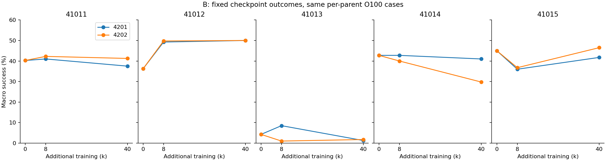
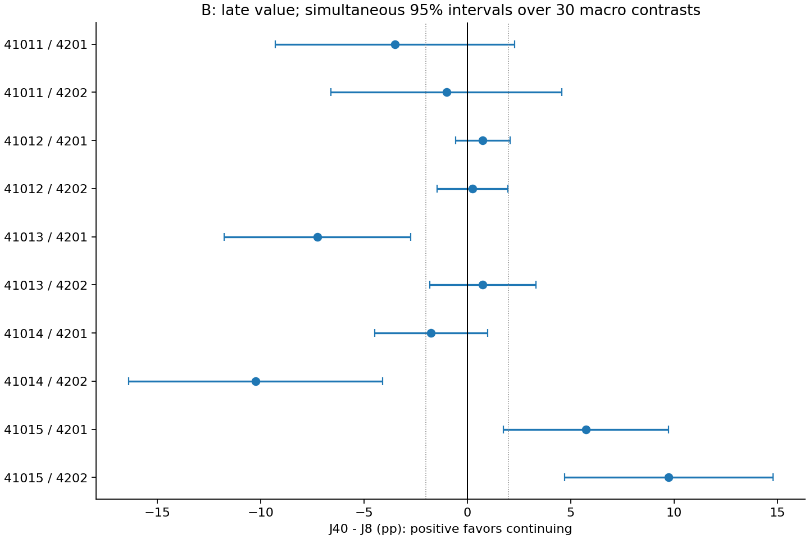
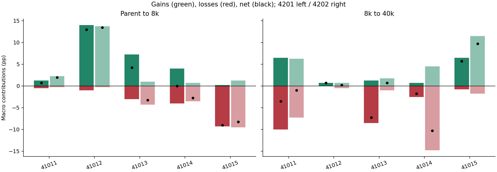
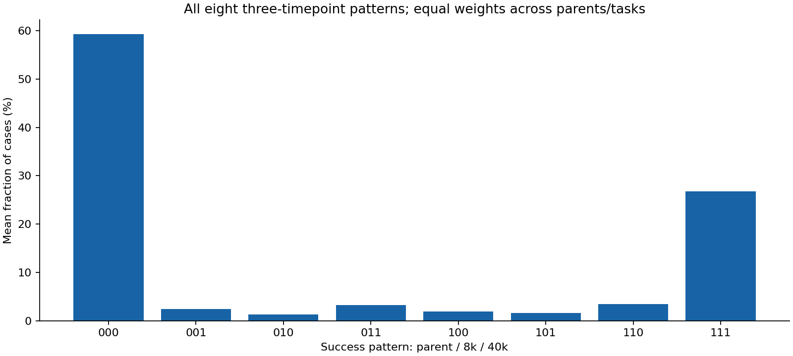

# B 완료 보고서 — 8k 이후 추가 학습의 손익과 성공 보존

기록일: 2026-10-20 KST. 실행은 [48번](../48_bp8k_checkpoint_evaluation_v1/README.md), 분석은 독립 49번이다.
[A 보고서](../47_existing_data_path_loss_analysis_v1/report_ko.md)와 [원래 1단계 보고서](../45_stage1_selection_value_analysis_v1/report_ko.md)는 보존한다.

**B의 측정·분석·독립 산술 검산을 완료했다.** 추가 학습 없이 기존 BP 집중 8k 정책 10개를 평가했다.
평균 성공률은 **부모 33.700% → 8k 34.725% → 40k 34.075%**다.
8k 정책 보존의 관측 평균 이득은 **+0.650%p**지만, 평가 사례 구간과 부모 재표집 구간 모두 0을 포함한다.
항상 8k에서 중단하는 방법의 우월성은 확보하지 못했다.

이번에 좁혀진 것은 손실과 회복의 관측 구간이다.
**41014/4202는 8k 이후 큰 손실, 41015의 두 경로는 8k까지 큰 손실 후 회복**을 보였다.
초반 손실만으로 이후 지속의 손해를 판단할 수 없다는 구체적인 반대 사례가 생겼다.
이 결과는 새로운 사전 예측 규칙의 성능이나 같은 중간 상태에서의 기대 전환 가치를 검증한 결과가 아니다.
**C와 원래 2·3단계는 보류 상태를 유지한다.**

## 1. 질문, 실행 범위와 비교

측정 전에 [48번 명세](../48_bp8k_checkpoint_evaluation_v1/protocol.json)를 동결했다.
목적은 현재 TD 규칙을 적합하거나 검증하는 것이 아니라, 같은 사례에서 부모→8k→40k의 손익을 구분하는 것이다.

| 항목 | 실행한 범위 |
| --- | --- |
| 설정 | MetaWorld B, DO/DC/PU/BP, 기존 dense reward·공유 SAC |
| 부모 | 41011·41012·41013·41014·41015, 사전학습 200k |
| 후속 반복 | 4201·4202, BP 집중 `dose625` |
| 새 평가 | 절대 step 208,000의 정책 10개, 같은 부모의 기존 O100, 과제당 100사례 |
| 기존 평가 재사용 | 부모 5개 및 해당 BP 40k 정책 10개 |
| 분석 자료 | 고유 정책 25개, 평가 행 10,000개, 세 시점으로 연결한 경로×사례 4,000개 |
| 독립 단위 | 부모 5개. 두 경로는 부모 안에서 평균하며 독립 부모 10개로 세지 않음 |
| 추가 실행 | 평가만 수행. 새 학습·SAC update·전환 분기·선택 규칙 적합 0 |

`J0`는 200k 부모, `J8`은 추가 8k, `J40`은 추가 40k 정책의 4과제 평균 성공률이다.
세 지표는 다음과 같다.

- 초반 순변화: `early = J8 − J0`.
- 후기 순변화: `late = J40 − J8`.
- 8k 중단 이점: `stop8 = J8 − J40 = −late`.

이는 저장 정책의 독립적인 환경 평가다. 학습 중 확률적 정책의 성공 로그를 평가 성공률로 대체하지 않았다.
0k·8k·40k는 추가 학습량 기준이며 총 사전학습까지 포함한 0 step을 뜻하지 않는다.

## 2. 전체 평균은 작지만 경로별 손익은 다르다

### 부모별 두 경로 평균

성공률 단위는 %, 차이는 %p다.

| 부모 | J0 | J8 | J40 | 초반 변화 | 후기 변화 | 8k 중단 이점 |
| --- | ---: | ---: | ---: | ---: | ---: | ---: |
| 41011 | 40.250 | 41.625 | 39.375 | +1.375 | −2.250 | +2.250 |
| 41012 | 36.250 | 49.500 | 50.000 | +13.250 | +0.500 | −0.500 |
| 41013 | 4.250 | 4.750 | 1.500 | +0.500 | −3.250 | +3.250 |
| 41014 | 42.750 | 41.375 | 35.375 | −1.375 | −6.000 | +6.000 |
| 41015 | 45.000 | 36.375 | 44.125 | −8.625 | +7.750 | −7.750 |
| 동일 가중 평균 | **33.700** | **34.725** | **34.075** | **+1.025** | **−0.650** | **+0.650** |

[부모별 원표](results/20261020T053017Z_B_analysis_b2d46333/parent_scores.csv).

평균을 “초반에는 개선, 이후에는 악화”라는 모든 부모의 공통 경로로 읽으면 안 된다.
41012의 큰 개선은 대부분 8k까지 관측됐고, 41015는 반대로 초반 손실 후 회복했다.
41012를 제외하면 초반 변화도 −2.031%p다.

### 열 경로와 후기 변화의 평가 사례 불확실성

아래 구간은 부모×경로×초반/후기/전체 **30대비를 함께 고려한 95% bootstrap 구간**이다.
완성된 정책들을 고정한 사례 불확실성이며, 동일 8k 상태에서의 미래 학습 난수 분산을 포함하지 않는다.

| 부모 / 후속 | J0 | J8 | J40 | 초반 변화 | 후기 변화 | 후기 변화 동시 구간 |
| --- | ---: | ---: | ---: | ---: | ---: | --- |
| 41011 / 4201 | 40.25 | 41.00 | 37.50 | +0.75 | −3.50 | [−9.302, +2.302] |
| 41011 / 4202 | 40.25 | 42.25 | 41.25 | +2.00 | −1.00 | [−6.586, +4.586] |
| 41012 / 4201 | 36.25 | 49.25 | 50.00 | +13.00 | +0.75 | [−0.570, +2.070] |
| 41012 / 4202 | 36.25 | 49.75 | 50.00 | +13.50 | +0.25 | [−1.470, +1.970] |
| 41013 / 4201 | 4.25 | 8.50 | 1.25 | +4.25 | −7.25 | [−11.750, −2.750] |
| 41013 / 4202 | 4.25 | 1.00 | 1.75 | −3.25 | +0.75 | [−1.822, +3.322] |
| 41014 / 4201 | 42.75 | 42.75 | 41.00 | 0.00 | −1.75 | [−4.487, +0.987] |
| 41014 / 4202 | 42.75 | 40.00 | 29.75 | −2.75 | −10.25 | [−16.389, −4.111] |
| 41015 / 4201 | 45.00 | 36.00 | 41.75 | −9.00 | +5.75 | [+1.758, +9.742] |
| 41015 / 4202 | 45.00 | 36.75 | 46.50 | −8.25 | +9.75 | [+4.708, +14.792] |

[경로별 원표](results/20261020T053017Z_B_analysis_b2d46333/path_scores.csv),
[동시·개별 구간](results/20261020T053017Z_B_analysis_b2d46333/path_contrasts_uncertainty.csv).

후기 변화의 부호는 양수 5경로·음수 5경로다.
2%p 이상을 기준으로 보면 지속 유리 2경로, 중단 유리 3경로, 절댓값 2%p 미만 5경로다.
동시 구간이 0을 제외하는 후기 손실은 41013/4201·41014/4202,
후기 이득은 41015의 두 경로다.
**실현된 손익의 이질성은 확인했지만, 이를 사전에 알아낼 수 있다는 결과는 없다.**

### 전체 평균의 두 불확실성 범위

| 대비 | 평균 %p | 사례 bootstrap 95% 개별 구간 | 부모 재표집 95% 기술 구간 |
| --- | ---: | --- | --- |
| J8−J0 | +1.025 | [+0.075, +2.000] | [−4.800, +7.950] |
| J40−J8 | −0.650 | [−1.550, +0.275] | [−4.150, +3.750] |
| J40−J0 | +0.375 | [−0.750, +1.500] | [−4.775, +7.525] |
| J8−J40 | +0.650 | [−0.275, +1.550] | [−3.750, +4.150] |

[계산 원표](results/20261020T053017Z_B_analysis_b2d46333/global_contrasts_uncertainty.csv).
두 구간은 다른 변동을 표현하므로 합치거나 더 좁은 쪽만 골라 결론 내리지 않는다.
부모는 5개뿐이며 부모 구간도 미래 모집단에 대한 확증적 정밀 추론으로 취급하지 않는다.

부모를 하나씩 제외한 8k 중단 이점은 다음과 같다.

| 제외 부모 | 중단 이점 %p |
| --- | ---: |
| 41011 | +0.2500 |
| 41012 | +0.9375 |
| 41013 | 0.0000 |
| 41014 | −0.6875 |
| 41015 | +2.7500 |

[전체 부모 제거 원표](results/20261020T053017Z_B_analysis_b2d46333/parent_removal.csv).
41014를 빼면 평균 방향이 바뀌고, 41015를 빼면 중단 이점이 커진다.
따라서 +0.650%p를 안정적인 고정 중단 방법의 성능 개선으로 채택하지 않는다.

## 3. 성공 획득·상실의 발생 구간

### 전체 과제 평균

획득·상실의 분모는 각 구간 시작의 성공/실패 부분집합이 아니라 **전체 평가 사례**다.
각 과제·부모·후속 경로를 동일 가중으로 평균했다.

| 구간 | 성공 획득 %p | 성공 상실 %p | 순변화 %p |
| --- | ---: | ---: | ---: |
| 부모→8k | 4.575 | 3.550 | +1.025 |
| 8k→40k | 4.050 | 4.700 | −0.650 |
| 부모→40k | 5.750 | 5.375 | +0.375 |

후기에는 4.700%p의 성공을 잃었지만 4.050%p를 새로 얻거나 회복했다.
따라서 손실 4.700%p만을 중단의 순가치로 간주할 수 없다.
부모→40k 분해는 A의 BP 결과와 일치한다.

### 과제별 변화

| 과제 | J0 % | J8 % | J40 % | 초반 획득 / 상실 %p | 후기 획득 / 상실 %p |
| --- | ---: | ---: | ---: | --- | --- |
| DO | 0.0 | 0.0 | 0.0 | 0.0 / 0.0 | 0.0 / 0.0 |
| DC | 82.2 | 81.6 | 80.5 | 2.7 / 3.3 | 1.6 / 2.7 |
| PU | 1.6 | 2.7 | 4.4 | 2.7 / 1.6 | 4.3 / 2.6 |
| BP | 51.0 | 54.6 | 51.4 | 12.9 / 9.3 | 10.3 / 13.5 |

[과제 평균](results/20261020T053017Z_B_analysis_b2d46333/task_mean_scores.csv),
[40개 과제×경로 분해](results/20261020T053017Z_B_analysis_b2d46333/task_gains_losses.csv).

BP의 후기 순변화 −3.2%p는 macro에서 −0.800%p,
DC의 −1.1%p는 −0.275%p, PU의 +1.7%p는 +0.425%p다.
합계가 −0.650%p다. 많이 연습한 BP 내부의 성공 상실이 여전히 중요하다.
DO의 관측 성공 0은 성공 가능성이 정확히 0이라는 증명이 아니다.

### 여덟 성공 패턴을 모두 보존

패턴 순서는 부모/8k/40k, 1은 성공·0은 실패다.

| 패턴 | 뜻 | 전체 사례 평균 % |
| --- | --- | ---: |
| 000 | 세 시점 모두 실패 | 59.275 |
| 001 | 8k 이후 처음 관측한 성공 | 2.450 |
| 010 | 초반 획득 후 최종 상실 | 1.275 |
| 011 | 초반 획득 후 최종에도 성공 | 3.300 |
| 100 | 부모 성공이 8k·40k 모두에서 없음 | 1.950 |
| 101 | 8k에 없던 부모 성공이 최종 회복 | 1.600 |
| 110 | 8k에 남아 있던 부모 성공을 최종 상실 | 3.425 |
| 111 | 세 시점 모두 성공 | 26.725 |

[모든 경로·과제의 8패턴](results/20261020T053017Z_B_analysis_b2d46333/three_time_patterns.csv),
[4,000사례 연결표](results/20261020T053017Z_B_analysis_b2d46333/case_trajectories.csv).

후기 상실은 기존 성공의 후기 상실 `110` 3.425와 초반 신규 성공의 후기 상실 `010` 1.275의 합이다.
후기 획득은 기존 성공의 회복 `101` 1.600과 후기 신규 성공 `001` 2.450의 합이다.
세 관측 시점 사이에서 정확히 언제 변화했는지, 여러 번 반전했는지는 알 수 없다.

순변화는 구간별로 더할 수 있지만 획득·상실은 단순 합산하면 안 된다.
실제 자료에서 `010 + 101 = 2.875%p`이므로,
초반 획득+후기 획득은 전체 획득보다 2.875%p 크고,
초반 상실+후기 상실도 전체 상실보다 2.875%p 크다. 모든 과제·경로에서 이 항등식을 검산했다.

## 4. 연구 판단을 바꾸는 구체적 경로

### 41014/4202: 큰 최종 BP 상실은 상당 부분 8k 이후에 관측된다

BP 성공 수는 **68 → 58 → 19 /100**이다.
부모→8k에서는 획득 1·상실 11로 −10,
8k→40k에서는 획득 18·상실 57로 −39였다.

8k에 성공한 58사례 중 57사례가 최종에는 실패했다.
이 57사례는 모두 부모에서도 성공한 `110` 사례다.
후기 획득 18은 부모 성공의 회복 5와 후기 신규 성공 13으로 나뉜다.
최종에 잃은 부모 성공 63사례는 `100` 6과 `110` 57로 분리된다.
따라서 부모 성공의 최종 상실이 모두 최초 8k에 이미 발생한 것은 아니다.

다른 반복 4201의 BP는 68→70→63이다.
두 반복의 BP 성공률 차이는 8k에서 12%p, 40k에서 44%p로 벌어졌다.
초기 경로 차이가 이미 있었고 이후 결과 차이도 더 커졌다는 관찰이다.
이를 초기 상태와 미래 난수의 분산 분해 또는 동일 상태에서의 반복 실험으로 해석하지 않는다.

### 41015: 초반 손실이 이후 손해를 뜻하지 않는다

| 후속 | Macro J0→J8→J40 % | BP 성공 수 /100 | 8k에 잃었다가 회복한 부모 BP 성공 `101` |
| --- | --- | --- | ---: |
| 4201 | 45.00→36.00→41.75 | 83→53→67 | 13 |
| 4202 | 45.00→36.75→46.50 | 83→48→81 | 35 |

4202는 초반에 부모 BP 성공 35개를 잃었지만, 그 35개가 최종에 모두 회복됐다.
동시에 8k에 유지했던 부모 BP 성공 6개는 나중에 잃었다.
따라서 BP 최종값 81은 부모값 83과 비슷해도 성공 사례의 이력이 같지는 않다.

두 경로 모두 계속 학습한 macro 이득이 +5.75/+9.75%p이며 동시 사례 구간도 양수다.
이 자료는 “초반 손실이 크면 지속도 해롭다”는 단순한 충분조건의 반대 사례다.
그렇다고 초반 손실이 회복을 예측하는 유효한 신호라는 역방향 주장을 만들지는 않는다.

### 41013: 같은 부모에서도 손실 위치가 다르고, 초반 획득도 사라진다

4201의 macro는 4.25→8.50→1.25로 초반 개선 후 큰 후기 손실이다.
DC는 17→27→5이고, 8k의 DC 성공 27개는 최종에 모두 사라졌으며 다른 5사례에서 성공했다.
그 27개에는 부모에서 유지한 5개뿐 아니라 초반 신규 획득 22개도 포함된다.
PU의 초반 신규 성공 7개도 최종에 모두 사라졌다.

4202의 DC는 17→0→0이다. 이 경로에서는 부모 DC 성공의 상실이 이미 8k에 관측된다.
따라서 “41013의 손실은 전부 후기 문제” 또는 “전부 초반 문제” 중 하나로 묶을 수 없다.
큰 critic loss·α가 원인이라는 인과적 설명을 이번 측정으로 추가하지 않는다.

### 41011·41012도 함께 보아야 한다

41011의 BP는 60→59→31 및 60→64→53으로 후기 하락했지만,
PU는 1→5→19 및 1→5→12로 개선됐다.
BP 하나만 보면 macro의 손익과 다른 크기의 손실을 말하게 된다.

41012의 BP는 두 경로 모두 44→97→100이다.
이 부모의 큰 전체 개선은 대부분 초반 8k까지 관측됐다.
추가 32k의 macro 이득은 +0.75/+0.25%p로 작지만, 새로운 부모 전체에 일반화할 고정 중단 규칙은 아니다.

## 5. 사전 개발 기준에 대한 결과와 다음 판단

48번에서 평가 전에 기록한 아래 기준은 **기술적 분류·투자 판단 보조**다.
원래 1단계의 관문을 바꾸거나 통계적 효과 부재를 증명하는 검정이 아니다.

| 측정 전 정한 분류 | 결과 | 해석 |
| --- | --- | --- |
| 초반 ≤−2%p, 후기 ≥+2%p | 2경로: 41015의 두 반복 | 초반 손실 후 회복이 실제로 관측됨 |
| 초반 ≤−2%p, 최종도 부모 대비 ≤−2%p | 3경로: 41013/4202, 41014/4202, 41015/4201 | 일부 회복해도 부모보다 낮게 끝날 수 있음 |
| ≥8/10경로 및 ≥4부모 양 반복에서 중단 이점 ≥2%p | 미충족: 3경로, 양 반복 충족 부모 0 | 광범위한 고정 8k 중단 우위로 정리하지 않음 |
| 한 부모의 두 반복은 지속 ≥2%p, 다른 부모의 두 반복은 중단 ≥2%p | 미충족: 지속 쪽 41015만 충족 | 서로 반대인 부모 선호의 반복 가능성을 확보하지 못함 |
| 위 반대 선호가 동시 사례 구간에서도 지지됨 | 미충족 | 선택 가능성의 독립 확인으로 승격하지 않음 |
| ≥8/10경로의 후기 차이 절댓값 <2%p | 미충족: 5경로 | 모든 차이가 작다는 결론도 부적절 |

[경로별 분류](results/20261020T053017Z_B_analysis_b2d46333/path_development_flags.csv).
분류는 겹칠 수 있다. 예를 들어 41015/4201은 초반 손실 뒤 일부 회복했지만 최종에도 부모보다 낮다.

**B의 목적은 달성했다.** 후기 상실, 초반 상실, 후기 회복을 구분할 새 근거가 생겼다.
동시에 현재 표본은 항상 중단의 우월성, 상태별 중단 규칙의 예측력, 실제 전환의 효능을 입증하지 않았다.

이후 가설을 개발한다면 “손실이 크다” 하나보다 **현재 성공을 계속 보존할 가능성과 이미 잃은 성공을 회복할 가능성의 순효과**를 구분할 필요가 있다.
이는 이번 자료가 제기한 개발 방향이며, 그러한 사전 지표를 확보했다는 주장은 아니다.
특정 경로를 사후로 골라 복구/불안정 유형이라고 이름 붙인 것을 검증된 분류기로 취급하지 않는다.

다음 실행을 다시 판단하려면 최소한 아래 내용을 새 명세에 고정해야 한다.

1. 8k 이전에 얻을 수 있는 입력의 정확한 정의와 비용, 유한한 규칙 후보.
2. 진단 사례와 최종 채점 사례의 분리, 부모를 나눈 확인 자료. 이미 관측한 이번 O100을 무료 입력으로 사용하지 않음.
3. 항상 중단·항상 지속 기준과 비교하고, 같은 8k 상태에서 미래 난수를 반복해 상태 차이와 미래 변동을 구분할 범위.
4. 전환을 연구한다면 위험 예측과 별도로 유지·전환의 실제 효과를 비교할 대조와 예산.

이번에는 그 규칙 개발·추가 평가·새 학습을 실행하거나 예약하지 않았다.
원래 1단계 미통과와 현재 TD 수치 규칙이 열 경로 모두 지속을 선택한다는 기록은 유지한다.
현재 TD 규칙군은 B에서도 항상 지속과 같은 행동을 하므로 상태별 선택의 추가 가치는 없다.
연속 TD 점수의 정보량 전체가 0이라고 결론 내리지 않으며, 결과에 맞춰 임계값을 바꾸지 않았다.

## 6. 불확실성 방법과 해석의 경계

사례 bootstrap은 부모×과제 안에서 100사례를 복원추출하고,
같은 인덱스를 부모 정책 및 두 경로의 8k/40k 정책에 공통 적용했다.
20,000회, PCG64 seed 480202, quantile `linear`, **SD 계산에 ddof=1을 사용했다.**
최대 절대 표준화 편차의 95% 분위수는 3.100997이며 30 macro 대비의 동시 구간에 사용했다.
해당 30대비의 퇴화 SD는 0개다. 과제별 0성공처럼 경험적 변동이 없는 경우는 별도 표시하며 확실한 모집단 0으로 취급하지 않는다.

부모 bootstrap은 각 부모의 두 반복을 먼저 평균한 뒤 5부모를 복원추출하는 5^5=3,125개 조합을 모두 계산했다.
이는 관측된 두 경로의 부모별 평균에 대한 기술적 민감도다.
새 부모·새 학습 난수·같은 8k 상태의 기대 미래를 모두 포괄하는 검증은 아니다.
20,000회·3,125회를 독립적인 학습 표본 수로 세지 않는다.

입력 `J8−J0`와 결과 `J40−J8`의 단순 상관을 계산해 예측력으로 보고하지 않았다.
두 변화량이 공유하는 J8 오차 때문에 인위적인 음의 관계가 생길 수 있다.
같은 사례의 세 시점 연결은 이번 기술 분석에는 적절하지만, 예측 규칙에는 별도 진단/채점 분리가 필요하다.

이번 결과는 기존 B 구성·BP 집중·200k 출발·8k/40k의 범위다.
다른 일정의 8k 결과, 동일 8k 상태에서의 여러 미래, 새로운 부모의 중단 알고리즘은 측정하지 않았다.
학습 손실의 메커니즘을 내부 표상 소실·간섭·탐험·가소성으로 특정하지 않았다.
8k와 40k 사이의 세부 발생 시점이나 최적 중단 시점도 이번 세 시점만으로 특정하지 않는다.

## 7. 비용, 무결성, 재현 자료

| 비용 항목 | 실제 사용량 |
| --- | ---: |
| 연구 평가: 10정책 × 4과제 × 100사례 | 4,000 episodes, **1,352,726 환경 step** |
| 연구 평가 사전 상한 | 2,000,000 환경 step |
| 기존 40k 정책의 8사례 기술 재현 | **2,183 환경 step** / 별도 상한 4,000 |
| 신규 환경 step 총합 | **1,354,909** |
| 새 학습 step / SAC update | **0 / 0** |
| 평가 campaign 경과시간 | 1,276.274초, 약 21분 16초 |
| 평가 worker wall 합계 / CPU 합계 | 2,441.877초 / 1,622.281초 |
| 49 본분석 wall / CPU | 4.392초 / 1.234초 |
| 별도 산술 검산 wall / CPU | 12.844초 / 6.359초 |

두 worker를 병렬 실행했으므로 worker wall 합계는 실제 경과시간과 다르다.
정책 추론에 RTX 3070을 사용했지만 누적 GPU busy time·전력은 미계측이다.
문서 작성·전체 도구 조회 시간도 위 분석 시간과 다르며 따로 추정하지 않는다.
성공 시 조기 종료하는 기존 평가 규약 때문에 실제 환경 step이 상한보다 작다.

B의 O100은 연구용 측정 비용이다. 기존 로그만 사용하는 중단 규칙에 자동으로 4k를 차감하지 않는다.
이번 비교는 8k 대 40k이며 같은 최대 40k 허용 예산 안에서 실제 학습 사용량은 서로 다르다.
남은 32k의 재배치 효과나 사용하지 않은 예산의 효용을 계산하지 않았다.
나중에 4k의 온라인 진단을 실제로 수행한다면 8k+4k+28k=40k가 되므로,
지속 정책은 총 학습 **36k**여야 한다. 그 비용 회수 실험은 이번 B에 포함되지 않는다.

기술 확인에서 기존 BP 40k 정책의 8사례가 성공·길이·return·초기 상태까지 정확히 재현됐다.
열 정책 모두 manifest·원본 binary hash, 전체 learner/replay/collector/RNG 복원,
평가 전후 상태 동일성, 원본 checkpoint 불변성, 사례 중복/누락 및 비용을 확인했다.
기술 재현 8사례는 과학적 효과나 전체 O100 재실행의 근거로 확대하지 않는다.

48 정적 검사 25건, 49 합성 사전 검산 32건, 본분석 검사 20,455건,
독립 구현 검산 12,919건을 통과했다. 기술·산술 검사의 개수는 효과의 증거 수가 아니다.
이번 평가·분석에서 실패한 실행·재시도·폐기한 결과는 없다.
이전 A의 실패 기록은 이전 버전에 그대로 남아 있다.

의존성은 Python 3.12.0, NumPy 2.2.4, Torch 2.5.1+cu121, Gymnasium 1.2.3,
MuJoCo 3.5.0, MetaWorld 3.0.0, Stable-Baselines3 2.7.1, Matplotlib 3.10.1이다.
원래/후속 seed 및 실제 파생 RNG seed 열 쌍은 checkpoint 출처 파일에 보존했다.

- [동결 평가 campaign과 원자료](../48_bp8k_checkpoint_evaluation_v1/results/20261020T050842Z_B_evaluation_5a8b5434/plan.json), [완료 표지](../48_bp8k_checkpoint_evaluation_v1/results/20261020T050842Z_B_evaluation_5a8b5434/COMPLETE.json).
- [분석 설정](analysis_config.json), [분석 요약](results/20261020T053017Z_B_analysis_b2d46333/summary.json), [실제 비용](results/20261020T053017Z_B_analysis_b2d46333/costs.json).
- [원자료 목록](results/20261020T053017Z_B_analysis_b2d46333/input_assets.csv), [입력 hash](results/20261020T053017Z_B_analysis_b2d46333/input_hashes.json), [실행 소스 hash](results/20261020T053017Z_B_analysis_b2d46333/source_hashes.json), [checkpoint·RNG·패키지 출처](results/20261020T053017Z_B_analysis_b2d46333/checkpoint_provenance.json).
- [bootstrap 정의](results/20261020T053017Z_B_analysis_b2d46333/bootstrap_definition.json), [재표집 인덱스](results/20261020T053017Z_B_analysis_b2d46333/case_resample_indices.npz), [재표집 계산 결과](results/20261020T053017Z_B_analysis_b2d46333/bootstrap_draws.npz).
- [별도 검산 결과](results/20261020T053035Z_independent_verification_1a1605b9/summary.json), [후보별 근거 갱신](evidence_record_ko.md), [판정 기록](decision_record.json).

47번의 “부트스트랩 SD의 자유도는 1”은 “SD 계산에 ddof=1을 사용했다”로 정정한다.
47번 계산 자체의 변경은 없으며 전달된 문서를 덮어쓰지 않고 이 기록에서 설명을 바로잡는다.
