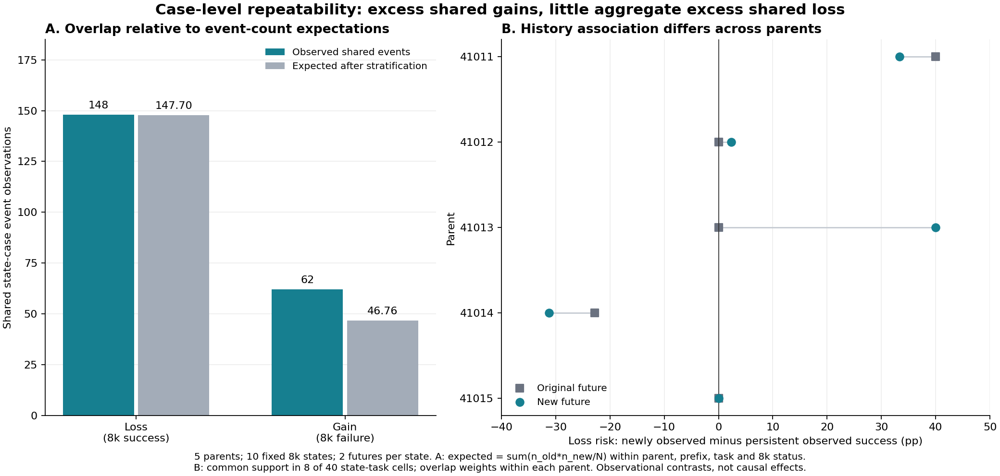

# 동일 상태 이후 성공 획득·상실의 사례별 반복성

2026-10-22. 기존 자료만 사용한 탐색 분석. 실행·분석 버전 55.

**사건 총량과 상태·과제를 맞춘 뒤에도 같은 사례를 획득하는 중첩은 남았다.
상실에서는 전체 평균의 초과 중첩이 거의 없었다. 성공 이력별 상실 위험 차이는 집계에서 보였지만,
같은 조건 안의 비교에서는 부모별로 달라 보편적 관계로 고정하기 어려웠다.**

이 결과는 새로 채택한 현상 연구의 첫 관측 결과다. 기존 선택기 투자 기준 미통과를 바꾸지 않는다.
최종 성능이나 새로운 선택 방법의 향상 수치로 해석하지 않는다.

## 1. 질문과 자료

중심 질문은 다음으로 고정했다.

> 동일한 전체 학습 상태에서 같은 규칙과 예산으로 추가 학습했을 때,
> 성공의 획득과 상실은 서로 다른 미래 학습 경로에서 얼마나 반복되는가?

그 반복성이 어떤 출발 조건과 관련되는지, 후속 학습 조건을 바꾸면 달라지는지는 구분한다.
이번에는 기존 두 미래의 사례 중첩과 8k 이전 성공 이력이라는 관측 조건만 확인했다.
학습 조건에 개입하지 않았다.

부모 41011–41015, 각 부모의 prefix seed 4201/4202에서 얻은 BP 8k 상태를 사용했다.
각 상태에는 기존 32k 미래와 52번에서 추가한 새 32k 미래가 하나씩 있다.
모든 과제는 DO/DC/PU/BP이고, 부모별 동일 O100 평가 bank를 사용했다.
52번은 정책·critic·optimizer·replay·collector·일정 위치를 보존한 뒤 미래 난수만 바꿨다.

주 독립 단위는 **부모 5개**다. 고유 부모×과제×평가 사례는 2,000개이며,
두 prefix에서 각각 관측해 **상태×사례 관측 4,000건**이다. 아래 사건 수는 이 관측 단위의 수다.
4,000개 독립 학습 실행이나 10개의 독립 부모로 세지 않는다.

54번의 `paired_outcomes.csv`를 원래 49·52번 평가 CSV에 다시 대조했다.
부모·8k·기존 미래·새 미래의 seed·초기 상태 hash·성공 여부가 모두 일치했다.
분석 정의는 이번 집계를 실행하기 전에 기록했지만, 기존 결과를 본 뒤 만든 가설이므로 **탐색 분석**이다.

## 2. 사건을 정의하고 비교 기준을 맞췄다

8k 성공→40k 실패를 **상실**, 8k 실패→40k 성공을 **획득**으로 정의한다.
부모에서 성공했으나 8k에 실패한 사례의 후기 회복도 여기서는 획득에 포함한다.

각 부모×prefix×과제 안에서 상실은 8k 성공 사례, 획득은 8k 실패 사례만 비교한다.
그 집단 크기가 N, 기존/새 미래 사건 수가 n₁/n₂, 관측 공통 사건 수가 m이면
라벨을 무작위로 대응했을 때 기대되는 중첩은 `n₁n₂/N`이다.
이 기대값을 **각 층에서 계산한 뒤 합산**했다. 전체 과제와 상태를 합친 하나의 사건률을 쓰지 않았다.

전체 40개 상태×과제 층에서 `m−n₁n₂/N`을 합한 값이 초과 중첩 수다.
그 합을 40으로 나누면 4,000개 관측 전체에 대한 %p가 된다.
이는 부모·prefix·과제를 같은 가중으로 집계한 **초과 공통 사건의 비중**이지 성공률 개선 효과가 아니다.
N=0인 층은 사건 기여 0으로 두되 조건부 위험·중첩률은 계산 불가로 표시했다.

## 3. 두 미래에서 무엇이 겹쳤는가

| 사건 구분 | 비교 가능한 관측 N | 둘 다 사건 | 기존 미래만 | 새 미래만 | 둘 다 비사건 |
| --- | ---: | ---: | ---: | ---: | ---: |
| 상실: 8k 성공 사례 | 1,389 | 148 | 40 | 78 | 1,123 |
| 획득: 8k 실패 사례 | 2,611 | 62 | 100 | 90 | 2,359 |

기존 미래의 상실은 188건, 새 미래는 226건이다. 획득은 각각 162건과 152건이다.
상실 중첩 148건은 많아 보이지만, 사건 총량을 맞춘 비교에서는 다른 결과가 나온다.

| 사건 | 관측 중첩 m | 층별 우연 기대 중첩 합 | 초과 중첩 수 | 전체 관측 대비 초과 중첩 |
| --- | ---: | ---: | ---: | ---: |
| 상실 | 148 | 147.698 | +0.302 | **+0.008%p** |
| 획득 | 62 | 46.759 | +15.241 | **+0.381%p** |

상실의 원시 Jaccard는 55.639%, 획득은 24.603%다. 그러나 이 값만으로 반복성 순위를 매기면
서로 다른 사건률·비교 집단 크기·상태 구성의 영향을 혼동한다.
예를 들어 41013에서는 8k 성공 38건을 기존 미래가 전부 잃었다. 새 미래가 잃은 36건은 반드시
기존 상실 집합에 들어가므로, 공통 상실 36건과 기대 중첩 36건이 같다.
이 큰 겹침만으로 특별히 취약한 하위 사례 집합이 반복됐다고 말할 수 없다.

관측된 양의 초과 중첩은 **획득**에 있다. 상태·과제별 획득량으로 기대되는 정도보다
같은 사례에서 성공을 얻는 일이 더 많이 겹쳤다. 이로부터 공통 사례 난이도나 학습 가능한 영역이
공유될 가능성을 연구할 수 있다. 아직 특정 학습 기전이나 재현 가능한 사례별 확률을 확인한 것은 아니다.

상실의 평균 초과 중첩이 작다는 것은 상실이 전적으로 무작위라는 증명이 아니다.
일부 부모의 양·음의 초과 중첩이 상쇄됐고, 상태당 미래는 두 번뿐이다.
획득과 상실의 위험 집단·사건률이 다르므로 “획득이 본질적으로 더 반복 가능하다”는 일반 법칙도 도출하지 않는다.

## 4. 획득의 초과 중첩이 한 부모에만 있는가

| 부모 | 상실 초과 중첩 수 | 획득 초과 중첩 수 |
| --- | ---: | ---: |
| 41011 | −2.256 | +1.203 |
| 41012 | 0.000 | 0.000 |
| 41013 | 0.000 | +4.426 |
| 41014 | +2.183 | +3.448 |
| 41015 | +0.375 | +6.165 |

획득은 4개 부모에서 양수, 1개에서 0이다. 어느 부모 하나를 제외해도 전체 관측 대비 초과 중첩은
**+0.284~+0.476%p**로 양수다. 41015를 제외한 값은 +0.284%p다.
이는 이전 중단 선택 이득의 41015 집중도와 다른 기술적 결과이며, 새 선택기 투자 관문으로 사용하지 않는다.

| 과제 | 상실: 관측 / 기대 중첩 | 획득: 관측 / 기대 중첩 | 획득 초과 중첩 수 |
| --- | ---: | ---: | ---: |
| DO | 0 / 0 — 8k 성공 없음 | 0 / 0 | 0.000 |
| DC | 25 / 25.000 | 16 / 12.918 | +3.082 |
| PU | 25 / 24.400 | 7 / 2.905 | +4.095 |
| BP | 98 / 98.298 | 39 / 30.936 | +8.064 |

두 미래 모두 사건/비사건이 섞여 있어 초과 중첩을 드러낼 수 있는 층은
상실 6개, 획득 11개뿐이다. 모든 40개 층이 같은 정도의 정보를 주는 것은 아니다.
DO에서 상실 0은 성공 보존의 증거가 아니라 8k 성공 사례가 없는 구조적 결과다.

부모 시점 성공 여부 J0까지 추가로 나눠 기대 중첩을 계산해도 획득의 초과 중첩은
**+15.043건, +0.376%p**로 남았다. 이 두 시점 성공 이력 분류만으로 초과 중첩이 사라지지는 않았다.
상실은 이 보조 기준에서 −1.672건, −0.042%p다. 이 비교도 공통 난이도와 학습 원인을 분리하지 않는다.

## 5. 성공 이력에 따른 상실률 — 제시한 집계 비율은 맞았다

| 8k 성공 사례의 이력 | 관측 수 | 기존 미래 상실 | 새 미래 상실 |
| --- | ---: | ---: | ---: |
| 부모·8k 모두 성공(11) | 1,206 | 137 / 1,206 = **11.360%** | 171 / 1,206 = **14.179%** |
| 부모 실패·8k 성공(01) | 183 | 51 / 183 = **27.869%** | 55 / 183 = **30.055%** |

전체 관측 중 비중도 각각 30.150%, 4.575%로 사용자 계산과 일치한다.
그러나 두 집단의 과제 구성은 다음처럼 크게 다르다.

| 과제 | 11 집단 | 01 집단 |
| --- | ---: | ---: |
| DO | 0 | 0 |
| DC | 789 | 27 |
| PU | 0 | 27 |
| BP | 417 | 129 |

11 집단에는 성공률이 높은 DC가 많이 포함되고, PU의 8k 성공은 모두 01 집단이다.
집계 비율 차이를 성공 이력 자체의 효과로 읽을 수 없는 이유다.

두 집단이 모두 있는 **같은 부모×prefix×과제**만 비교했다.
각 층에서 `상실률01−상실률11`을 계산하고, 부모 안에서는 `N01*N11/(N01+N11)`로 가중했다.
이 가중치는 작은 비교 집단만 있는 층이 전체 부모 결과를 과도하게 좌우하는 일을 줄이며,
두 미래에 똑같이 사용한다. 마지막에는 부모를 동일 가중했다.
가중 방식에 따라 목표 평균이 달라지므로 층 균등 가중도 함께 보고한다.

| 집계 방식: 01−11 상실 위험 차이 | 기존 미래 | 새 미래 |
| --- | ---: | ---: |
| 전체 사례를 합친 비율 차이 | +16.509%p | +15.876%p |
| 같은 조건 안 비교, 부모 내 표본 크기 가중 후 부모 동일 가중 | **+3.440%p** | **+8.895%p** |
| 같은 조건 안 비교, 부모 내 층 균등 가중 | **−3.636%p** | **+2.592%p** |

첫 행과 나머지 행은 비교 대상·가중치가 다르다. 감소량 전부를 특정 교란 요인의 인과적 기여로 부르지 않는다.
특히 기존 미래에서는 가중 방식에 따라 평균 부호도 바뀐다.

공통 비교가 가능한 층은 **40개 중 8개**다. 01 집단은 156/183건, 11 집단은 446/1,206건이
이 비교에 포함된다. 부모 5개 모두 기여하지만 BP는 부모 3개의 5개 층,
DC는 부모 2개의 3개 층에 한정된다. DO·PU는 이력 집단 내 비교가 불가능했다.
비교 불가능한 층에 차이 0을 대입하지 않았으며, 이 결과를 모든 성공 사례의 조정 효과로 일반화하지 않는다.

| 부모 | 기존 미래의 조건 내 위험 차이 | 새 미래의 조건 내 위험 차이 |
| --- | ---: | ---: |
| 41011 | +40.000%p | +33.333%p |
| 41012 | 0.000%p | +2.334%p |
| 41013 | 0.000%p | +40.000%p |
| 41014 | **−22.801%p** | **−31.192%p** |
| 41015 | 0.000%p | 0.000%p |

41014는 새로 관측한 성공 집단이 오히려 덜 상실되는 방향이었다.
41011의 01 비교 집단은 4건, 41013의 11 집단은 5건뿐이어서 큰 위험 차이를 정밀한 효과로 읽지 않는다.
기존 미래는 41011을 제외하면 평균 차이가 −5.700%p로 바뀐다.
BP만의 부모 동일 가중 비교는 기존 +5.733, 새 +1.492%p이며, DC는 기존 0.000, 새 +20.000%p다.

따라서 “부모에서 실패했다가 8k에서 성공한 사례는 일관되게 더 취약하다”는 법칙은 확보하지 못했다.
평균적 차이가 전혀 없다고 입증한 것도 아니다. 두 시점의 성공 여부는 실제 학습 나이·숙달 기간·기억 고착도를 측정하지 않는다.

## 6. 불확실성의 범위

| 측정량 | 점추정 | 조건부 사례 재표집 95% 구간 | 부모 재표집 기술적 95% 구간 |
| --- | ---: | ---: | ---: |
| 상실 초과 중첩 / 전체 관측 | +0.008%p | [−0.135, +0.150]%p | [−0.160, +0.164]%p |
| 획득 초과 중첩 / 전체 관측 | +0.381%p | [+0.206, +0.547]%p | [+0.141, +0.616]%p |
| 이력별 위험 차이, 기존 미래 | +3.440%p | [−6.891, +10.449]%p | [−13.681, +24.000]%p |
| 이력별 위험 차이, 새 미래 | +8.895%p | [+0.070, +18.408]%p | [−12.049, +30.667]%p |

사례 재표집은 부모×과제×공통 이력 `(J0,J8_4201,J8_4202)` 안에서 같은 수의 사례 인덱스를
복원 추출했다. 두 prefix와 두 미래에 동일 인덱스를 적용해 의존성을 보존하고,
관측된 이력 집단의 분모와 가중치를 유지했다. 20,000회, seed 550303이다.
부모 구간은 부모 안 집계 후 순서 있는 5개 부모 추출 3,125개를 모두 계산했다.

구간은 탐색적 **개별 percentile 구간**이며 다중 비교를 보정한 확증 구간이나 투자 관문이 아니다.
사례 구간은 학습된 정책과 관측된 이력 구성에 조건부다. 새 미래의 학습 변동을 포함하지 않는다.
새 미래 이력 차이의 사례 구간이 간신히 0을 제외한다는 사실만으로 반복 가능한 이력 효과를 주장하지 않는다.
부모 5개의 기술 구간도 모집단 효과의 정밀한 추정이 아니다.

## 7. 새 연구에서 무엇을 남길 것인가

이번에 남길 구체적 현상은 **“같은 상태의 두 미래가 성공을 획득한 사례에는,
상태·과제별 획득량으로 기대되는 것보다 더 많은 공통 부분이 있다”**이다.
한 부모에만 나타난 패턴은 아니며, 부모의 성공 이력으로 더 세분한 기준에서도 남았다.
이것은 최종 성공률만으로 보이지 않던 사례 집합의 구조다.

동시에 두 단순한 해석을 채택하지 않는다.

- 상실 집합의 큰 원시 중첩을 곧바로 반복 가능한 취약 사례 집합의 증거로 삼지 않는다.
- 01 집단의 높은 전체 상실률을 보편적인 최근 성공 취약성 또는 기억 고착의 원인으로 삼지 않는다.

다음 설명 후보는 **공통된 사례 난이도·획득 용이성**과 **공유된 학습 상태·경험 노출이 만드는 영향**이다.
현재 자료로 어느 쪽이 원인인지 정하지 않는다. 특히 replay가 원인이라는 결론은 없다.
다음 개입을 설계한다면 먼저 어떤 설명을 구분하는지와, 총 획득량·총 상실량을 분리한 상태에서
초과 중첩이 어떤 방향으로 바뀔 것인지를 명시해야 한다.
온라인 수집을 유지한 개입의 총효과와 고정 데이터에서 순서만 바꾸는 효과도 구분해야 한다.

중심 질문은 획득·상실 양쪽에 유지한다. 이번 획득 결과는 후속 설명을 구체화할 출발 근거이며,
즉시 논문 독창성이나 유효한 선택 알고리즘이 확정됐다는 뜻은 아니다.
문헌 원문 비교와 새로운 개입·확인 실험은 이번 분석에 포함되지 않았다.
기존 선택기 개발과 C·원래 2·3단계의 보류 판정은 유지한다.

## 8. 실행·검산·비용과 출처

새 환경 step, 정책 평가 episode, SAC 업데이트 모두 **0**이다. 모델·replay를 로드하지 않았다.
사용한 입력의 SHA256은 `7c75c6186ae833ecfb3f9a71180c87bcd7aec37137ee6cd85c6490eec3750efb`다.
52번 연구 비용은 기존 기록에 두며 이번 비용에 다시 더하지 않는다.

최초 분석 명령은 Python 구문 오류로 실행 전에 종료됐다. 해당 소스·hash·오류를
새 실패 폴더에 보존한 뒤 괄호 오류를 수정하고 별도 분석 폴더에서 실행했다. 실패 시 환경 비용도 0이다.
수정된 본분석 wall 2.015초/CPU 0.891초, 독립 검산 wall 1.088초/CPU 0.438초다.
문서 작성·조회 시간은 이 계측에 포함하지 않는다.

독립 검산은 본분석 함수를 import하지 않고 원자료를 집합·유리수 산술로 다시 집계했다.
재표집은 사례를 직접 인덱싱한 본분석과 달리 사례별 추출 빈도를 계산해 20,000×6개 결과 벡터를 대조했다.
934개 확인이 통과했다. 검산한 범위에서 계산과 자료 연결이 일치하며, 위 관측적 한계를 붙여 공유할 수 있다.
기술적 검사 수는 독립 과학 표본 수가 아니다.

- [분석 설정](analysis_config.json), [연구 질문과 범위](research_question_ko.md).
- [분석 요약](results/20261022T031427Z_analysis_a137ba0b/summary.json), [입력 hash](results/20261022T031427Z_analysis_a137ba0b/input_hashes.json), [소스 hash](results/20261022T031427Z_analysis_a137ba0b/source_hashes.json).
- [모든 상태·과제의 중첩](results/20261022T031427Z_analysis_a137ba0b/overlap_by_state_task.csv), [모든 이력 집단의 분모·상실 수](results/20261022T031427Z_analysis_a137ba0b/history_by_state_task.csv).
- [부모별 중첩](results/20261022T031427Z_analysis_a137ba0b/overlap_by_parent.csv), [과제별 중첩](results/20261022T031427Z_analysis_a137ba0b/overlap_by_task.csv), [부모 제거](results/20261022T031427Z_analysis_a137ba0b/leave_one_parent_out.csv).
- [독립 검산](results/20261022T031646Z_verification_801c7f5f/summary.json), [실패 보존](results/20261022T031426Z_parse_failure_dee35bfe/FAILED.json).
- [이전 54 결과](../54_same_state_future_replication_analysis_v1/report_ko.md), [최초 후보 근거 원장](../25_candidate_factor_evidence_register_v1/README.md).

Python 3.12.0·NumPy 2.2.4로 분석했고 그림은 Matplotlib 3.10.1로 생성·육안 확인했다.
원래 seed와 미래 root seed는 입력 사본의 `state_results.csv`에 모두 보존했다.
새 55번 디렉터리의 각 실행은 별도 소스 snapshot과 결과 폴더를 사용했으며 기존 버전은 수정하지 않았다.
