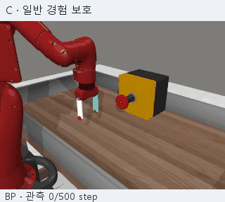
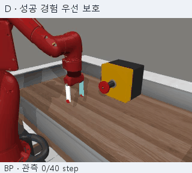
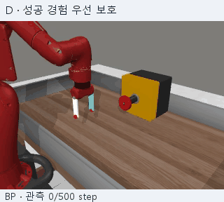
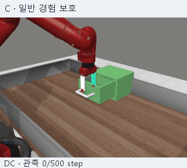
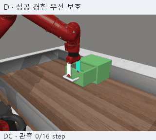
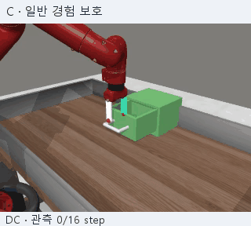
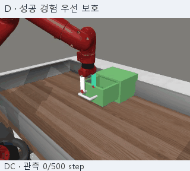

# Robot practice allocation

추가 학습에서 무엇을 어떻게 보호해야 기존 성공의 상실을 줄이면서, 다른 사례의 성공 획득과 이전 성공의 회복을 유지할 수 있는지 연구합니다.

## 연구 질문별로 보기

기존 실험 번호와 버전명은 그대로 유지하고 관련 질문을8개 큰 폴더로 묶었습니다. [연구 질문의 변화 과정](00_research_overview/RESEARCH_TRAJECTORY.md)을 먼저 보면 각 묶음이 이어진 이유를 볼 수 있습니다.

| 큰 폴더 | 핵심 질문 | 기존 버전 수 |
|---|---|---:|
| [연구 개요·문헌](00_research_overview/) | 어떤 문제를 연구 주제로 구체화하고 어떤 근거를 기여로 삼을 것인가? | 3 |
| [배분 효과의 재현](01_allocation_effects/) | 집중 배분의 이득은 반복·부모·출발 단계·과제 구성이 달라도 유지되는가? | 13 |
| [학습 단서·조건](02_learning_signals_and_conditions/) | 어떤 진단 신호·경험 노출·집중 강도·순서가 학습 결과와 선택을 설명하는가? | 16 |
| [일정 선택의 가치](03_schedule_selection_value/) | 상태마다 다른 일정을 고르면 강한 고정 일정보다 이득인가? | 6 |
| [중단·지속의 가치](04_stop_continue_value/) | 8k 이후 지속의 순손익과 중단·지속 선택은 다른 학습 미래에도 유지되는가? | 8 |
| [획득 사례의 반복성](05_acquisition_repeatability/) | 같은 상태에서 획득하는 사례 패턴은 반복되며 다른 출발 상태와 구별되는가? | 5 |
| [보존 개입·사례 영상](06_retention_interventions/) | 무엇을 보호하면 기존 성공의 상실을 줄이면서 획득과 회복을 유지할 수 있는가? | 5 |
| [실행·검증·공개](07_operations_and_publication/) | 코드·상태·비용·실패·연구 기록을 어떻게 검증하고 보존·공개했는가? | 10 |

실행·공개 폴더에는 이번 정리 도구74를 추가했습니다. 번호 순서는 실험의 성패나 확증 수준을 뜻하지 않습니다.

## 먼저 볼 자료

- [현재 보존 개입 결과](06_retention_interventions/68_retention_intervention_result_review_v1/results/20261028T072607Z_review_323af171/report_ko.md)
- [보존 개입·사례 영상 목차](06_retention_interventions/README.md)
- [연구 개요와 문헌](00_research_overview/README.md)
- [루트 파일럿 설계 원문](LOCAL_PRACTICE_ALLOCATION_PILOT_DESIGN_20261007.md)

<!-- retention-video-publication:start -->
## 일반 경험 보호와 성공 경험 우선 보호

추가 학습 중 **어떤 경험의 행동을 보호하느냐**를 비교한 개발 실험이다. 두 방법 모두 추가 학습 시작 정책 **S(208k)**를 고정 교사로 사용한다. 같은 관측에서 교사와 현재 정책의 행동 분포 차이 `KL(교사 || 현재)`를 actor 손실에 더한다(계수 1). 이때 보호하는 것은 해당 관측에서의 행동 분포이며 성공 라벨 자체가 아니다.

| 조건 | 보호할 관측을 고르는 방식 | 학습에서 하는 일 |
|---|---|---|
| **C · 일반 경험 보호** | 성공 여부로 우선순위를 주지 않고 일반 훈련 경험에서 관측을 선택 | 고정 S 교사의 행동 분포와 현재 정책의 차이를 제한 |
| **D · 성공 경험 우선 보호** | 과거 성공 episode에 속한 관측을 우선 선택. 해당 과제·시기 층에 성공 자료가 없으면 C와 동일한 일반 자료로 대체 | C와 같은 행동 보존 손실 적용 |

과제·경험 생성 시기(25k 구간)·episode/관측 할당과 실제 보호 표집 횟수를 맞췄다. 같은 계수가 실제 제약의 크기·방향까지 같게 만든다는 뜻은 아니다. **D는 SAC의 replay에서 성공 경험을 더 자주 뽑아 RL 업데이트하는 방법이 아니다.** 원래 RL replay·critic·entropy 업데이트는 유지하고 별도 보호 관측으로 actor를 정규화한다. C에도 성공 경험이 포함될 수 있고, 성공 episode의 모든 관측이 공유 기초 동작으로 식별된 것은 아니다.

### 같은 출발 상태·같은 평가 사례의 영상

기존 Meta-World B의 BP(Button Press)와 DC(Drawer Close) 예시다. P는 200k 사전학습 기준, S는 BP 집중 8k 후의 208k 출발점이며, 아래 C/D 최종 정책은 각각 32k를 더 학습한 240k 정책이다. 같은 부모·기존 미래 N1·초기 상태·goal·평가 seed로 비교했다. 아래 GIF를 누르면 각 정책의 **전체 MP4**를 열 수 있다. 미리보기는 별도 재생되므로 정확한 시점 비교는 표시된 step과 MP4를 기준으로 한다.

**영상 출처:** 새 기능 진단에서 저장한 수치 상태를 고정 카메라로 다시 시각화한 영상이다. 이 재시각화와 README 게시에서는 새 rollout이나 정책 실행을 생성하지 않았다. 성공이 처음 관찰되면 평가가 종료되며, 미리보기의 짧은 영상 뒤는 관찰 종료로 표시한다. 그 뒤의 행동이 유지되거나 실패했다고 채워 넣지 않는다.

#### BP 사례: D 성공·C 실패

부모 **41014**, 미래 **N1**, 과제 **BP**, 물리 사례 **64**.

| C · 일반 경험 보호 | D · 성공 경험 우선 보호 |
|:---:|:---:|
|  |  |
| **미성공 · 500 step** · [전체 MP4](06_retention_interventions/73_retention_readme_video_publication_v1/results/20261029T064753Z_prepare_62007f05/media/bp_d_better_C.mp4) | **성공 · 40 step** · [전체 MP4](06_retention_interventions/73_retention_readme_video_publication_v1/results/20261029T064753Z_prepare_62007f05/media/bp_d_better_D.mp4) |

이 사례에서 D는 40step에 성공했고 C는 버튼 부근까지 이동했지만 500step까지 성공하지 못했다. 접근만으로 성공 여부를 설명할 수 없다는 예시이며, 정확한 접촉 원인은 영상만으로 판정하지 않는다.

반대 BP 사례: C 성공·D 실패

부모 **41011**, 미래 **N1**, 과제 **BP**, 물리 사례 **7**.

| C · 일반 경험 보호 | D · 성공 경험 우선 보호 |
|:---:|:---:|
|  |  |
| **성공 · 38 step** · [전체 MP4](06_retention_interventions/73_retention_readme_video_publication_v1/results/20261029T064753Z_prepare_62007f05/media/bp_c_better_C.mp4) | **미성공 · 500 step** · [전체 MP4](06_retention_interventions/73_retention_readme_video_publication_v1/results/20261029T064753Z_prepare_62007f05/media/bp_c_better_D.mp4) |

반대 방향의 BP 사례다. C는 38step에 성공했지만 D는 500step까지 성공하지 못했다. 성공 경험 우선 보호가 모든 사례에 유리한 것은 아니다.

DC 사례: D 성공·C 실패

부모 **41013**, 미래 **N1**, 과제 **DC**, 물리 사례 **24**.

| C · 일반 경험 보호 | D · 성공 경험 우선 보호 |
|:---:|:---:|
|  |  |
| **미성공 · 500 step** · [전체 MP4](06_retention_interventions/73_retention_readme_video_publication_v1/results/20261029T064753Z_prepare_62007f05/media/dc_d_better_C.mp4) | **성공 · 16 step** · [전체 MP4](06_retention_interventions/73_retention_readme_video_publication_v1/results/20261029T064753Z_prepare_62007f05/media/dc_d_better_D.mp4) |

DC에서 D가 빠르게 성공한 사례다. 성공 정책의 짧은 관찰 구간을 500step 동안의 안정적 보존으로 해석하지 않는다.

반대 DC 사례: C 성공·D 실패

부모 **41011**, 미래 **N1**, 과제 **DC**, 물리 사례 **17**.

| C · 일반 경험 보호 | D · 성공 경험 우선 보호 |
|:---:|:---:|
|  |  |
| **성공 · 16 step** · [전체 MP4](06_retention_interventions/73_retention_readme_video_publication_v1/results/20261029T064753Z_prepare_62007f05/media/dc_c_better_C.mp4) | **미성공 · 500 step** · [전체 MP4](06_retention_interventions/73_retention_readme_video_publication_v1/results/20261029T064753Z_prepare_62007f05/media/dc_c_better_D.mp4) |

반대 방향의 DC 사례다. C는 성공했지만 D는 대상에서 벗어나는 움직임과 함께 미성공으로 끝났다. 기능 능력의 영구적 상실을 입증하는 영상은 아니다.

### 현재 결과의 범위

[68번 결과](06_retention_interventions/68_retention_intervention_result_review_v1/results/20261028T072607Z_review_323af171/report_ko.md)의 원래 네 과제 평균 D−C는 **+2.55%p** (개별 조건부 사례 95% 구간 **[+1.499, +3.650]**), BP는 **+11.8%p**, DC는 **−2.4%p**였다. D−기본 SAC는 네 과제 평균 **+1.10%p [−0.25, +2.45]**로 일반적 총성능 우위는 미확정이다. 이 숫자들은 영상 예시의 평균이 아니다.

영상은 기존 결과를 알고 고른 **양방향 설명용 사례**다. 전체 빈도를 대표하지 않으며, 성공의 인과적 기전이나 공유 기초 동작의 보존을 확인한 자료로 취급하지 않는다. [영상별 출처·해시·복사 및 인코딩 규칙](06_retention_interventions/73_retention_readme_video_publication_v1/results/20261029T064753Z_prepare_62007f05/publication_record_ko.md)을 함께 공개했다.

<!-- retention-video-publication:end -->

## 기록 보존과 실행 경로

학습 코드·원자료·JSON의 원래 출처 경로는 그대로입니다. 문서 링크만 게시용 경로로 보정했고 수정 전 원문을 함께 보관했습니다. 이동된 폴더에서 기존 실행 코드를 그대로 다시 학습시키기 전에 [원래 구조 복원 도구와 주의사항](07_operations_and_publication/74_repository_research_structure_v1/README.md)을 확인하세요. 이번 정리는 새 학습이나 평가가 아닙니다.
